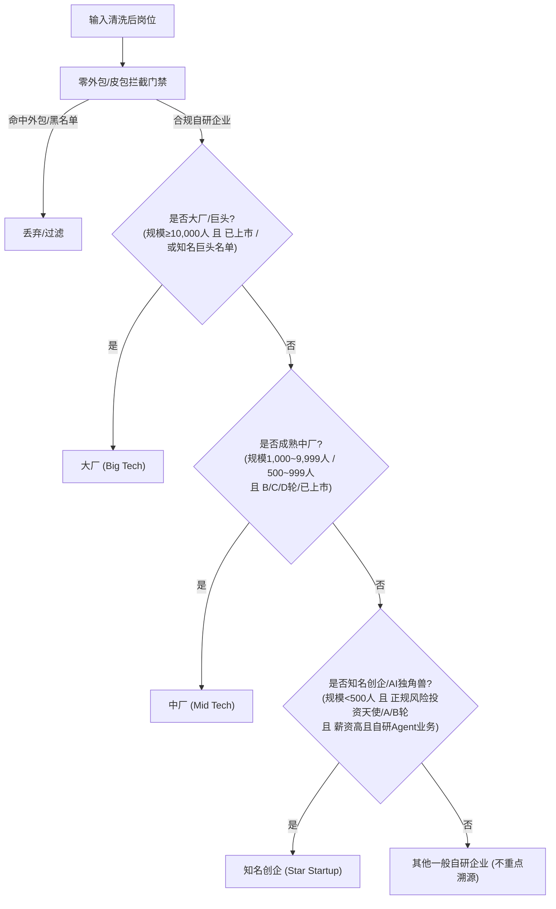

# Design: leo-job-career Skill 瘦身与人岗差距分析重构设计

- **Date**: 2026-10-15
- **Status**: Draft (Approved in Brainstorming, Pending Spec Review)
- **Target Skill**: `lib/skills/leo-job-career`

---

## 1. 背景与目标 (Context & Objectives)

### 1.1 背景
当前 `leo-job-career` 存在严重的功能耦合与设计过重问题：
1. **职责过载**：同时承担了“市场岗位雷达”、“多轮技术面试官（深度证据链萃取）”和“教研排期项目经理（按周末小时排期备考）”三项完全不同生命周期的任务。
2. **心智负担重**：用户只想快速获知“目标岗位真实要求什么、自己当前欠缺什么”，却被迫经历多轮项目细节拷问与固化的周末备考排期。

### 1.2 核心目标
1. **彻底瘦身，专注单一职责 (SRP)**：
   - 保留并强化“真实岗位抓取、零外包清洗、公司梯队识别、能力溯源”。
   - 砍掉繁琐的多轮技术面试证据收集与周末备考日历排期。
   - 重新定位为：**基于客观市场数据的人岗能力画像与全景差距诊断引擎**。
2. **零外包与皮包公司绝对拦截**：
   - 实行严格的黑名单与模式过滤，无论规模大小、是否上市，外包公司与外包岗位一律 100% 熔断剔除。
3. **企业资质动态分级与知名度保障**：
   - 避免写死名单造成“好公司被漏掉”，基于企业客观规模、融资阶段与行业属性动态评定大厂、中厂与知名创企。
   - 在报告中明确标出能力出处与具体公司名称（如美团、快手、小红书、智谱AI等）。
4. **两阶段轻量交互收敛**：
   - 阶段 1：定锚意向（方向、职级、城市、年限、期望薪资）；
   - 阶段 2：基于当前市场提取的 6~8 项关键硬核要求，用户快速自评掌握度。
5. **全景透明交付物 (Single Markdown Report)**：
   - 对话中完整渲染 Markdown 报告，同时本地保存单一 `gap-analysis-report.md`；
   - **全面呈现所有能力差距**（分级归类：Top 2~3 核心硬骨头 + 次要关键缺口 + 加分项），不做信息隐藏；
   - 报告作为无缝上下文，可直接供下游独立的“学习规划 / 面试辅导 Skill”消费。

---

## 2. 架构与瘦身范围 (Refactoring Scope)

### 2.1 移除与废弃清单 (Deletions)
| 模块 / 文件 | 类型 | 处置方式 | 理由 |
| :--- | :--- | :--- | :--- |
| `references/career-interview.md` | 文档 | 废弃删除 | 移除繁重的深度面试官证据采集机制 |
| `references/preparation-planning.md` | 文档 | 废弃删除 | 移除按周末小时规划的固定排期系统 |
| `references/roadmap-phases-2-3.md` | 文档 | 废弃删除 | 清理过时的多阶段规划 |
| `schemas/experience-evidence.schema.json` | Schema | 废弃删除 | 消除复杂证据库数据契约 |
| `scripts/lib/prepare-engine.mjs` | 代码 | 废弃删除 | 移除备考排期算法与日历生成 |
| `tests/integration/profile-prepare.test.mjs` | 测试 | 废弃/重构 | 移除旧 prepare 流程测试 |
| CLI 命令 `profile record-evidence` | 命令 | 移除 | 不再进行复杂事件证据入库 |
| CLI 命令 `prepare plan` | 命令 | 移除 | 转移由后续独立学习规划 Skill 承接 |

### 2.2 保留并增强清单 (Retained & Enhanced)
| 模块 / 文件 | 类型 | 增强内容 |
| :--- | :--- | :--- |
| `SKILL.md` | 核心入口 | 更新为专注人岗差距分析的轻量工作流与触发词 |
| `scripts/lib/freshness.mjs` | 规则过滤 | 强化零外包拦截库（扩充外包公司黑名单与外派关键词） |
| `scripts/lib/company-tier.mjs` (新建) | 核心算法 | 企业客观特征动态评级（大厂/中厂/知名创企）与防坑防皮包机制 |
| `scripts/lib/market-pipeline.mjs` | 核心管道 | 统计岗位时附带公司梯队与真实公司名单映射 |
| `scripts/lib/gap-analyzer.mjs` (新建) | 核心算法 | 结合用户两阶段自评与岗位要求，输出全景差距与 Top 硬骨头 |
| `scripts/lib/cli.mjs` | CLI 入口 | 增设 `gap analyze` 命令，输出单一 Markdown 报告 |
| `references/job-quality-policy.md` | 文档 | 更新企业分级策略与零外包红线标准 |

---

## 3. 详细设计 (Detailed Specifications)

### 3.1 零容忍外包与皮包公司拦截门禁 (Zero-Outsourcing Gate)
任何岗位在进入分析池前，必须 100% 经过双重前置阻断：

1. **公司级黑名单拦截**：
   - 知名大中型外包企业（中软国际、软通动力、法本信息、诚迈科技、博彦科技、润和软件、拓保软件、文思海辉、易宝软件、宇信科技、中科创达等外包外派类）绝对熔断。
   - 行业属性包含 `人力资源服务`、`劳务派遣` 一律剔除。
2. **岗位级描述与模式拦截**：
   - 扫描关键词：`驻场`、`外派`、`派驻`、`客户现场`、`现场办公`、`人力外包`、`劳务派遣`、`软件外包`、`介意外包勿投`、`项目制`、`代招` 等。
3. **空壳/皮包微型作坊拦截**：
   - 员工规模 < 20 人，且融资轮次为“未融资”或“不需要融资”，且缺少自研业务描述的直接剔除，避免劣质坑人公司。

### 3.2 企业客观资质动态分级算法 (Dynamic Company Tiering)
严格通过零外包检测后，执行动态分级判定：

- **大厂 (Big Tech)**：规模 ≥ 10,000 人且已上市（如阿里、美团、快手、腾讯、百度、京东等上市公司），或顶级科技外企（微软、亚马逊等）。
- **中厂 (Mid Tech)**：规模 1,000~9,999 人或 500~999 人，且处于成熟融资期（B轮/C轮/D轮以上/已上市），如小红书、知乎、得物、爱奇艺、滴滴、网易等。
- **知名创企 (Star Startup / AI 独角兽)**：规模 500 人以下，但**必须满足正规资本背书**（天使轮/A轮/B轮/战略投资等），薪资具备核心竞争力（月薪下限 ≥ 25k），主营业务为大模型/Agent 自研（如智谱AI、MiniMax、月之暗面、百川智能等）。
- **公司名记录**：建立 `Skill -> [{ companyName: "美团", tier: "大厂" }, ...]` 的倒排映射，供报告直接引用。

### 3.3 两阶段交互流程设计 (Two-Stage Interaction)

1. **第一阶段：求职意向与背景定锚**
   - Agent 收集 5 个关键参数：
     - 目标方向（如 Java Agent / 大模型后端架构师）
     - 目标城市（默认北京，支持指定）
     - 目标职级（如 大厂 P7 / 同级 Tech Lead）
     - 经验年限（如 8 年经验）
     - 期望薪资（如 60~70W）
   - 底层检索已清洗的真实验收池，提炼出 6~8 项高频关键核心硬技能要求。
2. **第二阶段：核心技能掌握度自评**
   - Agent 将提炼出的 6~8 项关键技能一次性呈现，引导用户打标掌握度（A. 丰富实战经验 / B. 理论了解/仅做过demo / C. 尚未接触）；
   - 用户自然语言回复后，Agent 快速结构化并执行匹配推演。

### 3.4 最终交付物：全景 Markdown 报告规范
报告生成至 `~/.shrimp/leo-job-career/gap-analysis-report.md`（并在对话中直接完整渲染）：

- **Section 1: 求职画像与真实验收池概览**
  - 用户意向概要（角色、城市、目标职级、期望薪酬）；
  - 纳入统计的真实合规企业名单（分类列出具体公司：大厂 N 家、中厂 N 家、知名创企 N 家，声明 100% 过滤外包）。
- **Section 2: 能力出处溯源与人岗对照全景表**
  - Markdown 表格列出所有提炼的能力项，包含：
    - `核心技能项`
    - `企业梯队与具体公司出处`（如：“美团、快手、阿里 (大厂)”）
    - `市场权重`（高频 / 标配 / 加分）
    - `用户掌握状态`
    - `诊断结论`（稳固基本盘 / 核心欠缺 / 进阶欠缺）
- **Section 3: 各梯队企业差异化侧重**
  - **大厂视角**：超大规模高并发、底层框架改造、分布式治理体系；
  - **中厂视角**：大模型工程化提效、业务敏捷落地、端到端全链路交付；
  - **知名创企视角**：前沿 Agent 框架敏捷适配（MCP、工作流编排）、独立解决不确定性问题。
- **Section 4: 欠缺能力全景清单与攻坚重点 (100% 全面公开)**
  - 🔴 **最高优先级硬骨头 (Top 2~3 Blockers)**：直击进入目标职级（如大厂P7）最致命的技能断层；
  - 🟡 **次要与进阶欠缺项 (Secondary Gaps)**：目标岗位常见但可通过短期针对性复习弥补的缺口；
  - 🟢 **加分与潜力项 (Stretch Opportunities)**：面试中拉开差距的特色项。
- **Section 5: 下游衔接说明**
  - 明确标注此报告已落盘，可无缝作为“学习规划 / 面试攻坚 Skill”的直接输入。

---

## 4. 实施与验证策略 (Implementation & Testing)

1. **测试驱动 (TDD)**：
   - 编写 `company-tier.test.mjs`：验证大厂、中厂、AI创企的动态识别，确保外包公司（无论规模多大）100% 拦截剔除。
   - 编写 `gap-analyzer.test.mjs`：输入样本技能与用户自评状态，验证全景差距报告及 Top 2~3 硬骨头提取算法的正确性。
2. **清理冗余代码**：
   - 安全删除 `prepare-engine.mjs`、旧面试文档、多余 schema。
3. **端到端验证**：
   - 运行全量测试套件，验证 CLI `doctor`、`auth`、`market` 及新 `gap` 指令正常运作。
