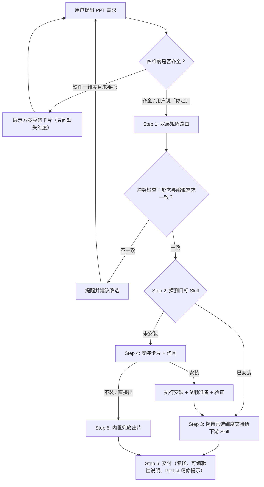

# leo-ppt-router 设计规格

- 日期：2026-10-30
- 参照：`lib/skills/leo-imagine-router`（同款"导航 → 路由 → 探测 → JIT 安装 → 兜底 → 交付"模式）
- 调研来源：`D:\Java Project\AI-PPT` 下 8 个开源项目（ppt-master、dashi-ppt-skill、guizang-ppt-skill、codex-ppt-skill、slidev、marp、PPTist、PptxGenJS）

## 1. 定位

`leo-ppt-router` 是 PPT / 演示文稿需求的**引导式路由器**：

1. 需求不明确时，用一张编号选项卡引导用户确定 **用途场景、交付形态（含是否需要在 WPS/PowerPoint 编辑）、风格、素材** 四个维度；
2. 按"交付形态 → 场景/风格"双层矩阵路由到最合适的下游 PPT Skill；
3. 动态探测下游 Skill 是否安装，缺失时给出安装卡片，经用户同意后代为安装；
4. 用户拒绝安装或无合适 Skill 时，用内置兜底规范 + 工具（PptxGenJS / Marp CLI / 单文件 HTML）出片。

**非目标（明确不做）**：

- 不做场景化内容整理（述职/路演等内容框架），留待后续单独决策；
- 不重复下游 Skill 内部的流程（ppt-master 自身的三路由、dashi 的风格确认等）；
- 不集成 PPTist（Web GUI，无 CLI/API，AGPL-3.0），仅在交付时作为"手动精修"提示；
- `leo-ppt-agent` 由本 router 取代：其 4 份有价值的提示词规范迁入 router 后，整体删除（见 §11）。

## 2. 目录结构

```text
lib/skills/leo-ppt-router/
├── SKILL.md                         # 工作流、导航卡片、路由矩阵、安装与兜底协议
├── README.md                        # 面向人的说明与安装方法（同 leo-imagine-router 格式）
└── references/
    ├── skills-catalog.md            # 下游 Skill 详细档案：特性、风格清单、依赖、安装、可编辑性、交接注意事项
    └── fallback/
        ├── outline-architect.md     # 迁自 leo-ppt-agent（金字塔大纲）
        ├── bento-grid-layout.md     # 迁自 leo-ppt-agent（便当网格版式）
        ├── cognitive-design-principles.md  # 迁自 leo-ppt-agent
        ├── cjk-text-fit.md          # 从 leo-ppt-agent/svg-generator.md 摘出 CJK 1.8x 宽度折算与字号收缩规则
        ├── pptxgenjs-guide.md       # 新写：用 PptxGenJS 输出原生可编辑 PPTX 的规范与代码骨架
        ├── marp-guide.md            # 新写：Marp Markdown 语法要点与 marp-cli 导出命令
        └── html-deck-guide.md       # 新写：单文件 HTML 横向翻页 deck 的最小规范
```

SKILL.md 只保留导航卡片、路由矩阵与流程协议；各下游 Skill 的风格明细放在 `skills-catalog.md`，按需读取，控制 SKILL.md 体积（目标 ≤ 15KB，与 leo-imagine-router 相当）。

## 3. 工作流



## 4. 方案导航卡片（引导）

**触发条件**（任一）：

- 调用 `/leo-ppt-router` 但未给出具体需求；
- 用户只说"做个 PPT / 做个演示"等泛意图；
- 四维度中任一缺失且用户未表示委托。

**规则**：

- 已从用户输入中能确定的维度**不再询问**，卡片只展示缺失维度；
- 用户回复编号即可（如 `1B 2A 3推荐 4B`）；
- 用户明确委托（"你定""不用问直接做"）时跳过卡片，取默认值：①按内容推断、②A 可编辑 PPTX、③推荐、④按实际提供的材料判断；交付时列出全部假设；
- ③风格选项**依据 ①② 的选择动态过滤**，只列与目标 Skill 匹配的风格（明细取自 `skills-catalog.md`）。

**卡片模板**：

```markdown
📊 Leo PPT Router · 方案导航
请按编号回复，例如「1B 2A 3推荐 4B」，已说明的维度可跳过：

① 用途场景
  A 工作汇报 / 述职 / 年终总结   B 产品介绍 / 发布会   C 技术分享 / 开发者大会
  D 数据报告 / 市场分析          E 教学课件 / 培训     F 学术答辩 / 科研
  G 咨询提案 / 战略              H 人文分享 / 行业观察演讲   I 党政汇报

② 交付形态（决定后续能否编辑）
  A 要在 WPS / PowerPoint 里继续修改 → 可编辑 PPTX
  B 现场演讲、浏览器播放（演讲者视图、翻页动效）→ HTML 网页
  C 视觉冲击优先，不需要改字 → 整页图片式 PPTX
  D 开发者风格，代码高亮与动画 → Markdown（Slidev）
  E 已有 PPTX，要美化 / 改内容 / 套模板

③ 风格（根据 ①② 动态列出，或回复「推荐」）

④ 素材
  A 只有主题，需要帮忙调研   B 有文档 / 文章 / 大纲   C 有现成 PPTX
```

## 5. 路由矩阵

| ② 交付形态 | ①③ 细分条件 | 目标 Skill 标识符 | WPS 可编辑 |
| :--- | :--- | :--- | :--- |
| A 可编辑 PPTX | 默认（绝大多数场景） | `ppt-master` | ✅ 原生形状/图表/表格 |
| A 可编辑 PPTX | 用户点名 dashi 的 12 套主题视觉 | `dashi-ppt`（导出 PPTX） | 🟡 DOM 提取，部分区域截图 |
| B HTML | 人文分享、发布会、强个人风格；杂志风 / 瑞士风 | `guizang-ppt-skill` | ❌ 仅 HTML |
| B HTML | 商务、科技、数据类主题 | `dashi-ppt` | 🟡 可转 PPTX |
| C 图片式 | 麦肯锡、科研答辩、党政红、手绘、教学等风格 | `codex-ppt` | ❌ 整页图片 |
| D Markdown | 技术分享、代码演示、课程 | `slidev` | ✅ 用 `--format pptx-editable` 导出 |
| E 已有 PPTX | 美化 / 填充内容 / 做模板 / 加讲稿动画 | `ppt-master` | ✅ |
| 任意 | 目标未安装且用户拒绝安装 | `built-in-fallback` | 视兜底工具而定（见 §8） |

**冲突提醒**：用户选 ②B/②C，但同时表达"要在 WPS/PowerPoint 里改"时，必须提醒该形态不可编辑（或仅部分可编辑），并建议改选 ②A；用户坚持则照办。

**场景 → 默认推荐**（③回复"推荐"时使用）：

| ① 场景 | ②A 下推荐 | ②B 下推荐 | ②C 下推荐风格 |
| :--- | :--- | :--- | :--- |
| A 汇报/述职 | ppt-master | dashi theme01 轻拟态 / theme07 冷白调研 | codex 清爽专业风 |
| B 产品/发布会 | ppt-master | dashi theme02 炫光紫绿 / guizang 瑞士风 | codex 创意杂志风 |
| C 技术分享 | ppt-master（或 ②D slidev） | dashi theme03 深浅代码 | codex 手绘技术解释风 |
| D 数据报告 | ppt-master | dashi theme05 色谱图表 / theme06 深色图谱 | codex 数据仪表盘风 |
| E 教学课件 | ppt-master | guizang 杂志风 | codex 教学课件风 |
| F 学术答辩 | ppt-master | guizang 瑞士风 | codex 科研答辩风 |
| G 咨询战略 | ppt-master | dashi theme06 深色图谱 | codex 麦肯锡风格 |
| H 人文演讲 | ppt-master | guizang 杂志风 | codex 电子墨水杂志风 |
| I 党政汇报 | ppt-master | dashi theme07 冷白调研 | codex 党政红风格 |

## 6. 下游 Skill 档案（写入 skills-catalog.md 的要点）

| 标识符 | 来源 | 安装命令 | 运行依赖 | 交接注意事项 |
| :--- | :--- | :--- | :--- | :--- |
| `ppt-master` | github.com/hugohe3/ppt-master（v6.8.0, MIT） | `npx skills add hugohe3/ppt-master -g`；备选 `git clone` 后取 `skills/ppt-master` | Python 3.10–3.14；安装目录内 `pip install -r requirements.txt` | 自带 `attribution_guard.py` 完整性校验，非零即停，**不得绕过**；其内部路由（Generate / Create Template / Edit Native）由它自己决定 |
| `dashi-ppt` | github.com/chuspeeism/dashi-ppt-skill（v0.4.14） | `npx dashi-ppt-skill@latest`（国内镜像 `--registry=https://registry.npmmirror.com`）；默认装到 `~/.agents/skills` | Node.js；导出 PPTX 需本机预览服务 + Playwright | 它强制先问风格（展示风格图）与是否用图片/视频；router 已收集的答案随交接传入，其余遵从它自身门禁；只有明确要 PPTX 才导出 PPTX |
| `guizang-ppt-skill` | github.com/op7418/guizang-ppt-skill | `npx skills add https://github.com/op7418/guizang-ppt-skill --skill guizang-ppt-skill -g` | 浏览器即可 | 不支持导出 PPTX；来源/赞助信息不得写入产物 |
| `codex-ppt` | github.com/ningzimu/codex-ppt-skill | `npx -y skills@latest add ningzimu/codex-ppt-skill --skill codex-ppt -g` | Python 3；生图后端（内置生图工具，或 `OPENAI_API_KEY` 等 API 配置） | 有样张审批门禁；不可编辑，需可编辑时提示作者的 image-to-editable-ppt-skill |
| `slidev` | github.com/slidevjs/slidev（官方 skill） | `npx skills add slidevjs/slidev -g` | Node.js + pnpm；导出需 playwright-chromium | 需 WPS 编辑时导出用 `slidev export --format pptx-editable` |

## 7. 运行期探测与 JIT 安装

**探测路径**（与 leo-imagine-router 一致，禁止硬编码个人主机路径）：

1. Agent 上下文 `Available skills:` 列表；
2. `~/.agents/skills/<skill-name>/SKILL.md`（Windows：`%USERPROFILE%\.agents\skills\...`）；
3. `~/.gemini/config/skills/<skill-name>/SKILL.md`；
4. 工作区 `./lib/skills/<skill-name>` 或 `./.agents/skills/<skill-name>`。

**安装卡片**：沿用 leo-imagine-router 模板，增加两行——"运行依赖"与"WPS 可编辑性"。用户回复"安装"后：

1. 执行 §6 的安装命令；
2. 准备运行依赖（如 ppt-master 的 `pip install -r requirements.txt`），失败则如实报告并询问是否改走兜底；
3. 验证 `SKILL.md` 存在；
4. 不要求用户重复需求，携带已选维度直接交接。

**安装失败**（网络、依赖缺失）：报告错误原文，提供"重试 / 改走兜底"两个选项，不擅自换用其他安装源。

## 8. 内置兜底

触发：目标 Skill 未安装且用户选择"直接出"，或安装失败后用户选择兜底。

1. **内容**：按 `fallback/outline-architect.md`（金字塔大纲）整理大纲，展示给用户确认后再出片；
2. **版式**：遵循 `fallback/bento-grid-layout.md`、`cognitive-design-principles.md`、`cjk-text-fit.md`；
3. **出片工具按交付形态选择**：

| ② 交付形态 | 兜底工具 | WPS 可编辑 |
| :--- | :--- | :--- |
| A 可编辑 PPTX | PptxGenJS：agent 按 `pptxgenjs-guide.md` 的骨架写 `.mjs` 脚本，`npm i pptxgenjs` 后 `node` 执行 | ✅ |
| E 已有 PPTX | PptxGenJS 只能新建、不能原地编辑：先提取旧 PPTX 文字内容（`uv run --with python-pptx`），再按 A 行重新生成新 deck；须事先告知用户**不保留原设计** | ✅ |
| B HTML | 按 `html-deck-guide.md` 写单文件 HTML | ❌ |
| C 图片式 | 逐页调用 `leo-codex-imagine` 生图，再用 PptxGenJS 拼装整页图片 | ❌ |
| D Markdown | 按 `marp-guide.md` 写 Markdown，`npx @marp-team/marp-cli@latest deck.md --pptx`（需可编辑则加 `--pptx-editable`，依赖 LibreOffice） | 默认 ❌ / 加参数 🟡 |

兜底不内置维护脚本：`pptxgenjs-guide.md` 提供可直接改写的代码骨架（封面、目录、要点、数据、结束页 5 种版式），由 agent 按内容生成脚本。

## 9. 交付规范

交付时必须告知：

1. 产物文件的可点击绝对路径（`.pptx` / `index.html` / `.md`）；
2. 本次使用的 Skill 或兜底工具；
3. **可编辑性说明**：✅ / 🟡 / ❌ 及原因；
4. 若为 PPTX：附一句"如需在线手动精修，可将 .pptx 导入 PPTist（https://pipipi-pikachu.github.io/PPTist/）"；
5. 委托模式下的全部假设。

## 10. 规划中

| 方向 | 说明 |
| :--- | :--- |
| 场景化内容整理 | 述职、路演等内容框架，用户后续再决定放在 router 内还是独立 Skill |
| 独立 Marp Skill | 目前无权威 Marp skill，暂以兜底工具形式使用 marp-cli |
| image-to-editable-ppt-skill | 图片式 PPTX 转可编辑，待调研后可作为 ②C 的后处理 |

## 11. 迁移与上线

1. 新建 `lib/skills/leo-ppt-router/`，从 `leo-ppt-agent/references/prompts/` 复制三份规范并摘出 CJK 规则；
2. 在 `lib/skills/managed-catalog.json` 中加入 `leo-ppt-router` 条目，**接替** `leo-ppt-agent` 的位置（`category: creative`、`categoryLabel: 创意与演示`、`icon: 📊`、`featured: true`、`promoted: true`、`managed: true`、`requiresDaemon: false`），并补一条单元测试校验该条目；
3. 本地验证通过后，复制到 `~/.agents/skills/leo-ppt-router` 与 `~/.gemini/config/skills/leo-ppt-router`（与本机现有 leo-imagine-router 一致：两处均为目录副本，非软链）；
4. **最后一步**（router 已验证、规范已迁入之后）删除 `leo-ppt-agent`：
   - `lib/skills/leo-ppt-agent/` 整个目录；
   - `managed-catalog.json` 中的 `leo-ppt-agent` 条目；
   - 已安装副本 `~/.agents/skills/leo-ppt-agent`；
   - 删除前再次 `git grep leo-ppt-agent` 确认无其他引用（2026-10-31 扫描结果：仅 catalog 引用）。

## 12. 验证方案

用子 agent 加载 SKILL.md 后跑以下场景，检查路由与提问行为：

| # | 用户输入 | 期望行为 |
| :--- | :--- | :--- |
| 1 | "帮我做个 PPT" | 展示完整四维度卡片 |
| 2 | "做一份述职 PPT，要能在 WPS 里改，素材我贴给你" | 只问 ③风格；路由 `ppt-master` |
| 3 | "做个发布会用的网页 PPT，杂志风" | 不展示卡片或只问 ④；路由 `guizang-ppt-skill` |
| 4 | "用图片式 PPT 做，但我之后要在 WPS 改字" | 触发冲突提醒，建议 ②A |
| 5 | "技术分享，有代码演示" | 路由 `slidev`（或询问 ②A/②D） |
| 6 | "把这份旧 PPTX 美化一下" | 路由 `ppt-master` |
| 7 | 目标未安装 + 用户回复"直接出" | 走兜底：先出大纲确认，再按形态选兜底工具 |
| 8 | "你定，不用问" | 跳过卡片，按默认值执行并在交付时列出假设 |

另做一次真实探测：在本机运行探测逻辑，确认 5 个下游 Skill 当前均判定为"未安装"、触发安装卡片。
