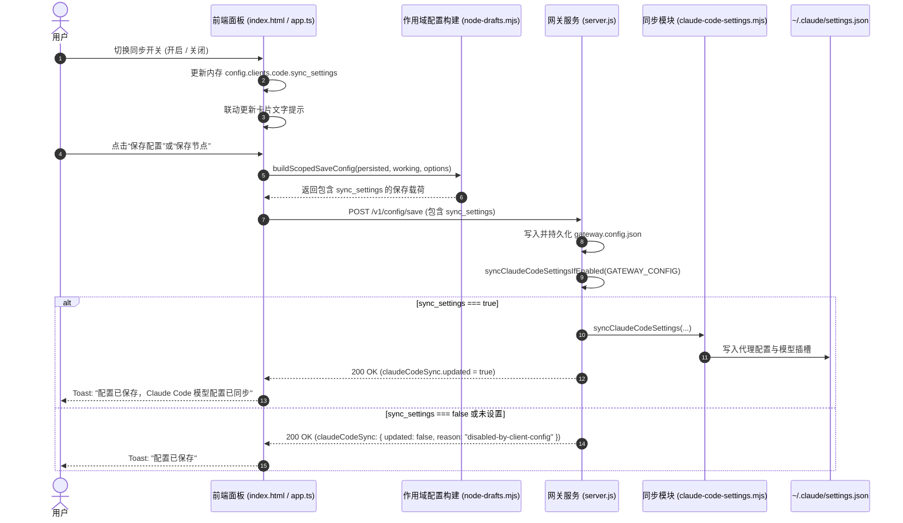

# Claude Code 代理节点 settings.json 同步开关设计文档

- **创建日期**: 2026-10-31
- **状态**: Approved by User
- **目标组件**: Claude Code 代理节点面板 (`#section-code`)、网关配置持久化层、后端设置同步模块

---

## 1. 背景与需求概述

### 1.1 背景
在网关管理后台中，用户可以为多种 AI 编程助手（Claude Code、Claude Desktop、Codex 等）配置代理节点与模型映射。
对于 Claude Code（CLI），网关原本在保存该客户端的配置或节点时，会自动将网关的 Base URL、Token 及预设快捷模型（Opus/Sonnet/Haiku/Fable）同步写入本机的 `~/.claude/settings.json`。

### 1.2 需求
用户希望在 **Claude Code 代理节点页面** 增加一个开关按钮：
1. **默认状态**: **关闭（OFF）**。
2. **关闭状态行为**: 用户在该页面新增/编辑节点、调整快捷模型或点击保存配置时，修改内容仅保存至网关自身的 `gateway.config.json`，**不同步/不覆盖** `~/.claude/settings.json`，确保本地原生 Claude Code 配置文件不受影响。
3. **开启状态行为**: 恢复原有的自动同步机制，在保存配置或节点时将相关代理配置同步写入 `~/.claude/settings.json`。

---

## 2. 总体架构与数据流

### 2.1 配置结构变更 (`gateway.config.json`)
在 `clients.code` 节点中增加可选布尔字段 `sync_settings`：
```json
{
  "clients": {
    "code": {
      "sync_settings": false,
      "endpoints": [ ... ],
      "model_slots": { ... }
    }
  }
}
```
* **默认值规则**：若 `sync_settings` 字段不存在（`undefined`）或显式为 `false`，均视为**关闭**；仅当严格为 `true` 时视为**开启**。

### 2.2 数据流时序



---

## 3. 详细设计与实现细节

### 3.1 前端 UI 改造 (`desktop/index.html`)
在 `#section-code` 顶部原有静态卡片处改造：
```html
<div class="usage-guide sync-toggle-card">
    <div class="sync-toggle-info">
        <div class="sync-toggle-title-row">
            <svg width="15" height="15" viewBox="0 0 24 24" fill="none" stroke="currentColor" stroke-width="2" stroke-linecap="round" stroke-linejoin="round">
                <path d="M21.5 2v6h-6M21.34 15.57a10 10 0 1 1-.57-8.38l5.67-5.67"></path>
            </svg>
            <h3>自动同步到 ~/.claude/settings.json</h3>
        </div>
        <p id="claude-code-sync-desc">
            已关闭（默认）：保存节点或快捷模型时，仅更新网关，不会修改本地 ~/.claude/settings.json。
        </p>
    </div>
    <div class="sync-toggle-control">
        <label class="switch" title="开启或关闭自动同步到 ~/.claude/settings.json">
            <input type="checkbox" id="claude-code-sync-toggle" onchange="toggleClaudeCodeSync(this.checked)">
            <span class="slider round"></span>
        </label>
    </div>
</div>
```

### 3.2 样式补充 (`desktop/src/styles/` 或 `panel.css`)
确保 `.sync-toggle-card` 具有良好的弹性排版与主题自适应性：
* `display: flex; justify-content: space-between; align-items: center; gap: 16px;`
* 右侧开关采用标准的 iOS 扁平切换滑块。

### 3.3 前端逻辑绑定 (`desktop/src/app.ts`)
1. **渲染与初始化 (`renderClaudeCodeSyncToggle`)**:
   - 读取 `Boolean(config.clients?.code?.sync_settings)`。
   - 同步至 `checkbox.checked`。
   - 动态更新 `#claude-code-sync-desc` 文本。
2. **事件处理 (`toggleClaudeCodeSync(checked: boolean)`)**:
   - `config.clients.code.sync_settings = checked;`
   - 调用更新文案函数。
   - 标记配置变更状态以支持保存。
3. **Toast 提示精细化**:
   - 当 `payload.claudeCodeSync?.reason === 'disabled-by-client-config'` 时，统一作为正常操作处理，显示常规保存成功提示，不提示错误或“已同步”。

### 3.4 作用域合并逻辑 (`desktop/src/modules/node-drafts.mjs`)
在 `buildNodeSaveConfig`、`buildScopedSaveConfig`（以及各 scope 分支如 `default`、`exposure`、`proxy`、`client`、`delete`）中：
* 当 `client === 'code'` 时，确保 `targetClient.sync_settings` 正确继承 `working.clients.code.sync_settings === true`。

### 3.5 后端拦截逻辑 (`server.js`)
在 `syncClaudeCodeSettingsIfEnabled(config)` 中加入前置条件：
```javascript
function syncClaudeCodeSettingsIfEnabled(config) {
  if (CLAUDE_CODE_SYNC_DISABLED) {
    return { updated: false, reason: "disabled" };
  }
  if (config?.clients?.code?.sync_settings !== true) {
    return { updated: false, reason: "disabled-by-client-config" };
  }
  return syncClaudeCodeSettings({
    config,
    ...(CLAUDE_CODE_SETTINGS_FILE
      ? { settingsPath: resolveUserPath(CLAUDE_CODE_SETTINGS_FILE) }
      : {}),
    authToken: CONFIGURED_API_KEY_SENTINEL,
    gatewayBaseUrl: `http://${LISTEN_HOST === "0.0.0.0" ? "127.0.0.1" : LISTEN_HOST}:${LISTEN_PORT}/code`,
  });
}
```

---

## 4. 测试与验证计划

1. **单元测试与逻辑测试**:
   - 验证 `syncClaudeCodeSettingsIfEnabled` 在 `sync_settings` 为 `false` 或缺失时返回 `{ updated: false, reason: "disabled-by-client-config" }` 且不写入文件。
   - 验证 `sync_settings === true` 时正常执行同步。
   - 验证 `node-drafts.mjs` 在节点保存、全局保存等 scope 下正确保留 `sync_settings` 字段。
2. **前端与集成构建测试**:
   - 运行前端打包构建（`npm run build` 或 esbuild 脚本），确认无语法或类型报错。
   - 验证默认初始状态下，开关呈现关闭状态，保存节点后 `~/.claude/settings.json` 未被修改。
   - 切换开关为开启后保存，确认 `~/.claude/settings.json` 成功同步。
