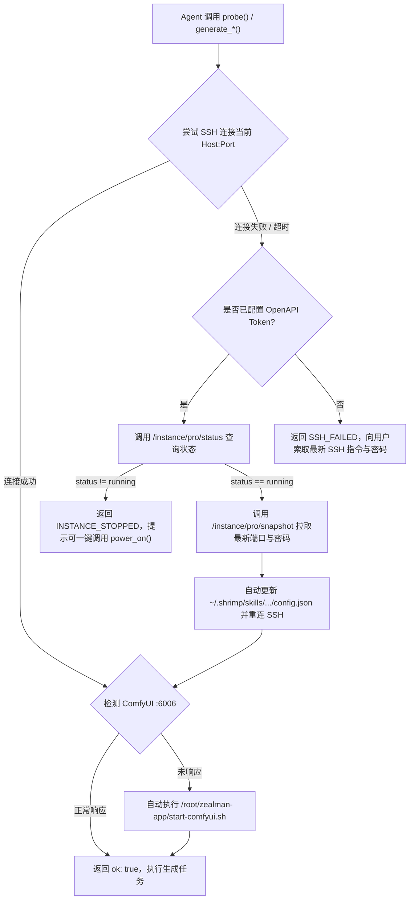

# AutoDL 官方 OpenAPI 与故障自愈手册 (AutoDL OpenAPI & Troubleshooting)

本文档沉淀了 **AutoDL 共创云 (`www.autodl.art`) 官方开发者 OpenAPI** 的真实接口协议，以及实例关机、端口变更、服务未启动时的全自动自愈流程。

---

## 1. AutoDL 官方开发者 OpenAPI 真实接口规范

* **官方文档地址**：`https://www.autodl.art/docs/app_api/`
* **API Base URL**：`https://www.autodl.art`
* **通用请求头 (Headers)**：
  ```json
  {
    "Authorization": "<JWT_TOKEN>",
    "Content-Type": "application/json"
  }
  ```
* **本地配置持久化位置**：`~/.shrimp/skills/leo-autodl-imagine-video/config.json`（不入 Git 版本库，保障密钥安全）。

### 1.1 查询实例列表 (获取 `instance_uuid`)
* **Endpoint**：`POST /api/v1/adl_dev/dev/instance/pro/list`
* **Request Body**：`{"page_index": 1, "page_size": 10}`
* **Response 示例**：
  ```json
  {
    "code": "Success",
    "data": {
      "list": [
        {
          "uuid": "pro-7927c3f34e28",
          "machine_alias": "westd-01",
          "gpu_name": "RTX 5090",
          "status": "running"
        }
      ]
    }
  }
  ```

### 1.2 查询实例实时运行状态
* **Endpoint**：`GET /api/v1/adl_dev/dev/instance/pro/status?instance_uuid={instance_uuid}`
* **Response 示例**：
  ```json
  {
    "code": "Success",
    "data": "running",
    "msg": ""
  }
  ```
  > `data` 状态枚举值：`"running"`（运行中）、`"stopped"`（已关机）、`"starting"`（开机中）、`"stopping"`（关机中）。

### 1.3 获取实例快照与最新动态 SSH 凭证 (`--refresh`)
每次 AutoDL 实例关机再开机后，平台可能会重新分配动态 SSH 端口（`ssh_port`）。通过此 API 可免人工干预自动拉取最新连接参数：
* **Endpoint**：`GET /api/v1/adl_dev/dev/instance/pro/snapshot?instance_uuid={instance_uuid}`
* **Response 示例**：
  ```json
  {
    "code": "Success",
    "data": {
      "uuid": "pro-7927c3f34e28",
      "status": "running",
      "proxy_host": "connect.westd.seetacloud.com",
      "ssh_port": 52742,
      "root_password": "<DYNAMIC_PASSWORD>",
      "ssh_command": "ssh -p 52742 root@connect.westd.seetacloud.com"
    }
  }
  ```

### 1.4 远程开机实例 (`--power-on`)
* **Endpoint**：`POST /api/v1/adl_dev/dev/instance/pro/power_on`
* **Request Body**：
  ```json
  {
    "instance_uuid": "pro-7927c3f34e28",
    "payload": "gpu"
  }
  ```
  > `payload` 参数说明：`"gpu"` 表示正常有卡开机（挂载 GPU 算力）；`"non_gpu"` 表示无卡模式开机（仅传数据，不挂载显卡）。

### 1.5 远程关机实例并停止计费 (`--power-off` / `--shutdown`)
* **Endpoint**：`POST /api/v1/adl_dev/dev/instance/pro/power_off`
* **Request Body**：
  ```json
  {
    "instance_uuid": "pro-7927c3f34e28"
  }
  ```
* **Response 示例**：`{"code": "Success", "data": null, "msg": ""}`

---

## 2. 探活与动态端口自愈流程 (Self-Healing State Machine)

当 Agent 调用 `client.probe()`、`client.generate_image()` 或 `client.generate_video()` 时，`remote_engine.py` 内置如下自动自愈状态机：



---

## 3. 重要环境与排障经验沉淀

1. **100TB 公共模型盘挂载要求 (`/.autodl-model/data`)**：
   * 必须从 **`https://www.autodl.art`**（共创云社区镜像页）创建实例，系统会自动挂载只读高速共享模型盘 `/.autodl-model/data`，所有 `minimax_h3`、`SDXL`、`Flux`、`Qwen3-VL` 软链接开箱即用，无需下载。
   * 若从普通版 `autodl.com` 创建，不会挂载 `/.autodl-model/data`，会导致软链接悬空（Broken Symlink）。
2. **安全合规与密钥隔离**：
   * `~/.shrimp/skills/leo-autodl-imagine-video/config.json` 存放用户的 `token`、`password`、`host`、`port` 和 `instance_uuid`。
   * 代码仓库（`lib/skills/leo-autodl-imagine-video/`）中**严禁硬编码任何密码或 JWT Token**。
3. **运维常用 CLI 速查**：
   ```bash
   PYTHON_BIN="$HOME/.shrimp/skills/leo-autodl-imagine-video/.venv/Scripts/python.exe"
   CLI_PATH="lib/skills/leo-autodl-imagine-video/scripts/client.py"

   # 探活与自愈检查
   & $PYTHON_BIN $CLI_PATH --probe --json

   # 远程一键开机（自动等待 running 并同步新端口）
   & $PYTHON_BIN $CLI_PATH --power-on --json

   # 远程一键关机（停止计费）
   & $PYTHON_BIN $CLI_PATH --power-off --json

   # 手动更新 SSH 凭证或 Token
   & $PYTHON_BIN $CLI_PATH --update-config --ssh "ssh -p 52742 root@connect.westd.seetacloud.com" --password "xxx" --instance-uuid "pro-xxx"
   ```
