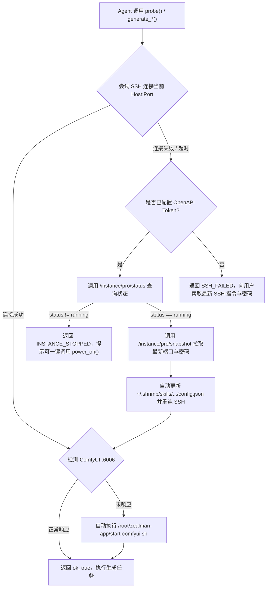

# AutoDL 官方 OpenAPI 与故障自愈手册 (AutoDL OpenAPI & Troubleshooting)

本文档沉淀了 **AutoDL 共创云 (`www.autodl.art`) 官方开发者 OpenAPI** 的真实接口协议，以及实例关机确认铁律、端口变更自愈、暂存产物清理的完整规范。

---

## 1. 铁律约束：禁止私自关机与暂存目录规范

> [!IMPORTANT]
> **1. 远程关机铁律（Mandatory User Confirmation for Power-Off）**：
> * **任何 Agent 严禁在生图或生视频任务结束后私自调用 `--power-off` / `--shutdown` / `client.power_off()` 关闭云端实例！**
> * 原因：开机加载 32B 模型需要预热时间，且用户通常会有连续多轮修改或后续任务。
> * **标准流程**：任务完成后，Agent 仅可向用户友好提示“实例仍在运行中，若不再使用可告诉我为您关机”。**只有当用户明确下达关机指令或确认同意后**，Agent 才允许传入 `--confirm`（或 `confirm=True`）执行关机。代码层已内置强校验：未传 `confirm=True` 调用 `power_off()` 会直接拒绝并返回 `CONFIRMATION_REQUIRED`。
>
> **2. 暂存目录与按需导出清理规范（Staging & Cleanup Rule）**：
> * 所有生成的视频与图片默认统一回传至 **`~/.shrimp/skills/leo-autodl-imagine-video/outputs/`**，绝不直接污染用户的当前工作区目录。
> * 当用户对某张图片或某段视频满意、要求保存到指定项目目录时，调用 `--export <文件名> --to <用户指定路径> --clean-others`（或 `client.export_asset(..., clean_others=True)`），将最终产物移动过去并一键清理其余无用的草稿图片和视频。

---

## 2. AutoDL 官方开发者 OpenAPI 真实接口规范

* **官方文档地址**：`https://www.autodl.art/docs/app_api/`
* **API Base URL**：`https://www.autodl.art`
* **通用请求头 (Headers)**：
  ```json
  {
    "Authorization": "<JWT_TOKEN>",
    "Content-Type": "application/json"
  }
  ```
* **本地配置持久化位置**：`~/.shrimp/skills/leo-autodl-imagine-video/config.json`（不入 Git 版本库，保障密钥安全）。

### 2.1 查询实例列表 (获取 `instance_uuid`)
* **Endpoint**：`POST /api/v1/adl_dev/dev/instance/pro/list`
* **Request Body**：`{"page_index": 1, "page_size": 10}`

### 2.2 查询实例实时运行状态
* **Endpoint**：`GET /api/v1/adl_dev/dev/instance/pro/status?instance_uuid={instance_uuid}`
* **Response 示例**：`{"code": "Success", "data": "running", "msg": ""}`
  > `data` 状态枚举值：`"running"`（运行中）、`"stopped"`（已关机）、`"starting"`（开机中）、`"stopping"`（关机中）。

### 2.3 获取实例快照与最新动态 SSH 凭证 (`--refresh`)
每次 AutoDL 实例关机再开机后，平台可能会重新分配动态 SSH 端口（`ssh_port`）。通过此 API 可免人工干预自动拉取最新连接参数：
* **Endpoint**：`GET /api/v1/adl_dev/dev/instance/pro/snapshot?instance_uuid={instance_uuid}`
* **Response 示例**：
  ```json
  {
    "code": "Success",
    "data": {
      "uuid": "pro-7927c3f34e28",
      "status": "running",
      "proxy_host": "connect.westd.seetacloud.com",
      "ssh_port": 52742,
      "root_password": "<DYNAMIC_PASSWORD>",
      "ssh_command": "ssh -p 52742 root@connect.westd.seetacloud.com"
    }
  }
  ```

### 2.4 远程开机实例 (`--power-on`)
* **Endpoint**：`POST /api/v1/adl_dev/dev/instance/pro/power_on`
* **Request Body**：`{"instance_uuid": "pro-7927c3f34e28", "payload": "gpu"}`

### 2.5 远程关机实例并停止计费（需用户确认后调用 `--power-off --confirm`）
* **Endpoint**：`POST /api/v1/adl_dev/dev/instance/pro/power_off`
* **Request Body**：`{"instance_uuid": "pro-7927c3f34e28"}`

---

## 3. 探活与动态端口自愈流程 (Self-Healing State Machine)



---

## 4. 运维与资产清理 CLI 速查

```bash
PYTHON_BIN="$HOME/.shrimp/skills/leo-autodl-imagine-video/.venv/Scripts/python.exe"
CLI_PATH="lib/skills/leo-autodl-imagine-video/scripts/client.py"

# 1. 探活与自愈检查
& $PYTHON_BIN $CLI_PATH --probe --json

# 2. 远程一键开机（自动等待 running 并同步新端口）
& $PYTHON_BIN $CLI_PATH --power-on --json

# 3. 将用户选中的最终产物移动到目标目录，并自动清理其余无用的图片/视频
& $PYTHON_BIN $CLI_PATH --export "MiniMaxH3_BuiltInAudio_Builder_00001-audio.mp4" --to "D:/my-project/videos/" --clean-others --json

# 4. 单独清理 ~/.shrimp/skills/leo-autodl-imagine-video/outputs/ 下所有无用产物
& $PYTHON_BIN $CLI_PATH --clean-outputs --json

# 5. 【仅在用户明确确认同意关机后执行】远程关机停止计费
& $PYTHON_BIN $CLI_PATH --power-off --confirm --json
```
