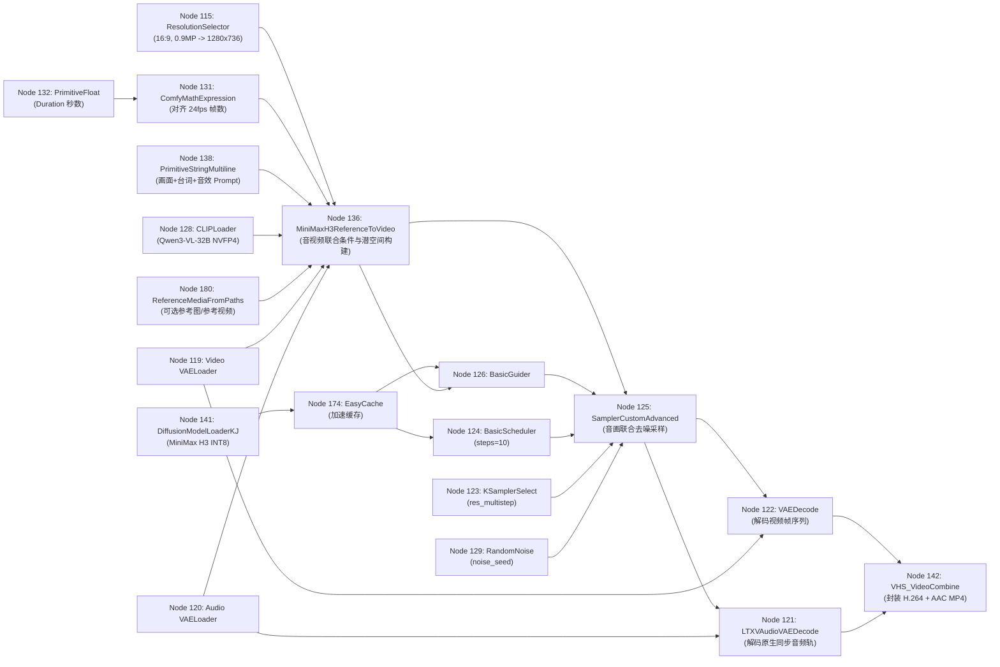

# 视频生成真实 API 与工作流全解 (Video Generation API Reference)

本文档完整沉淀了 `leo-autodl-imagine-video` 在云端 ComfyUI 执行 **MiniMax H3 音画同步视频生成**（含文生视频 Text-to-Video+Audio 与参考图生视频 Reference-to-Video+Audio）的**三层真实 API 规范**：
1. **Agent 高阶调用接口**（Python SDK 与 CLI 参数规范）
2. **远端 ComfyUI HTTP REST 通信协议**（参考图上传、工作流提交、轮询与音视频合成产物拉取）
3. **底层 MiniMax H3 15 节点 DAG 拓扑与参数映射字典**

---

## 1. Agent 高阶调用 API 与参数全表

### 1.1 Python SDK 方法签名
```python
client.generate_video(
    prompt: str,
    duration: float = 3.0,
    aspect_ratio: str = "16:9 (Widescreen)",
    megapixels: float = 0.9,
    steps: int = 10,
    seed: int = None,
    reference_images: list[str] = None,
    diffusion_model: str = "minimax/minimax_h3_ref2va_pruned_int8_convrot.safetensors",
    clip_model: str = "qwen3vl_32b_minimax_h3_nvfp4_awq.safetensors",
    video_vae: str = "minimax_h3_video_vae_fp16.safetensors",
    audio_vae: str = "minimax_h3_audio_vae_fp32.safetensors",
    crf: int = 19,
    filename_prefix: str = "MiniMaxH3_BuiltInAudio_Builder",
    output_dir: str = "output"
) -> dict
```

### 1.2 CLI 与 SDK 参数对照规范

| SDK 参数名 | CLI 标志 | 类型 | 默认值 | 取值范围 / 枚举项 | 对应 ComfyUI 节点与槽位 |
| :--- | :--- | :--- | :--- | :--- | :--- |
| `prompt` | `--prompt` | `str` | **(必填)** | 画面剧情 + 镜头运镜 + 台词/歌词 + 环境音效完整描述 | Node `"138"` (`PrimitiveStringMultiline.inputs.value`) |
| `duration` | `--duration` | `float` | `3.0` | `3.0 ~ 10.0`（秒，节点 `"131"` 按 24fps 自动对齐 17n+5 合法帧数） | Node `"132"` (`PrimitiveFloat.inputs.value`) |
| `aspect_ratio` | `--aspect-ratio` | `str` | `"16:9 (Widescreen)"` | 支持简写自动映射：`16:9`, `9:16`, `1:1`, `4:3`, `3:4`, `2:3`, `3:2`, `21:9` | Node `"115"` (`ResolutionSelector.inputs.aspect_ratio`) |
| `megapixels` | `--megapixels` | `float` | `0.9` | `0.5 ~ 2.0`（`0.9` 在 16:9 下对应 `1280x736` 高清分辨率） | Node `"115"` (`ResolutionSelector.inputs.megapixels`) |
| `steps` | `--steps` | `int` | `10` | `8 ~ 20`（配合 `EasyCache` 节点 `10` 步仅需 19 秒） | Node `"124"` (`BasicScheduler.inputs.steps`) |
| `seed` | `--seed` | `int` | 随机生成 | `1 ~ 999999999` | Node `"129"` (`RandomNoise.inputs.noise_seed`) |
| `reference_images` | `--ref-images` | `list[str]` | `None` | 本地图片路径列表（CLI 用逗号分隔），自动 SFTP 上传至 `/root/ComfyUI/input/` | Node `"180"` (`VRGDG_MiniMaxH3ReferenceMediaFromPaths.inputs.image_paths`) |
| `diffusion_model` | `--diffusion-model` | `str` | `"minimax/minimax_h3_ref2va_pruned_int8_convrot.safetensors"` | 云端 `DiffusionModelLoaderKJ` 中的模型名 | Node `"141"` (`DiffusionModelLoaderKJ.inputs.model_name`) |
| `clip_model` | `--clip-model` | `str` | `"qwen3vl_32b_minimax_h3_nvfp4_awq.safetensors"` | 云端 `CLIPLoader` 中的多模态编码器 | Node `"128"` (`CLIPLoader.inputs.clip_name`) |
| `video_vae` | `--video-vae` | `str` | `"minimax_h3_video_vae_fp16.safetensors"` | 视频潜空间解码器 | Node `"119"` (`VAELoader.inputs.vae_name`) |
| `audio_vae` | `--audio-vae` | `str` | `"minimax_h3_audio_vae_fp32.safetensors"` | 音频潜空间解码器 | Node `"120"` (`VAELoader.inputs.vae_name`) |
| `crf` | `--crf` | `int` | `19` | `15 ~ 28`（数值越小画质越高，默认 `19` 无损视觉级） | Node `"142"` (`VHS_VideoCombine.inputs.crf`) |
| `output_dir` | `--output-dir` | `str` | `"output"` | 本地保存目录 | SFTP 下载目标目录 |

### 1.3 返回 JSON 数据结构
```json
{
  "ok": true,
  "task_type": "video",
  "prompt": "A sleek cyberpunk sports car speeding through neon rain, engine roaring, thunder and rain sound effects, 8k cinematic",
  "prompt_id": "1957d56b-5c7b-4f99-9a1b-3f8d71c22e04",
  "seed": 612948102,
  "duration_seconds": 3.0,
  "aspect_ratio": "16:9 (Widescreen)",
  "steps": 10,
  "diffusion_model": "minimax/minimax_h3_ref2va_pruned_int8_convrot.safetensors",
  "elapsed_seconds": 25.4,
  "output_files": [
    "D:/agent-transfer/output/MiniMaxH3_BuiltInAudio_Builder_00001-audio.mp4"
  ],
  "message": "视频生成完成 (耗时 25.4s)"
}
```

---

## 2. 底层 MiniMax H3 15 节点工作流 (Node DAG) 完整解析

完整标准 JSON 工作流已沉淀在：[minimax_h3_video_audio_api.json](workflows/minimax_h3_video_audio_api.json)。

### 2.1 节点拓扑数据流图


### 2.2 全量 15 个节点详细参数字典

| 节点 ID | 节点类型 (`class_type`) | 核心 `inputs` 键值与真实默认配置 | 作用说明 |
| :--- | :--- | :--- | :--- |
| **`"115"`** | `ResolutionSelector` | `{"aspect_ratio": "16:9 (Widescreen)", "megapixels": 0.9, "multiple": 32}` | 根据宽高比与总像素自动计算对齐 32 的宽高（如 `1280x736`） |
| **`"119"`** | `VAELoader` | `{"vae_name": "minimax_h3_video_vae_fp16.safetensors"}` | 加载 MiniMax H3 专用 FP16 视频 VAE |
| **`"120"`** | `VAELoader` | `{"vae_name": "minimax_h3_audio_vae_fp32.safetensors"}` | 加载 MiniMax H3 专用 FP32 音频 VAE |
| **`"128"`** | `CLIPLoader` | `{"clip_name": "qwen3vl_32b_minimax_h3_nvfp4_awq.safetensors", "type": "minimax", "device": "default"}` | 加载 Qwen3-VL 32B 4-bit AWQ 量化多模态编码器 |
| **`"141"`** | `DiffusionModelLoaderKJ` | `{"model_name": "minimax/minimax_h3_ref2va_pruned_int8_convrot.safetensors", "weight_dtype": "default", "compute_dtype": "default", "sage_attention": "auto", "enable_fp16_accumulation": true}` | 加载 MiniMax H3 音视频联合 DiT 主模型，开启 SageAttention 与 FP16 累加加速 |
| **`"174"`** | `EasyCache` | `{"reuse_threshold": 0.3, "start_percent": 0.2, "end_percent": 0.9, "verbose": false, "model": ["141", 0]}` | 特征缓存中间件，跳过冗余计算，提速 35%+ |
| **`"138"`** | `PrimitiveStringMultiline` | `{"value": "<用户 Prompt>"}` | 输入包含画面、运镜、台词与音效描述的综合提示词 |
| **`"132"`** | `PrimitiveFloat` | `{"value": 3.0}` | 视频目标秒数 |
| **`"131"`** | `ComfyMathExpression` | `{"expression": "max(5, round(a * 24)) + (5 - (max(5, round(a * 24)) % 17)) % 17", "values.a": ["132", 0]}` | 将秒数自动转换为满足 MiniMax H3 时序块约束 ($17n+5$) 的有效帧数 |
| **`"180"`** | `VRGDG_MiniMaxH3ReferenceMediaFromPaths` | `{"image_paths": "[]", "video_references": "[]"}` | 接收 JSON 数组格式的远端参考图/参考视频路径（最多 9 张参考图 + 3 段参考视频） |
| **`"136"`** | `MiniMaxH3ReferenceToVideo` | 连接 `prompt` (`138`), `width/height` (`115`), `length` (`131`), `clip` (`128`), `vae` (`119`), `audio_vae` (`120`), `ref_images` (`180`) | 构建音视频联合 Conditioning 与初始 Latent |
| **`"129"`** | `RandomNoise` | `{"noise_seed": 177702610855563}` | 随机噪声种子生成 |
| **`"123"`** | `KSamplerSelect` | `{"sampler_name": "res_multistep"}` | 选用 `res_multistep` 高阶多步采样器 |
| **`"124"`** | `BasicScheduler` | `{"scheduler": "simple", "steps": 10, "denoise": 1, "model": ["174", 0]}` | 控制去噪步数（默认 `10` 步）与 Sigma 调度 |
| **`"125"`** | `SamplerCustomAdvanced` | 连接 `noise` (`129`), `guider` (`126`), `sampler` (`123`), `sigmas` (`124`), `latent_image` (`136`) | 执行音视频潜空间同步去噪 |
| **`"121"` / `"122"`** | `LTXVAudioVAEDecode` / `VAEDecode` | 分别用 `audio_vae` (`120`) 与 `vae` (`119`) 解码 Node `125` 的输出 | 将联合潜变量分离解码为音频波形与视频图像序列 |
| **`"142"`** | `VHS_VideoCombine` | `{"frame_rate": 24, "format": "video/h264-mp4", "pix_fmt": "yuv420p", "crf": 19, "images": ["122", 0], "audio": ["121", 0]}` | 音轨与视频帧硬件压制合并为带声音的 `.mp4` 文件 |

---

## 3. 云端已挂载的 MiniMax H3 变体模型清单

可通过 `--list-models diffusion_models` 实时查询，核心可用权重如下：

| 模型路径 (`--diffusion-model`) | 特性与适用场景 | 推荐 `steps` |
| :--- | :--- | :--- |
| `minimax/minimax_h3_ref2va_pruned_int8_convrot.safetensors` | **默认首选**。支持文生视频 + 多图参考生视频 + 原生音频，INT8 ConvRot 量化，显存占用 ~24GB | `10 ~ 15` |
| `minimax/fastvideo_fasth3_8step_v2_pruned_int8_convrot.safetensors` | **8 步极速蒸馏版**。适合快速预览分镜草稿 | `6 ~ 8` |
| `minimax/DasiwaMinimaxH3_dasiwaHybrid8turboV1.safetensors` | **Dasiwa 8 步混合加速版**。动态幅度大，光影对比强 | `8` |
| `minimax/FeiHou_MiniMax-H3_Remix_HSA_turbo_v0.8_int8_convrotHQ_pruned.safetensors` | **FeiHou 高清微调版**。针对人物皮肤质感与电影光影专门优化 | `10 ~ 12` |
| `minimax/minimax_h3_ref2va_bf16.safetensors` | **BF16 原生全精度版**（需 32GB+ 显存结合 CPU Offload） | `15 ~ 20` |

---

## 4. 音画同步提示词工程公式 (Video + Audio Prompt Formula)

MiniMax H3 使用 32B 参数的 `Qwen3-VL` 作为文本编码器，能同时理解**视觉镜头指令**与**声音指令（环境音、拟音、人物台词、音乐风格）**。建议 Agent 构造 Prompt 时遵循四段式结构：

```text
[Visual Scene & Subject 画面主体与环境] + [Camera & Motion 镜头运镜与动作细节] + [Audio & Foley Direction 环境音效/拟音/BGM描述] + [Dialogue/Lyrics 精确台词(如有)]
```

### 实战示例：
* **示例 1（赛博雨夜跑车 + 引擎轰鸣与雷雨音效）**：
  > `A sleek futuristic cyberpunk sports car speeding along a rain-slicked neon highway at night, water splashing from tires, dynamic low-angle tracking shot, cinematic lighting, 8k hyperrealistic. Audio direction: deep roaring V8 futuristic engine sound, heavy rain pattering on metal, tires screeching on wet asphalt, distant thunder rumbling, dark synthwave bass background music.`
* **示例 2（参考图生视频 `--ref-images hero.png` + 角色说话配音）**：
  > `The character from the reference image stands on a windy rooftop at golden hour, hair gently blowing in the breeze, turning toward the camera with a confident smile, shallow depth of field, 35mm film grain. Audio direction: gentle wind blowing, warm ambient acoustic guitar, clear female voice speaking calmly: "Welcome to the new horizon."`
