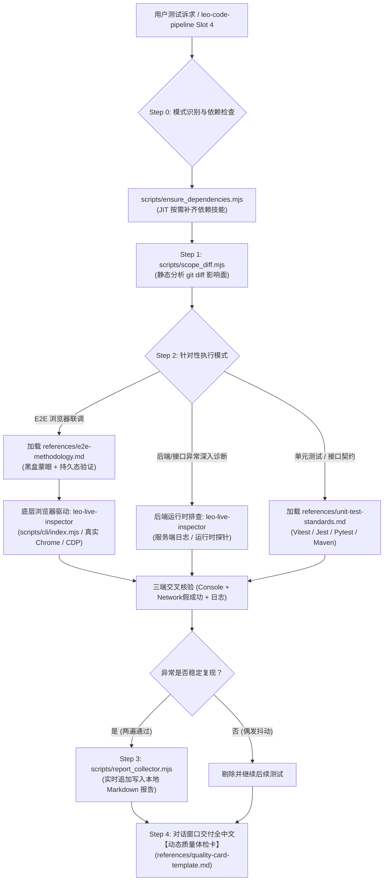

# Leo Code QA（代码质检与测试中枢）

`leo-code-qa` 是面向全栈软件工程的**多模态代码质检与自动化测试中枢**。

遵循**“借脑不借手”**架构哲学：
- **借脑**：深度吸收开源项目 `garrytan/gstack`（`qa-only` / `qa`）在软件工程质检中的工业级方法论——**测前划范围、测中蒙眼黑盒、三端交叉核验、写操作强验持久态、两遍复现定律、增量落盘防丢失、默认只查不改**；
- **不借手（生态解耦，不造轮子）**：彻底剥离 gstack 自带的 Playwright、内置 browse CLI 与环境遥测，底层统一依托专职技能 **`leo-live-inspector`** 收口全链路执行能力，减少冗余技能依赖：
  - **E2E 浏览器测试与页面抓取** $\rightarrow$ 调用 **`leo-live-inspector` 内置浏览器 CLI**（`scripts/cli/index.mjs`，操作真实 Chrome、复用真实登录态、CDP 原生事件、极省 Token 的 DOM 树与网络抓包）；
  - **后端运行时与日志诊断** $\rightarrow$ 联动 **`leo-live-inspector`** 诊断脚本（排查服务端日志、异常堆栈与运行时探针）；
  - **研发流水线集成** $\rightarrow$ 完美作为 **`leo-code-pipeline` 的 `Slot 4: [test]` 门禁**。

---

## 1. 核心质检原则（六大铁律）

1. **测前划范围，测中蒙眼睛（Strict Black-Box Boundary）**：
   - **测前**：通过 `node scripts/scope_diff.mjs` 自动根据 `git diff` 锁定受影响的路由、Controller、API 与页面视图，生成定向测试清单；
   - **测中**：**严禁使用任何工具读取被测应用的业务源码**！必须站在真实用户的纯黑盒视角感知系统，从物理层面杜绝“看源码脑补功能合理性”。
2. **三端交叉核验与假成功拦截（Triple-Check Verification）**：
   - 交互后必须同步核验：① 浏览器控制台未捕获报错；② 网络抓包；③ 后端运行时日志（联动 `leo-live-inspector`）；
   - **重点拦截“假成功”**：HTTP 状态码返回 200，但响应体业务状态码异常（如 `code != 0/200` 或包含错误文案）一律定性为 Bug（详见 [fake-success-rules.md](references/fake-success-rules.md)）。
3. **写操作必须验持久态（Anti-Optimistic UI Guard）**：
   - 凡涉及**新建（C）、编辑（U）、删除（D）或状态流转**操作，在前端页面提示成功后，**必须强制刷新页面（`reload --bypass-cache`）或重新触发 API 查询**，从数据库重新拉取真实数据，核验是否真正入库，戳破前端乐观 UI 幻觉。
4. **两遍复现定律（Two-Pass Repro）**：
   - 任何疑似 Bug 必须原样重跑第二遍，排除网络微小抖动与脏数据，只有 100% 稳定复现才定性为 Bug；
   - 严禁抓取非功能性 CSS 样式问题凑数，严禁抓取老代码遗留无关警告。
5. **增量追加落盘防丢（Live-Append Reporting）**：
   - 任务启动即在 `~/.shrimp/skills/leo-code-qa/reports/` 初始化 Markdown 报告；
   - **每确认一条 Bug，立即通过 `scripts/report_collector.mjs` 追加写入本地磁盘**，即使长会话中断也绝不丢失任何证据。
6. **默认只查不改，修复强制加护栏**：
   - 默认以 `qa-only` 模式运行（严禁触碰业务代码，纯出具证据报告）；
   - 显式触发修复（`qa` 模式）时强制执行三层熔断护栏：**单 Bug 单次修 $\rightarrow$ 相邻路径防回归复测 $\rightarrow$ 连续 2 次修复失败或引入新报错立即 `git checkout` 回滚并停机**。

---

## 2. 架构与依赖自愈体系



---

## 3. 标准执行流程

### Step 0: 模式识别与依赖 JIT 自愈
1. **模式判断**：
   - **E2E 模式 (`e2e`)**：涉及网页端功能、交互流程、表单提交流程时激活；
   - **单测模式 (`unit`)**：涉及业务逻辑函数、算法、SDK、模型类改动时激活；
   - **接口模式 (`api`)**：涉及微服务接口、纯后端端点变动时激活；
   - **全量质检 (`full`)**：用户未明确指定时，根据改动文件自动组合激活。
2. **依赖检查与自愈**：
   - 执行 `node scripts/ensure_dependencies.mjs`（返回 `leo-live-inspector` 的本地安装目录 `<leo-live-inspector-dir>`）；
   - 若激活 E2E 模式或需要排查后端问题，且缺少 `leo-live-inspector` $\rightarrow$ 自动触发 `npx -y skills add zlpawn/leo-live-runner -g --skill leo-live-inspector`。

### Step 1: 测前范围划定 (Scope Locking)
运行范围分析探针：
```bash
node ./scripts/scope_diff.mjs [base-branch]
```
提取受影响的前端路由、后端 Controller、API 接口列表，并在 `~/.shrimp/skills/leo-code-qa/reports/` 初始化增量报告。

### Step 2: 模式化执行与三端核验

#### 场景 A: E2E 浏览器联调（依托 `leo-live-inspector` 内置浏览器 CLI，严格黑盒）
1. 开启独立窗口并导航（复用真实登录态，不干扰工作）：
   > 注：统一通过 `leo-live-inspector` 内置浏览器 CLI 执行（完整指令见 `<leo-live-inspector-dir>/references/browser-guide.md`），下面以 `cli` 简写代表 `node <leo-live-inspector-dir>/scripts/cli/index.mjs`。
   ```bash
   cli() { node "<leo-live-inspector-dir>/scripts/cli/index.mjs" "$@"; }
   cli start-task --title="qa-e2e"
   cli goto "<target-url>"
   ```
2. 执行三端核验循环（**严禁读取业务源码**）：
   - 启动网络监听：`cli net-start`；
   - 定位元素：`cli state`（读取带有 `ref` 的紧凑 DOM，极省 Token）；
   - 物理输入与点击：`cli fill --ref <N> --val "<text>" --blur`、`cli click --ref <N>`；
   - 提取网络响应：`cli net-get --grep="api"` $\rightarrow$ `cli net-stop`；
   - **假成功排查**：检查 HTTP 200 响应体是否含 `code !== 0` 或失败文案（参考 [fake-success-rules.md](references/fake-success-rules.md)）；
   - **写操作强验落库**：执行 `cli reload --bypass-cache`，刷新后再次 `cli state` 核实数据是否依然存在。

#### 场景 B: 后端异常深度排查（同源 `leo-live-inspector`）
当接口返回 5xx、假成功或数据库报错时，直接调用已就绪的 `leo-live-inspector` 诊断脚本（如 `fast_query.js`、`test_log_query.js`）捕获服务端运行日志与异常调用栈，作为证据链。

#### 场景 C: 单元测试与接口集成
根据工程特征自动执行对应的测试套件（如 `npx vitest run`、`mvn test`），严格断言核心分支与边界条件（参考 [unit-test-standards.md](references/unit-test-standards.md)）。

### Step 3: Bug 举证与实时追加落盘
当发现异常时：
1. **原样重走第二遍**，确保 100% 稳定复现；
2. 捕获现场截图存证（仅在确认 Bug 时截图，拒绝无脑截图浪费 Token）：
   ```bash
   cli screenshot --out="~/.shrimp/skills/leo-code-qa/reports/evidence-<id>.png"
   ```
3. 调用 `node scripts/report_collector.mjs` 立即将缺陷信息以追加模式写入磁盘报告文件。

### Step 4: 交付动态质量体检卡
测试结束时：
1. 释放 E2E 资源：`cli end-task`；
2. 按照 [quality-card-template.md](references/quality-card-template.md) 在对话窗口输出高信噪比的中文**【代码质检体检卡】**，并附上本地留底报告绝对路径。
