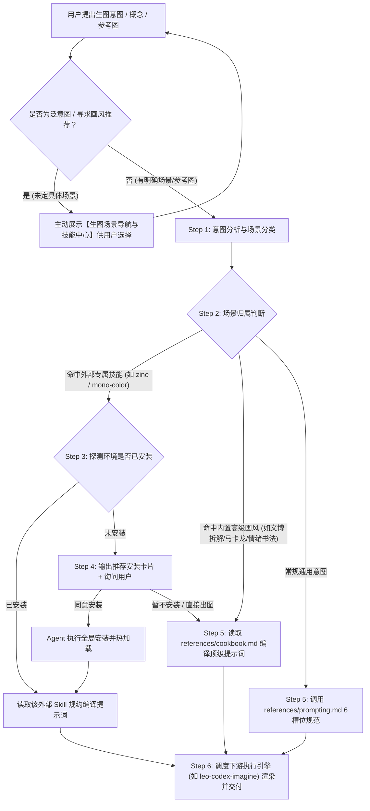

# Leo Imagine Router (AI 生图场景智能路由与技能调度中心)

## 📖 核心定位
`leo-imagine-router` 是一个轻量级、去中心化的 **AI 生图场景智能路由器与 JIT（Just-In-Time 即时能力）调度管家**。

它解决的核心问题：
1. **主动场景导航与探索交互**：在用户提出模糊需求或尚未确定 Prompt 前，主动呈现结构化场景目录，让用户自由挑选或激发创意灵感。
2. **场景与风格智能匹配**：避免所有画风杂揉在一个大 Prompt 中造成规则污染。根据用户意图精准路由至最专业的垂直技能或内置工业级顶级模版。
3. **解耦生态，去中心化协作**：不强行复制代码或硬编码本地路径，按 Skill 标识符进行动态探测；下游技能更新，Router 自动享受最新特性。
4. **缺失技能引导与交互式安装**：当识别到最佳外部专属 Skill 但本地未安装时，向用户提供 GitHub 来源与安装命令；在获得用户授权后，直接代劳全局安装并无缝接力生成。
5. **开箱即用顶级画风库 (Built-in Master Cookbook)**：全面吸纳工业级实战调优的 10 大类、60+ 细分视觉场景顶级提示词库与视觉设计规约（文博拆解、马卡龙信息图、情绪书法真迹、品牌包装家族、短剧分镜、脑洞跨界等），无需额外安装即可直接出图。
6. **生图引擎解耦与自动派发**：Router 只专注场景识别与高质量提示词编译，完成后自动调用下游执行引擎（如 `leo-codex-imagine` 的 gpt-image-2 / 第三方 API，或环境内其他生图工具）完成图片渲染与自动落盘。

---

## 🧭 工作流概览 (Workflow Pipeline)



---

## 💡 主动场景探索与导航交互 (Scenario Discovery & Navigation)

当用户满足以下任一条件时，Agent **必须首先主动向用户展示全景技能目录卡片**：
- 用户调用 `/leo-imagine-router` 但尚未提供具体的图片或描述；
- 用户询问“你能做什么”、“支持哪些画风/场景”、“我想做张图有什么推荐”；
- 用户上传了照片但没有说明具体想要的效果方向。

### 交互展示卡片模板
```markdown
🎨 **Leo Imagine Router 生图场景导航与技能中心**

目前已深度整合以下专精场景与内置顶级画风库，您可以直接回复编号、场景名称，或上传照片/描述构想：

### 📸 1. 真实生活与旅行摄影重构 (源自 gathered-scenes-zine-skill)
- **【实景拼贴 · 拾景纸刊】(`scenes-gathered-zine-v1-3`)**：**真景为锚**。保留照片核心主体，手撕纤维毛边过渡，背景抽象为网点线描印刷场，高纯度单色块，打字机微缩文字。（最适合：旅行、建筑、街景、活动纪念照）
- **【影像蒸馏 · 极简插画】(`scene-distillation-zine-v1-3`)**：**不保留原摄影像素**。提炼人物关系与情绪隐喻，转译为高雅文学性的独立极简插画海报，支持`单色块模式`。（最适合：想把照片画成画、情感表达）
- **【莫兰迪电影摄影海报】(`morandi-cinematic-poster-zeejay`)**：**原片锁定不重绘**。莫兰迪纸张与克制油墨，5大电影排版构型 + 虚构演职员表（Billing Block），秒变大片剧照海报。（最适合：建筑、街头、人像摄影）
- **【拾景实况动效】(`scenes-gathered-zine-live-flow-v1-0`)**：在海报基础上增加揭开手撕纸的动态撕纸效果，生成 Apple Live Photo（JPG+MOV）。

### 📰 2. 当代编辑部单色/双色印刷 (源自 mono-color-skill)
- **【单色/受控双色印刷海报】(`mono-color`)**：严格限制 1~2 块印刷油墨版（主墨 70%–85% + 辅墨 15%–30%，如钴蓝+陶土橙、薄荷绿+炭黑），机械网点（Halftone）与孔版颗粒（Risograph），自适应中性纸基，25%–55% 大面积留白，5x 字阶跳跃排版。（最适合：文化/活动海报、单曲/黑胶封面、小红书高格调封面、商品贴纸）

### 🖼️ 3. 摄影双联画与抽象记忆面板 (源自 photo-abstract-editorial)
- **【摄影双联画 · 抽象记忆面板】(`photo-abstract-editorial`)**：**原片绝对锁定不改写**，下方无缝拼接纯净象牙白抽象面板（#F3F0E8），提取照片中真实可追溯的几何母题/轴线/群像墨点，65%–80% 大面积留白，搭配信达雅英文衬线诗意标题。（最适合：文艺旅行摄影、建筑光影、艺术双联海报）

### 🏛️ 4. 文博图鉴与建筑速写 (内置顶级 Cookbook)
- **【博物馆图鉴式中文拆解】(`built-in:museum-deconstruction`)**：四区分割法，兼具真实写实主视觉、引线部位标注、局部特写、材质纹样与流转流程。（汉服、连弩、现代主战坦克、空间站等）
- **【建筑师手绘速写手稿】(`built-in:architectural-sketch`)**：反过度完成感，钢笔淡彩、铅笔辅助线、线条呼吸感与松弛手写笔记。（天坛、乐山大佛、应县木塔等）
- **【维多利亚神秘学全览】(`built-in:tarot-archive`)**：羊皮纸旧底、黑金档案、塔罗牌阵与神圣几何符号。

### 📊 5. 高密度信息图与知识图解 (内置顶级 Cookbook)
- **【马卡龙手绘科技/商业单页信息图】(`built-in:infographic-macaron`)**：#F5F0E8暖米纸、马卡龙圆角色块、手绘抖动线条（wobble）、珊瑚红强调色。（大模型发布、行业研报、商业模式）
- **【数学与科学理论可视化】(`built-in:math-visualization`)**：优雅学术风、时域到频域分解、几何直觉与本质拆解。（傅里叶变换、算法直觉）
- **【地景档案模型沙盘】(`built-in:landscape-archive`)**：30°-45°斜俯视物理沙盘切片模型，带外框严密比例尺、图例与指北针。（长城、珠峰、浦江天际线）

### 📜 6. 东方书卷、情绪书法与敦煌美学 (内置顶级 Cookbook)
- **【3D 诗画卷轴世界海报】(`built-in:chinese-scroll-world`)**：悬浮展开的画卷作为视觉原点，微缩天地破卷而出，金箔烫印大字与印章。（城市文旅形象、宏大文学IP）
- **【注入历史情绪内核的书法真迹】(`built-in:emotional-calligraphy`)**：拒绝冰冷临摹，将作者当时的悲愤、苍凉或沉郁注入墨色顿挫与字形欹正中，带自然残卷折痕。（祭侄文稿、报任安书、寒食帖）
- **【敦煌唐代重彩壁画与沥粉贴金】(`built-in:dunhuang-fresco`)**：吴带当风铁线描、矿物重彩设色、龟裂风化泥壁与沥粉贴金剥落质感。（飞天神女、九色鹿、千手观音）
- **【东方手绘双重曝光海报】(`built-in:oriental-double-exposure`)**：巨大侧脸主形融合写意山海云气卷轴叙事，纸本淡彩与大量留白。（红楼梦、刺客聂隐娘）

### 🛍️ 7. 品牌商业提案与几何装置电商 (内置顶级 Cookbook)
- **【4:5 品牌包装家族视觉系统】(`built-in:brand-packaging-system`)**：高完成度品牌包装全案展示，涵盖手提袋、礼盒、容器、标签吊牌与产品本体，少而精的高端商业摄影陈列。
- **【极简几何装置风产品海报】(`built-in:geometric-product-kv`)**：高调纯净摄影棚，圆柱、亚克力支架、立方体等几何装置与自然食材/原料切片穿插，高级通透留白。
- **【基于实物照片生成功能图解】(`built-in:photo-to-ecommerce`)**：保留原图轮廓与品牌，生成商业场景并在周围引线标注核心卖点。

### 🎬 8. 电影概念、短剧分镜与写实游戏 (内置顶级 Cookbook)
- **【12格电影感短剧分镜表】(`built-in:storyboard-12frames`)**：4×3网格均匀排版，主角人设/服装/发型 100% 连贯，近景中景远景镜头交替，编号01-12。
- **【复古电影票根收藏海报】(`built-in:collector-ticket`)**：左侧电影核心主视觉，右侧撕票虚线与规范票务排版（ADMIT ONE、席位、日期时间、条形码）。
- **【写实 3D 动作游戏截图】(`built-in:action-game-screenshot`)**：黑神话悟空次世代实机画面，或水浒传硬核动作战斗场景（含血条、小地图与技能UI）。

### 💡 9. 脑洞跨界、时空融合与文创生活 (内置顶级 Cookbook)
- **【现代游戏角色宋代工笔画】(`built-in:game-song-gongbi`)**：英雄联盟/最终幻想角色化身宋代绢本工笔，带专属台词题跋与印章。
- **【3D 毛毡针刺织物画像】(`built-in:felt-needle-art`)**：羊毛毡针刺毛绒、手工刺绣织物与立体微缩场景。
- **【跨时代时空无缝融合】(`built-in:temporal-blending`)**：时代广场百年前与当今无缝过渡交融；上海外滩四季无缝全景长卷。
- **【青田石金石篆刻印谱五印体系】(`built-in:seal-carving`)**：为名人/科技巨头定制姓名印、理念印、精神印、愿景印、项目印成套印谱。
- **【生活美学与文创】(`built-in:lifestyle-merchandise`)**：宋朝人朋友圈（苏轼发东坡肉）、文学金句单页日历（地坛/小王子）、传统老黄历、反重力折叠城市。

### 🛡️ 10. 通用高品质与功能出图 (内置通用 6 槽位引擎)
- **【通用出图 / 架构图 / 封面图 / 局部修图】(`built-in-fallback`)**：严格遵循 6 槽位结构（用途/主体/场景/风格/构图/约束），防过度加料，局部图生图严格声明范围。
```

---

## 🗂️ 场景路由矩阵 (Scene Routing Table)

| 场景分类 | 核心风格特征 / 触发词 | 目标标识符 | 规范参考 / 来源 |
| :--- | :--- | :--- | :--- |
| **实景拼贴 · 拾景纸刊** | 照片拼贴、拾景、手撕纤维纸边、真景为锚、插画成场、大色块结构、打字机微缩字 | `scenes-gathered-zine-v1-3` | 外部 Skill (`Zeejay0/gathered-scenes-zine-skill`) |
| **影像蒸馏 · 极简插画** | 影像蒸馏、不保留原图、情感隐喻、极简艺术插画、艺术命题、单色块模式 | `scene-distillation-zine-v1-3` | 外部 Skill (`Zeejay0/gathered-scenes-zine-skill`) |
| **莫兰迪电影摄影海报** | 莫兰迪、电影海报、摄影大片、5大排版构型、演职员表(Billing Block)、原图锁定排版 | `morandi-cinematic-poster-zeejay` | 外部 Skill (`Zeejay0/gathered-scenes-zine-skill`) |
| **拾景实况动效海报** | 拾景实况、Live Photo、实况照片、平铺手撕纸揭开动效、Apple Live Photo ZIP | `scenes-gathered-zine-live-flow-v1-0` | 外部 Skill (`Zeejay0/gathered-scenes-zine-skill`) |
| **单色/双色编辑印刷** | 单色海报、受控双色、孔版印刷、Risograph、网点照片(Halftone)、独立Zine、黑胶封套 | `mono-color` | 外部 Skill (`yanliudesign/mono-color-skill`) |
| **摄影双联抽象面板** | 摄影双联画、抽象记忆面板、原片锁定+抽象面板、Diptych、象牙白画廊展签、诗意衬线标题 | `photo-abstract-editorial` | 外部 Skill (`ZzzLc0405/photo-abstract-editorial`) |
| **双重曝光剪影海报** | 剪影、海报、双重曝光、隐喻、叙事感、电影感人物轮廓 | `narrative-silhouette-prompt-generator` | 外部 Skill (`zlpawn/narrative-silhouette-prompt-generator`) |
| **博物馆图鉴拆解** | 拆解图、汉服拆解、武器拆解、坦克拆解、机构剖面、博物馆展板、图鉴式信息图 | `built-in-cookbook:deconstruction` | 内置 `references/cookbook.md` 第 3.1 节 |
| **建筑师手绘速写** | 建筑速写、手绘手稿、天坛速写、大佛手稿、建筑笔记、未完成感、钢笔淡彩 | `built-in-cookbook:architectural-sketch` | 内置 `references/cookbook.md` 第 3.2 节 |
| **马卡龙单页信息图** | 马卡龙信息图、手绘图解、发布会单页总结、研报图解、圆角卡片、科技图解 | `built-in-cookbook:infographic-macaron` | 内置 `references/cookbook.md` 第 6.1 节 |
| **数学/理论概念可视化** | 数学信息图、傅里叶变换、几何直觉、理论直觉拆解、学术手绘海报 | `built-in-cookbook:math-visualization` | 内置 `references/cookbook.md` 第 6.3 节 |
| **诗画卷轴世界海报** | 卷轴、诗画卷轴、悬浮画卷、纸面生长、东方3D海报、烫金标题 | `built-in-cookbook:chinese-scroll-world` | 内置 `references/cookbook.md` 第 1.8 节 |
| **情绪书法真迹** | 书法真迹、祭侄文稿、报任安书、寒食帖、情绪注入、书法作品、宣纸残卷 | `built-in-cookbook:emotional-calligraphy` | 内置 `references/cookbook.md` 第 4.2 节 |
| **敦煌重彩壁画** | 敦煌壁画、莫高窟、飞天神女、九色鹿、千手观音、重彩矿物、沥粉贴金 | `built-in-cookbook:dunhuang-fresco` | 内置 `references/cookbook.md` 第 4.4 节 |
| **东方双重曝光海报** | 东方双重曝光、红楼梦海报、写意剪影、纸本淡墨、东方叙事海报 | `built-in-cookbook:oriental-double-exposure` | 内置 `references/cookbook.md` 第 1.1 节 |
| **品牌包装家族系统** | 品牌包装、包装全案、包装展示图、家族陈列、4:5竖版、VIS提案图 | `built-in-cookbook:brand-packaging-system` | 内置 `references/cookbook.md` 第 10.1 节 |
| **极简几何装置产品海报**| 产品海报、几何装置、亚克力陈列、电商主视觉、水果产品海报、静物摄影 | `built-in-cookbook:geometric-product-kv` | 内置 `references/cookbook.md` 第 10.2 节 |
| **短剧分镜插画** | 短剧分镜、12格分镜、分镜表、角色连贯分镜、末日废土分镜、电影镜头组 | `built-in-cookbook:storyboard-12frames` | 内置 `references/cookbook.md` 第 8.3 节 |
| **游戏角色宋代工笔** | 游戏工笔画、英雄联盟宋代、工笔金克丝、工笔艾希、古典游戏插画 | `built-in-cookbook:game-song-gongbi` | 内置 `references/cookbook.md` 第 9.1 节 |
| **时空融合与四季长卷** | 时代融合、时代广场对比、历史今昔、四季全景、四季过渡长卷 | `built-in-cookbook:temporal-blending` | 内置 `references/cookbook.md` 第 2.12 / 2.13 节 |
| **金石篆刻印谱** | 篆刻、印章设计、青田石印章、马斯克印章、五印体系、金石学印蜕 | `built-in-cookbook:seal-carving` | 内置 `references/cookbook.md` 第 9.10 节 |
| **复古电影票根海报** | 电影票根、纪念票根、打孔撕票虚线、ADMIT ONE、电影周边收藏票 | `built-in-cookbook:collector-ticket` | 内置 `references/cookbook.md` 第 1.7 节 |
| **科普百科卡与地景沙盘**| 竖版科普图、科普百科卡、长城3D沙盘、珠峰地景模型、地形图鉴 | `built-in-cookbook:science-landscape` | 内置 `references/cookbook.md` 第 5.1 / 5.3 节 |
| **传统生活美学物料** | 宋朝朋友圈、传统老黄历、潮菜菜单、小王子日历、我与地坛日历、反重力城市 | `built-in-cookbook:lifestyle-tradition` | 内置 `references/cookbook.md` 第 6.4-6.6 / 9.3 节 |
| **通用高质量出图** | 未匹配上述特定风格的常规文生图、技术架构图、封面、参考图局部重绘 | `built-in-fallback` | 遵循内置 `references/prompting.md` 6槽位规范 |

---

## 🔍 Step 1: 意图分析与场景分类

当用户输入一个概念或提供一张参考图时：
1. **提取核心诉求**：判断用户想要的是“摄影照片二创/纸刊”、“高密度信息图”、“文博拆解”、“东方书卷/情绪书法”、“品牌包装提案”、“电影海报/分镜”、“脑洞跨界”还是“常规通用功能图”。
2. **场景映射**：比对【场景路由矩阵】，找出匹配度最高的技能或内置画风。

---

## ⚡ Step 2 & 3: 运行期动态探测 (Runtime Detection)

若匹配到外部专属 Skill（如 `scenes-gathered-zine-v1-3`、`mono-color`、`photo-abstract-editorial` 等）：
1. **上下文技能池**：检查 Agent 上下文中的 `Available skills:` 列表；
2. **标准中央技能库**：
   - macOS / Linux: `~/.agents/skills/<skill-name>`
   - Windows: `%USERPROFILE%\.agents\skills\<skill-name>`
3. **平台全局技能配置**：
   - `~/.gemini/config/skills/<skill-name>`（通常以软链形式指向中央库）
4. **当前工作区相对目录**：
   - `./lib/skills/<skill-name>` 或 `./.agents/skills/<skill-name>`

- **状态 A（已安装/已就绪）**：直接读取该 Skill 的 `SKILL.md`，执行其专属提示词规约。
- **状态 B（未安装）**：进入 **Step 4 引导安装流程**。

---

## 📦 Step 4: 缺失技能引导与交互式安装规范 (JIT Installation Protocol)

当命中外部专属场景但本地完全缺失时，Agent **不得直接报错终止**，按以下固定模板回复用户：

```text
💡 **场景推荐**：您描述的场景非常适合使用专精技能 **【<Skill Name>】**（<一句话特性介绍>）。

当前检测到您的环境中尚未安装该专属技能：
* **开源地址**：<GitHub Repo URL>
* **标准命令**：`npx skills add <repo> -g`

**请问是否需要我直接帮您全局安装此技能？**
* 您可以回复 **“安装”**，我将为您自动完成下载与配置，并立即呈现极致出图效果；
* 您也可以回复 **“直接出图”**，我将立即使用内置高级画风引擎为您生成当前需求。
```

当用户明确回复“安装”后，Agent 执行 `npx skills add <repo> -g` 或 Git 克隆，确认生效后立即无缝渲染出图。

---

## 🛡️ Step 5: 内置高级画风与通用生图引擎 (Built-in Premium Cookbook & Fallback Engine)

当用户命中内置高级画风、或选择“直接出图”、或为常规通用意图时：
1. **命中内置高级画风（`built-in-cookbook:*`）—— 零损耗跨界编译**：
   - 读取 [`references/cookbook.md`](references/cookbook.md) 中对应的视觉配方（**视觉 DNA + 可迁移插槽 + 黄金标杆示例**）；
   - **禁止死板生套或缩水**：将用户的跨界主题填入 `可迁移插槽`（若用户未提供细节则直接使用标杆示例），同时 **100% 完整保留**该配方的 `视觉 DNA`（纸张肌理、色号 Hex、光学材质、排版网格与比例）、**双引号文字锁定**以及 `Avoid` 负向清单；
   - 输出并传递密度不低于标杆示例的中英文双语高完成度 Prompt。
2. **常规通用意图（`built-in-fallback`）**：
   - 严格遵循 [`references/prompting.md`](references/prompting.md) 的 6 槽位结构（用途/主体/场景/风格/构图/约束），中英文双引号锁定文本防乱码，参考图局部修改明确变更隔离。
   - 参考 [`references/sample-prompts.md`](references/sample-prompts.md) 快速示例。

---

## 💾 存储策略与智能归档规范 (Dynamic Paths & File Organization)

遵循 Shrimp 生态规范（完全对齐 `leo-musicdl` 与 `leo-video-router`），生图的输出目录与命名遵循「三级解析 + 记忆持久化」策略，杜绝硬编码：

- **记忆配置文件**：统一保存在 `~/.shrimp/skills/leo-imagine-router/config.json`。
- **全局输出根目录三级解析**：
  1. **用户显式指定（最高优先级）**：用户在对话中直接指定或使用 `--dir` / `--output-dir` 参数，立即采用，并**自动回写更新**到 `~/.shrimp/skills/leo-imagine-router/config.json`（或由 Agent 执行 `node scripts/config.mjs set --dir "<path>"`），实现后续任务无感记忆，无需重复询问。
  2. **持久化记忆配置**：读取 `~/.shrimp/skills/leo-imagine-router/config.json` 中的 `output_dir`（当前默认配置为 `~/素材/imagine`，跨平台自动解析为系统家目录绝对路径如 `$HOME/素材/imagine`）。
  3. **默认兜底目录**：若未配置且未指定，回退到当前工程的 `./images`。
- **两级分层归档架构 (策略 B + 时间分层)**：
  每个场景大类建立独立的分类文件夹，并在其下方按当天日期（`YYYY-MM-DD`）建立时间文件夹：
  ```text
  <output_dir>/<场景大类>/YYYY-MM-DD/
  ```
  例如：
  - `~/素材/imagine/海报艺术/2026-11-18/`
  - `~/素材/imagine/拆解图鉴/2026-11-18/`
  - `~/素材/imagine/商业包装/2026-11-18/`
  - `~/素材/imagine/视觉信息图/2026-11-18/`
  - `~/素材/imagine/古代书画/2026-11-18/`
  - `~/素材/imagine/影视分镜/2026-11-18/`
  - `~/素材/imagine/脑洞跨界/2026-11-18/`
  - `~/素材/imagine/通用出图/2026-11-18/`
- **精炼语义文件名生成规约**：
  杜绝直接截断超长 Prompt 产生杂乱下划线的做法，统一按结构生成：
  ```text
  <主题>_<细分风格>_<时间戳>.<ext>
  ```
  例如：
  - `西游记_写意双重曝光海报_20261118_142013.png`
  - `明制汉服_博物馆四区拆解_20261118_142013.png`
  - `GPT5.5发布_马卡龙手绘信息图_20261118_142013.png`

---

## 🎨 Step 6: 生图执行与回传规范

Router 只负责场景与提示词，**不绑定、不指定任何底层生图引擎**：
1. **下游 Skill 自带执行流程**（如 Live Photo 动效类）：完全按该 Skill 自己的规约渲染与交付，Router 不干预其引擎选择。
2. **下游 Skill 只产出提示词，或走 Step 5 内置画风/兜底**：
   - **自动计算归档目录与文件名**：调用 `node scripts/config.mjs resolve --cat "<场景大类>" --topic "<主题>" --style "<细分风格>"` 或等效逻辑计算得到 `targetDir` 与 `filename`；
   - 优先从当前工作区或上下文中选择功能最完善的生图执行类 Skill（推荐首选 **`leo-codex-imagine`**，支持 Codex 本机订阅 gpt-image-2、第三方中转 API 与 APIMart，自带任务轮询与落盘）；
   - 也支持环境内可用的其他生图 Skill（如 `leo-antigravity-imagine`、`leo-grok-imagine`、`baoyu-image-gen` 等）；
   - **调用生图引擎时，必须显式传入 `--output-dir "<targetDir>"` 与 `--filename "<filename>"`**，确保底层引擎即使未单独配置也会精准落盘到由 Router 规范管理的归档路径；
   - 传入构造好的提示词、参考图路径与画面宽高比（`--aspect-ratio`）。
3. 无论成功与否，必须将生成的结构化提示词清晰展示给用户；
4. 图片渲染成功后，以标准的 Markdown 格式输出可点击的文件链接与图片预览：
   ```markdown
   
   *原图文件：[image.png](file:///path/to/image.png)*
   ```
