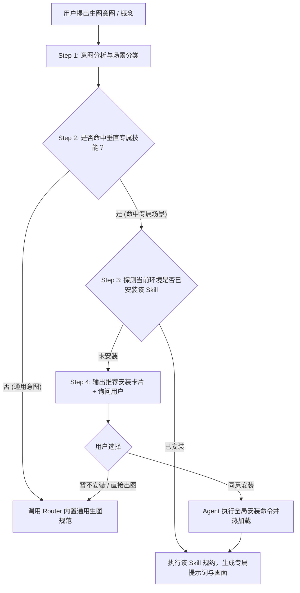

# Leo Imagine Router (AI 生图场景智能路由与技能调度中心)

## 📖 核心定位
`leo-imagine-router` 是一个轻量级、去中心化的 **AI 生图技能分发调度器与 JIT（Just-In-Time 即时能力）管理管家**。

它解决的核心问题：
1. **场景与风格智能匹配**：避免所有画风杂揉在一个大 Prompt 中造成规则污染。根据用户意图精准路由至最专业的垂直技能。
2. **解耦生态，避免硬编码**：不强行复制代码或硬编码本地路径，按 Skill 标识符进行动态探测；下游技能更新，Router 自动享受最新特性。
3. **缺失技能引导与交互式安装**：当识别到最佳专属 Skill 但本地未安装时，向用户提供 GitHub 来源与安装命令；在获得用户授权后，直接代劳全局安装并无缝接力生成。
4. **服务永不中断（优雅降级）**：内置通用高质量提示词工程基准规范与案例库，确保即使未安装任何垂直扩展技能，也能产出极高水准的提示词与画面。

---

## 🧭 工作流概览 (Workflow Pipeline)



---

## 🗂️ 场景路由矩阵 (Scene Routing Table)

| 场景分类 | 核心风格特征 / 触发词 | 目标 Skill 标识符 | 推荐来源 / 安装命令 |
| :--- | :--- | :--- | :--- |
| **双重曝光剪影海报** | 剪影、海报、双重曝光、隐喻、叙事感、电影感人物轮廓 | `narrative-silhouette-prompt-generator` | `npx skills add zlpawn/narrative-silhouette-prompt-generator -g` |
| **新国风写意水墨** | 水墨、泼墨、工笔、仙侠、古风、国潮东方韵味 | `leo-chinese-ink-generator` (预留) | 对应仓库源 / 提示开发中 |
| **3D 盲盒/黏土微缩** | 黏土、盲盒、潮玩、微缩景观、Isometric、3D 渲染 | `leo-isometric-clay-generator` (预留) | 对应仓库源 / 提示开发中 |
| **赛博朋克科幻机甲** | 赛博朋克、未来城市、机甲、废土科幻、霓虹光影 | `leo-cyberpunk-concept-generator` (预留) | 对应仓库源 / 提示开发中 |
| **通用高质量出图** | 未匹配到上述特定风格的常规文生图、信息图、封面、修图 | `built-in-fallback` | 遵循内置 `references/prompting.md`，无需外部安装 |

---

## 🔍 Step 1: 意图分析与场景分类

当用户输入一个概念（如“《三体》红岸基地”、“问薪无愧的打工人”、“太空孤航”、“一只可爱的粘土小猫”）时：
1. **提取核心诉求**：判断用户想要的是“故事隐喻海报”、“特定艺术流派”还是“通用/写实/功能图”。
2. **场景映射**：比对【场景路由矩阵】，找出匹配度最高的专属 Skill。

---

## ⚡ Step 2 & 3: 运行期动态探测 (Runtime Detection)

在决定使用某个专属 Skill（以 `narrative-silhouette-prompt-generator` 为例）前，Agent **必须检查当前运行时环境**：
1. 检查 Agent 上下文中的 `Available skills:` 列表。
2. 检查全局/中央技能目录：
   - **优先中央技能库**：`~/.agents/skills/`（Windows: `C:\Users\<user>\.agents\skills\`）
   - **Gemini / Antigravity 配置库**：`~/.gemini/config/skills/`
3. 检查工作区目录（`d:\agent-transfer\lib\skills/` 或类似路径）。

- **状态 A（已安装）**：直接读取该 Skill 的 `SKILL.md`，执行其完整的提示词生成规范。
- **状态 B（未安装）**：进入 **Step 4 引导安装流程**。

---

## 📦 Step 4: 缺失技能引导与交互式安装规范 (JIT Installation Protocol)

当命中专属场景但本地缺失时，Agent **不得直接报错报错终止**，按以下固定模板回复用户：

### 引导回复模板
```text
💡 **场景推荐**：您描述的场景非常适合使用专精技能 **【<Skill Name>】**（<一句话特性介绍>）。

当前检测到您的环境中尚未安装该专属技能：
* **开源地址**：<GitHub Repo URL>
* **标准命令**：`npx skills add <repo> -g`

**请问是否需要我直接帮您全局安装此技能？**
* 您可以回复 **“安装”**，我将为您自动完成下载与配置，并立即呈现极致出图效果；
* 您也可以回复 **“直接出图”**，我将立即使用通用高质量引擎为您生成当前需求。
```

### 用户同意安装后的处理流程
当用户明确回复“安装”、“同意”、“帮我装”后：
1. **执行安装**：Agent 调用命令将该 Skill 下载/同步至统一中央技能目录：
   - **下载目标路径**：`~/.agents/skills/<skill-name>`（Windows: `C:\Users\<user>\.agents\skills\<skill-name>`）
   - **下载执行方式**：
     - 若为 Git 仓库：`git clone <repo_url> "$HOME/.agents/skills/<skill-name>"`
     - 或执行官方命令：`npx skills add <repo> -g`
     - 若为本地工程：直接复制到 `~/.agents/skills/<skill-name>`
2. **确认生效**：验证 `~/.agents/skills/<skill-name>` 目录中已存在 `SKILL.md`。
3. **无缝执行**：安装完成后，**无需用户重复输入概念**，立即使用新安装的 Skill 规范输出生图提示词并完成图片渲染。

---

## 🛡️ Step 5: 内置通用生图规则（优雅降级兜底 Fallback）

当用户未命中特定专属场景（如常规文生图、技术架构图、封面图、局部重绘编辑），或在引导提示后选择“直接出图”时，严格遵循本 Skill 内置的通用规范构造 Prompt：
* **核心规范**：参考 [`references/prompting.md`](references/prompting.md)（防过度加料、中英文双引号防乱码、局部修改保留范围声明，以及通用的“用途/主体/场景/风格/构图/约束”6 槽位结构）。
* **场景案例模板**：参考 [`references/sample-prompts.md`](references/sample-prompts.md)（架构与技术信息图、概念插画与商业海报、参考图局部编辑）。

### 内置通用 Prompt 生成基线 (Universal Baseline)
```text
cinematic shot, {主体与核心动作描述}, highly detailed, {环境氛围与光影}, master lighting, sharp focus, professional color grading, clean composition, no blurry details, no visual artifacts, --ar 16:9 (或根据需求选择 3:4 / 1:1)
```

---

## 🎨 Step 6: 生图执行与回传规范

在生成提示词后，若当前环境具备生图工具或引擎（如 `leo-codex-imagine`、`leo-antigravity-imagine` 或 `image-generator`）：
1. 自动调用底层生图引擎执行渲染；
2. 无论成功与否，必须将生成的提示词（结构化中文与英文 Prompt）清晰展示给用户；
3. 图片渲染成功后，以标准的 Markdown 格式输出可点击的文件链接与图片预览：
   ```markdown
   
   *原图文件：[image.png](file:///path/to/image.png)*
   ```
