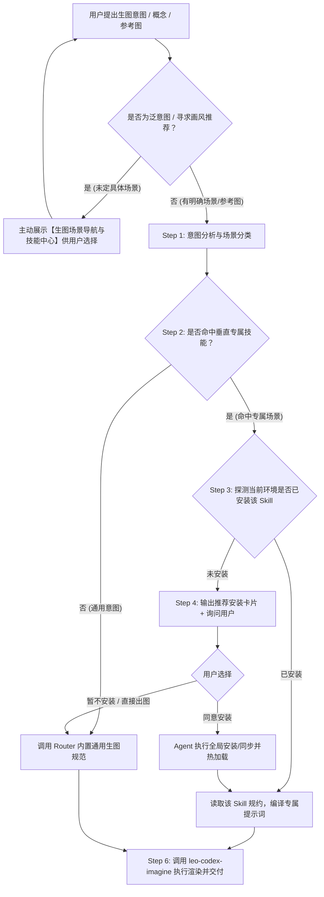

# Leo Imagine Router (AI 生图场景智能路由与技能调度中心)

## 📖 核心定位
`leo-imagine-router` 是一个轻量级、去中心化的 **AI 生图场景智能路由器与 JIT（Just-In-Time 即时能力）调度管家**。

它解决的核心问题：
1. **主动场景导航与探索交互**：在用户提出模糊需求或尚未确定 Prompt 前，主动呈现结构化场景目录，让用户自由挑选或激发创意灵感。
2. **场景与风格智能匹配**：避免所有画风杂揉在一个大 Prompt 中造成规则污染。根据用户意图精准路由至最专业的垂直技能。
3. **解耦生态，避免硬编码**：不强行复制代码或硬编码本地路径，按 Skill 标识符进行动态探测；下游技能更新，Router 自动享受最新特性。
4. **缺失技能引导与交互式安装**：当识别到最佳专属 Skill 但本地未安装时，向用户提供 GitHub 来源与安装命令；在获得用户授权后，直接代劳全局安装并无缝接力生成。
5. **服务永不中断（优雅降级）**：内置通用高质量提示词工程基准规范与案例库，确保即使未安装任何垂直扩展技能，也能产出极高水准的提示词与画面。

---

## 🧭 工作流概览 (Workflow Pipeline)



---

## 💡 主动场景探索与导航交互 (Scenario Discovery & Navigation)

当用户满足以下任一条件时，Agent **必须首先主动向用户展示全景技能目录卡片**：
- 用户调用 `/leo-imagine-router` 但尚未提供具体的图片或描述；
- 用户询问“你能做什么”、“支持哪些画风/场景”、“我想做张图有什么推荐”；
- 用户上传了照片但没有说明具体想要的效果方向。

### 交互展示卡片模板
```markdown
🎨 **Leo Imagine Router 生图场景导航与技能中心**

目前已深度整合以下专精场景 Skill，您可以直接回复编号、技能名称，或上传照片/描述构想：

### 📸 1. 真实生活与旅行摄影重构 (源自 gathered-scenes-zine-skill)
- **【实景拼贴 · 拾景纸刊】(`scenes-gathered-zine-v1-3`)**：**真景为锚**。保留照片核心主体，手撕纤维毛边过渡，背景抽象为网点线描印刷场，高纯度单色块，打字机微缩文字。（最适合：旅行、建筑、街景、活动纪念照）
- **【影像蒸馏 · 极简插画】(`scene-distillation-zine-v1-3`)**：**不保留原摄影像素**。提炼人物关系与情绪隐喻，转译为高雅文学性的独立极简插画海报，支持`单色块模式`。（最适合：想把照片画成画、情感表达）
- **【莫兰迪电影摄影海报】(`morandi-cinematic-poster-zeejay`)**：**原片锁定不重绘**。莫兰迪纸张与克制油墨，5大电影排版构型 + 虚构演职员表（Billing Block），秒变大片剧照海报。（最适合：建筑、街头、人像摄影）
- **【拾景实况动效】(`scenes-gathered-zine-live-flow-v1-0`)**：在海报基础上增加揭开手撕纸的动态撕纸效果，生成 Apple Live Photo（JPG+MOV）。

### 📰 2. 当代编辑部单色/双色印刷 (源自 mono-color-skill)
- **【单色/受控双色印刷海报】(`mono-color`)**：严格限制 1~2 块印刷油墨版（主墨 70%–85% + 辅墨 15%–30%，如钴蓝+陶土橙、薄荷绿+炭黑），机械网点（Halftone）与孔版颗粒（Risograph），自适应中性纸基，25%–55% 大面积留白，5x 字阶跳跃排版。（最适合：文化/活动海报、单曲/黑胶封面、小红书高格调封面、商品贴纸、短句/诗歌排版）

### 🖼️ 3. 摄影双联画与抽象记忆面板 (源自 photo-abstract-editorial)
- **【摄影双联画 · 抽象记忆面板】(`photo-abstract-editorial`)**：**原片绝对锁定不改写**，下方无缝拼接纯净象牙白抽象面板（#F3F0E8），提取照片中真实可追溯的几何母题/轴线/群像墨点，65%–80% 大面积留白，搭配信达雅英文衬线诗意标题。（最适合：文艺旅行摄影、建筑光影、艺术双联海报、画廊展签感作品）

### 🌌 4. 概念创意与视觉叙事
- **【双重曝光剪影海报】(`narrative-silhouette-prompt-generator`)**：70% 主体人物/动物剪影轮廓内嵌微缩深邃宇宙、故事隐喻与电影光影。（最适合：科幻、人物传记、思想隐喻海报）

### 🛡️ 5. 通用高品质与功能出图 (内置兜底引擎)
- **【通用出图 / 架构图 / 商业封面 / 局部修图】(`built-in-fallback`)**：严格遵循 6 槽位结构（用途/主体/场景/风格/构图/约束），防过度加料，局部图生图严格声明范围。

### 🚀 6. 规划中专精画风 (持续扩展中)
- **【新国风写意水墨】(`leo-chinese-ink-generator`)**：泼墨山水、工笔留白、仙侠古风。
- **【3D 盲盒/黏土微缩】(`leo-isometric-clay-generator`)**：潮玩手办、黏土质感、等距微缩。
- **【赛博朋克科幻机甲】(`leo-cyberpunk-concept-generator`)**：未来都市、重型机甲、废土霓虹。
```

---

## 🗂️ 场景路由矩阵 (Scene Routing Table)

| 场景分类 | 核心风格特征 / 触发词 | 目标 Skill 标识符 | 推荐来源 / 安装命令 |
| :--- | :--- | :--- | :--- |
| **实景拼贴 · 拾景纸刊** | 照片拼贴、拾景、手撕纤维纸边、真景为锚、插画成场、大色块结构、打字机微缩字 | `scenes-gathered-zine-v1-3` | `Zeejay0/gathered-scenes-zine-skill` (`npx skills add Zeejay0/gathered-scenes-zine-skill -g`) |
| **影像蒸馏 · 极简插画** | 影像蒸馏、不保留原图、情感隐喻、极简艺术插画、艺术命题、单色块模式 | `scene-distillation-zine-v1-3` | `Zeejay0/gathered-scenes-zine-skill` (`npx skills add Zeejay0/gathered-scenes-zine-skill -g`) |
| **莫兰迪电影摄影海报** | 莫兰迪、电影海报、摄影大片、5大排版构型、演职员表(Billing Block)、原图锁定排版 | `morandi-cinematic-poster-zeejay` | `Zeejay0/gathered-scenes-zine-skill` (`npx skills add Zeejay0/gathered-scenes-zine-skill -g`) |
| **拾景实况动效海报** | 拾景实况、Live Photo、实况照片、平铺手撕纸揭开动效、Apple Live Photo ZIP | `scenes-gathered-zine-live-flow-v1-0` | `Zeejay0/gathered-scenes-zine-skill` (`npx skills add Zeejay0/gathered-scenes-zine-skill -g`) |
| **单色/双色编辑印刷** | 单色海报、受控双色、孔版印刷、Risograph、网点照片(Halftone)、独立Zine、黑胶封套 | `mono-color` | `yanliudesign/mono-color-skill` (`npx skills add yanliudesign/mono-color-skill -g`) |
| **摄影双联抽象面板** | 摄影双联画、抽象记忆面板、原片锁定+抽象面板、Diptych、象牙白画廊展签、诗意衬线标题 | `photo-abstract-editorial` | `ZzzLc0405/photo-abstract-editorial` (`npx skills add ZzzLc0405/photo-abstract-editorial -g`) |
| **双重曝光剪影海报** | 剪影、海报、双重曝光、隐喻、叙事感、电影感人物轮廓 | `narrative-silhouette-prompt-generator` | `npx skills add zlpawn/narrative-silhouette-prompt-generator -g` |
| **新国风写意水墨** | 水墨、泼墨、工笔、仙侠、古风、国潮东方韵味 | `leo-chinese-ink-generator` (规划中) | 对应仓库源 / 提示开发中 |
| **3D 盲盒/黏土微缩** | 黏土、盲盒、潮玩、微缩景观、Isometric、3D 渲染 | `leo-isometric-clay-generator` (规划中) | 对应仓库源 / 提示开发中 |
| **赛博朋克科幻机甲** | 赛博朋克、未来城市、机甲、废土科幻、霓虹光影 | `leo-cyberpunk-concept-generator` (规划中) | 对应仓库源 / 提示开发中 |
| **通用高质量出图** | 未匹配到上述特定风格的常规文生图、信息图、封面、修图 | `built-in-fallback` | 遵循内置 `references/prompting.md`，无需外部安装 |

---

## 🔍 Step 1: 意图分析与场景分类

当用户输入一个概念或提供一张参考图时：
1. **提取核心诉求**：判断用户想要的是“摄影照片二创/纸刊”、“故事隐喻海报”、“特定艺术流派”还是“通用/写实/功能图”。
2. **场景映射**：比对【场景路由矩阵】，找出匹配度最高的专属 Skill。

---

## ⚡ Step 2 & 3: 运行期动态探测 (Runtime Detection)

在决定使用某个专属 Skill 前，Agent **仅通过标准规范路径动态探测当前环境**，严禁硬编码任何个人主机物理路径：
1. **上下文技能池**：检查 Agent 上下文中的 `Available skills:` 列表；
2. **标准中央技能库**：
   - macOS / Linux: `~/.agents/skills/<skill-name>`
   - Windows: `%USERPROFILE%\.agents\skills\<skill-name>`
3. **平台全局技能配置**：
   - `~/.gemini/config/skills/<skill-name>`（通常以软链形式指向中央库）
4. **当前工作区相对目录**：
   - `./lib/skills/<skill-name>` 或 `./.agents/skills/<skill-name>`

- **状态 A（已安装/已就绪）**：直接读取该 Skill 的 `SKILL.md`，执行其完整的提示词编译规约。
- **状态 B（未安装）**：进入 **Step 4 引导安装流程**。

---

## 📦 Step 4: 缺失技能引导与交互式安装规范 (JIT Installation Protocol)

当命中专属场景但本地完全缺失时，Agent **不得直接报错报错终止**，按以下固定模板回复用户：

### 引导回复模板
```text
💡 **场景推荐**：您描述的场景非常适合使用专精技能 **【<Skill Name>】**（<一句话特性介绍>）。

当前检测到您的环境中尚未安装该专属技能：
* **开源地址**：<GitHub Repo URL>
* **标准命令**：`npx skills add <repo> -g`

**请问是否需要我直接帮您全局安装此技能？**
* 您可以回复 **“安装”**，我将为您自动完成下载与配置，并立即呈现极致出图效果；
* 您也可以回复 **“直接出图”**，我将立即使用通用高质量引擎为您生成当前需求。
```

### 用户同意安装后的处理流程
当用户明确回复“安装”、“同意”、“帮我装”后：
1. **执行标准安装**：Agent 调用命令将该 Skill 下载/同步至统一中央技能目录 `~/.agents/skills/<skill-name>`：
   - 执行官方 CLI 安装命令：`npx skills add <repo> -g`；
   - 或通过 Git 克隆：`git clone <repo_url> "$HOME/.agents/skills/<skill-name>"`；
2. **确认生效**：验证 `~/.agents/skills/<skill-name>/SKILL.md` 存在。
3. **无缝执行**：安装完成后，**无需用户重复输入概念**，立即使用新安装的 Skill 规范输出生图提示词并完成图片渲染。

---

## 🛡️ Step 5: 内置通用生图规则（优雅降级兜底 Fallback）

当用户未命中特定专属场景（如常规文生图、技术架构图、封面图、局部重绘编辑），或在引导提示后选择“直接出图”时，严格遵循本 Skill 内置的通用规范构造 Prompt：
* **核心规范**：参考 [`references/prompting.md`](references/prompting.md)（防过度加料、中英文双引号防乱码、局部修改保留范围声明，以及通用的“用途/主体/场景/风格/构图/约束”6 槽位结构）。
* **场景案例模板**：参考 [`references/sample-prompts.md`](references/sample-prompts.md)（架构与技术信息图、概念插画与商业海报、参考图局部编辑）。

---

## 🎨 Step 6: 生图执行与回传规范

在生成提示词后，若当前环境具备生图工具或引擎（优先推荐 `leo-codex-imagine`）：
1. 自动调用底层生图引擎执行渲染：
   ```bash
   node ~/.agents/skills/leo-codex-imagine/scripts/leo_codex_imagine.mjs \
     --prompt "<Compiled Prompt>" \
     --images "<Reference Image Path (if any)>" \
     --aspect-ratio "3:4"
   ```
2. 无论成功与否，必须将生成的提示词（结构化中文与英文 Prompt）清晰展示给用户；
3. 图片渲染成功后，以标准的 Markdown 格式输出可点击的文件链接与图片预览：
   ```markdown
   
   *原图文件：[image.png](file:///path/to/image.png)*
   ```
