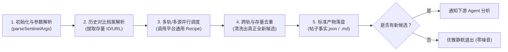

# Leo Lantern 垂直业务哨兵开发体系 (Sentinels Architecture)

本目录为 `leo-lantern` 技能的**上层业务哨兵专区（Vertical Sentinels）**。用于承载各类面向特定业务、周期性巡检（Sidecar / Cron）或事件触发的情报监控脚本。

## 架构分层

```text
leo-lantern/
├── scripts/cli/                     # 1. 最底层：CDP 原生浏览器原子操作 (goto, click, eval, cookies...)
├── recipes/                         # 2. 中间层：通用平台事实采集与发布配方 (x-source, github-source, bilibili...)
└── recipes/sentinels/               # 3. 顶层：垂直业务巡检哨兵体系 (Sentinels)
    ├── lib/
    │   └── sentinel-base.mjs        # 哨兵通用基底（状态对比、跨轨去重、静默控制、标准产物）
    ├── x-promo-sentinel.mjs         # 实例：大模型 AI 羊毛与官方促销双轨哨兵
    └── README.md                    # 本开发与扩展规范
```

---

## 哨兵核心生命周期

所有基于 `sentinel-base.mjs` 构建的哨兵自动具备以下标准闭环：



---

## 如何接入一个全新的垂直哨兵？（3 步极速模板）

只需在 `recipes/sentinels/` 下新建一个脚本（如 `github-ai-sentinel.mjs`），借助 `runSentinel` 声明业务逻辑即可，无需编写复杂的去重与文件操作：

```javascript
#!/usr/bin/env node
import { runSentinel } from "./lib/sentinel-base.mjs";

runSentinel({
  name: "GitHub Trending AI 新星项目哨兵",
  defaultArchive: "/Users/user/素材/GitHub/AI趋势汇总.md",
  defaultOut: "/Users/user/素材/GitHub/trending-latest",
  defaultLimit: 10,
  
  // 1. 历史档案去重正则（提取已收录的 GitHub 仓库全名）
  idExtractorRegex: /https:\/\/github\.com\/([a-zA-Z0-9_\-\.]+\/[a-zA-Z0-9_\-\.]+)/g,
  
  // 2. 采集项唯一标识提取
  idGetter: (item) => item.repoName || item.url,
  
  // 3. 声明本次巡检要跑的轨道/平台
  resolveTracks: (options) => [
    {
      name: "Python 热门 AI 库",
      recipe: "recipes/github-source.mjs",
      args: { mode: "trending", language: "python", limit: options.limit }
    },
    {
      name: "TypeScript 智能体项目",
      recipe: "recipes/github-source.mjs",
      args: { mode: "trending", language: "typescript", limit: options.limit }
    }
  ]
}).catch(console.error);
```

---

## 标准命令行参数支持

每个哨兵脚本默认自动继承以下标准 CLI 参数：

| 参数 | 简写 | 默认值 | 说明 |
| :--- | :--- | :--- | :--- |
| `--archive` | `-a` | 哨兵定义默认值 | 历史对比档案路径，用于增量去重 |
| `--limit` | `-n` | `8` | 单轨抓取数量上限 |
| `--out` | `-o` | 哨兵定义默认值 | 产物目录（输出 `帖子事实.json` 与 `.md`） |
| `--skip-media` | - | `true` | 是否跳过大文件多媒体下载以提升巡检速度 |
| `--json` | - | `false` | 终端是否仅输出结构化 JSON 元数据 |
| `--type` | `-t` | `latest` | 搜索流模式（`latest` 或 `top`） |
