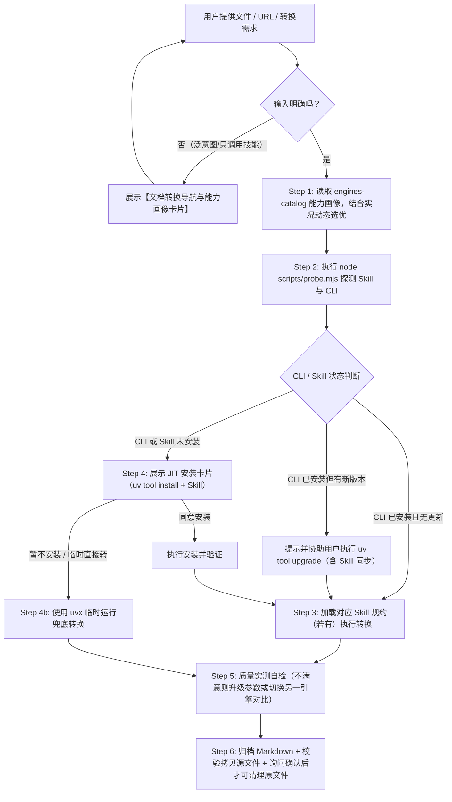

# Leo MD Router（文档转 Markdown 质量优先路由与归档中心）

## 📖 核心定位

`leo-md-router` 是面向文档解析与转 Markdown 场景的**动态质量优先路由器与工具调度管家**，首批纳管 **`docling`** 与 **`markitdown`**。

核心原则：
1. **产出效果第一优先级（基于能力画像动态决策，而非死板硬编码）**：不搞“某个后缀只能走某一个工具”的僵化路由表，而是由 Agent 结合**文件实际结构复杂度、用户下游用途、以及各引擎能力画像**综合研判；转换后若实测效果不佳，主动切换管线或交叉对比，交付质量更好的一版；
2. **解耦调度与版本守护**：运行期自动探测下游 Skill 与 CLI（`docling` / `markitdown`）是否就绪；已安装直接用，检测到新版协助更新，未安装引导确认（`uv tool install` + Skill）或走 `uvx` 临时兜底；
3. **统一归档与删除强确认**：默认归档到 `~/素材/md/`，源文件先校验拷贝至归档目录留底；**不管源文件在哪个目录，清理/删除原文件前都必须经过用户明确确认**。

---

## 🧭 工作流概览



---

## 💡 主动导航卡片（输入不明确时触发）

当用户仅触发 `/leo-md-router` 未提供文件或目标，或询问“支持哪些格式 / 用哪个工具更好”时，展示如下卡片：

```markdown
📄 **Leo MD Router 文档转 Markdown 智能路由中心**

请直接发送 **文件路径 / 文件夹 / URL**（可附带目标用途），我将以 **产出效果第一优先级** 动态评估并为您匹配最佳引擎：

1. **结构与版面精解析 (`docling`)** — 擅长版面分析、多栏阅读顺序、复杂表格、扫描件 OCR / VLM、公式、音视频 ASR，以及结构化 JSON / RAG 分块。
2. **轻量多格式与文本流 (`markitdown`)** — 擅长 `.epub` / `.msg` / `.zip` / `.ipynb` / YouTube 字幕、HTML 与轻量文本型文档的快速干净转换。

默认输出目录：`~/素材/md/<分类>/YYYY-MM-DD/<文档名>/`（源文件会先拷贝归档；如需删除原文件，每次均会单独征求您的同意）。
```

---

## 🗂️ Step 1：能力画像与动态选优（非硬编码）

读取 [`references/engines-catalog.md`](references/engines-catalog.md) 获取当前已纳管引擎的能力边界。**严禁因为某个引擎“已安装”或“更轻量”而降低质量标准**，也不要机械套用“后缀 → 工具”的死规则，而是按以下三个维度动态判断谁能产出最好的结果：

1. **看文档复杂度（决定是否需要版面/视觉理解）**：
   - 若文档包含**多栏排版、密集或合并单元格表格、扫描图片、数学公式、图文混排**，需要版面分析和视觉/OCR 还原 → 首选 **`docling`**（哪怕本地尚未安装，也优先推荐引导安装或 `uvx` 临时运行）；
   - 若文档结构扁平清晰（纯文本流、简单网页 HTML、电子书章节、邮件正文、代码 Notebook）或属于专属强项格式（如 `.epub` / `.msg` / `.zip` 递归 / YouTube 字幕）→ 首选 **`markitdown`**。
2. **看下游任务诉求**：
   - 需要无损 JSON、表格导出 DataFrame/CSV、RAG 标题层级分块或结构化字段抽取 → 选 **`docling`**；
   - 仅需一份简洁、无多余结构标签的纯阅读 Markdown（且文档不含复杂排版）→ **`markitdown`** 往往更干净利落。
3. **边界模糊时实测对比（经验判断可随时被实测推翻）**：
   - 遇到难判断谁更好的复杂 DOCX / PPTX / XLSX / HTML，若两个引擎均可用，允许**双跑对比或先试再切**——如果首选结果出现表格错乱、丢失层级、多栏串行或大段冗余噪声，**立即切换另一引擎或升级管线重转，只保留质量更优的版本交付**。

---

## ⚡ Step 2：运行期探测与版本检查

在调用任何引擎前，执行探测脚本查看本地 Skill、CLI 安装状态及版本情况：

```bash
# 快速探测本地 Skill 与 CLI 状态
node scripts/probe.mjs

# 需要检查是否有新版本可升级时（联网查 PyPI）
node scripts/probe.mjs --check-updates
```

探测逻辑覆盖：
1. **Skill 路径**：`Available skills:`、`~/.agents/skills/<name>/SKILL.md`、`~/.gemini/config/skills/<name>/SKILL.md`、`~/.claude/skills/<name>/SKILL.md`、工作区 `./.agents/skills/<name>/SKILL.md` 与 `./lib/skills/<name>/SKILL.md`；
2. **CLI 路径与版本**：`docling --version` / `markitdown --version` 与 `uv tool list`。

---

## 📦 Step 3 & 4：调度、更新与 JIT 安装协议

查阅 [`references/engines-catalog.md`](references/engines-catalog.md) 获取准确参数与命令后，按探测结果分流：

### 状态 A：CLI 已安装，且 Skill 就绪（或无需独立 Skill）
- **版本更新检查**：若发现 `updateAvailable === true`（或用户要求检查更新），主动提示用户新旧版本信息，经同意后执行：
  - `docling`：`uv tool upgrade docling`（升级后如包内自带 Skill 有变化，同步更新 `~/.agents/skills/docling`）
  - `markitdown`：`uv tool upgrade markitdown`
- **直接执行**：若目标引擎有已安装的独立 `SKILL.md`（如 `docling`），读取其 `SKILL.md` 与对应 reference 规约执行转换。

### 状态 B：CLI 或 Skill 缺失 → JIT 安装引导（不得直接报错退出）
向用户输出标准推荐卡片并等待确认：

```text
💡 **引擎推荐**：综合当前文件特征与产出质量考量，建议使用 **【<docling / markitdown>】**（<具体原因>）。

当前检测到环境缺失：
* **CLI 工具**：<已安装 / 未安装>（安装命令：`<uv tool install ...>`）
* **对应 Skill**：<已安装 / 未安装>（<Skill 来源说明>）
* **体量提示**：<例如：docling 完整版含 PyTorch 与本地模型，体积较大；markitdown 极轻量>

**请问您希望如何处理？**
* 回复 **“安装”**：我将为您执行 `uv tool install ...` 并同步配置对应 Skill 后立即转换；
* 回复 **“直接转”**：暂不全局安装，我将直接使用 `uvx` 临时环境为您完成转换。
```

- 用户回复 **“安装”** → 执行 `uv tool install docling`（或 `uv tool install "markitdown[all]"`）及对应 Skill 安装，验证可用后立即转换。
- 用户回复 **“直接转”** → 使用 `uvx` 临时运行兜底命令完成转换。

---

## 🔍 Step 5：产出质量实检与双引擎交叉对比

转换完成后，Agent **必须实检输出的 Markdown 文件**（逐项核对：① 内容完整性与页数/章节有无截断；② 表格是否保留完整 Markdown 表格结构；③ 多栏阅读顺序是否连贯；④ 公式、代码块与中文字符有无乱码或缺失）：
1. **PDF 近空 / 大量 `` / 疑似扫描件 / 公式与复杂排版失真**：使用 `docling` 重试并开启 OCR（macOS 可优先尝试 `--ocr-engine ocrmac`）或升级到 `--pipeline vlm`；
2. **表格散架、层级丢失、分栏串行或正文残缺**：切换另一引擎（或调整参数）再跑一次做效果对比，**只保留质量最好的那一份交付**，不留半成品垃圾文件。

---

## 💾 Step 6：存储归档与源文件删除强确认规范

遵循 Shrimp 生态规范，配置文件位于 `~/.shrimp/skills/leo-md-router/config.json`，通过 `scripts/config.mjs` 管理：

### 1. 目录结构（默认根目录：`~/素材/md/`）
```text
~/素材/md/<场景或来源分类>/YYYY-MM-DD/<文档名>/
├── <文档名>_<引擎>_<时间戳>.md
├── source/                     # 归档的源文件副本
│   └── <原文件名>
└── ...                         # （可选）JSON / 抽取图片等附属产物
```

### 2. 三级输出目录解析
1. **用户显式指定**：立即采用；若用户希望长期记住该目录，执行 `node scripts/config.mjs set --dir "<path>"`；
2. **持久化配置**：读取 `~/.shrimp/skills/leo-md-router/config.json` 中的 `output_dir`（默认 `~/素材/md`）；
3. **默认兜底**：`~/素材/md`。

### 3. 源文件归档与删除强确认原则（强制红线）
> [!CAUTION]
> **无论源文件位于任何目录（包括桌面、`~/Downloads`、`/tmp` 或项目目录），在删除原文件前都必须先完成拷贝校验，并显式向用户请求确认；未经用户明确同意，严禁删除任何源文件！**

两阶段执行流程：
1. **第一阶段（仅拷贝留底）**：执行 `node scripts/config.mjs archive-source --src "<源文件>" --dest-dir "<docDir>"`（默认 `copy` 策略；即便是 `move` 策略，在未传 `--confirm-delete` 时也只会安全拷贝并校验大小，绝不删原文件）；
2. **第二阶段（用户同意后再清理）**：交付转换结果时，列出原文件路径与已校验的归档副本路径，询问用户“是否需要清理/删除原位置的文件？”。**只有收到用户明确回复同意后**，才执行：
   ```bash
   node scripts/config.mjs delete-original --src "<源文件>" --archived "<归档副本路径>" --confirm-delete
   ```

### 4. 交付格式
转换与归档完成后，向用户汇报：
- 选用的引擎及动态决策理由（若经过交叉对比，说明为何选用最终版本）；
- 输出 Markdown 的可点击链接 `[filename.md](file:///...)`；
- 源文件归档路径 `[source](file:///...)`，并（如有清理需求）**询问是否同意删除原文件 `<原路径>`**；
- 关键质量摘要（如页数、是否触发 OCR/VLM、表格与图片还原情况）。
