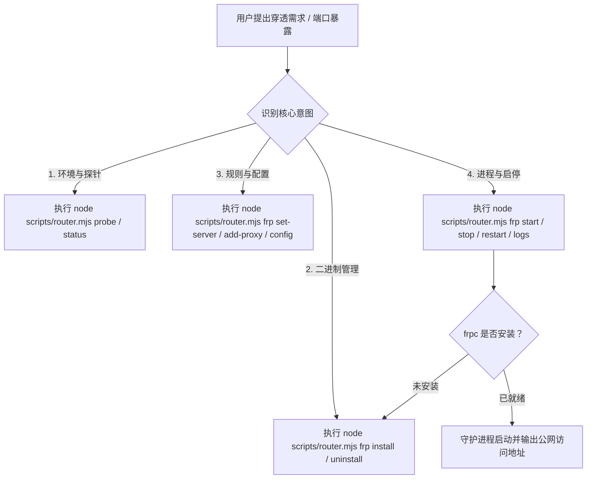

# Leo NAT Traversal Router（内网穿透智能路由中枢）

## 📖 核心定位

`leo-nat-traversal-router` 是面向**跨网访问、本地服务公网暴露与远程协作**的可插拔内网穿透调度中枢：
* **首期核心引擎**：**`frp`**（基于 Go 的高性能 TCP/UDP/HTTP 反向代理，支持自建 VPS 穿透与任意高端口映射）；
* **高扩展开放架构**：独立 Provider 插件机制，未来平滑扩展 `cloudflare`（Zero Trust 隧道）等；
* **极简免维护部署**：二进制优先落地 `~/.local/bin/frpc`，零系统污染，随时一键干净卸载；
* **凭据与运行沙箱隔离**：多工具按命名空间分层隔离（`providers/<tool>/`），数据目录完全可配置（支持 `--data-dir`、`LEO_NAT_DATA_DIR` 环境变量或默认目录），Token 敏感鉴权自动隔离。

---

## 🧭 极简路由工作流



---

## 💡 主动导航卡片（输入不明确时触发）

当用户未指定具体参数或仅触发本技能时，展示本卡片：

```markdown
🌐 **Leo NAT Traversal Router（内网穿透路由中心）**

请告诉我您的需求，我将为您全自动编排穿透服务：
1. **查看状态** — 检查当前 frpc 运行状态与已配置的穿透规则
2. **暴露本地端口** — 例如：“把本地 8080 端口通过 frp 映射到公网”
3. **配置服务器** — 设置公网 frps 节点的 IP、端口与安全 Token
4. **管理软件** — 安装、更新或彻底卸载 ~/.local/bin/frpc
```

---

## 🎯 场景与操作对照表

所有底层操作统一经由 `scripts/router.mjs` 调度：

### 1. 探针与环境管理
* **状态总览与探针**：`node scripts/router.mjs probe`
* **检查新版本**：`node scripts/router.mjs frp check-update`
* **安装 / 更新 frpc**：`node scripts/router.mjs frp install` / `node scripts/router.mjs frp update`
* **安全卸载 frpc**：`node scripts/router.mjs frp uninstall`

### 2. 规则与配置管理
* **配置公网服务器**：
  ```bash
  node scripts/router.mjs frp set-server --addr="<VPS_IP>" --port=7000 --token="<TOKEN>"
  ```
* **添加端口映射**（先检后配）：
  ```bash
  node scripts/router.mjs check-port --port=<LOCAL_PORT>
  node scripts/router.mjs frp add-proxy --name="<NAME>" --port=<LOCAL_PORT> --remote=<REMOTE_PORT> --type="tcp"
  ```
* **查看公开配置**：`node scripts/router.mjs frp config`
* **删除端口映射**：`node scripts/router.mjs frp remove-proxy --name="<NAME>"`

### 3. 运行监管与观测
* **启动穿透**：`node scripts/router.mjs frp start`
* **停止穿透**：`node scripts/router.mjs frp stop`
* **重启穿透**：`node scripts/router.mjs frp restart`
* **查看实时日志**：`node scripts/router.mjs frp logs --lines=30`

---

## 📚 深度参考与扩展

- **选型与决策矩阵**：详见 [`references/routing-matrix.md`](references/routing-matrix.md)
- **FRP 进阶配置与故障排查**：详见 [`references/providers/frp.md`](references/providers/frp.md)
