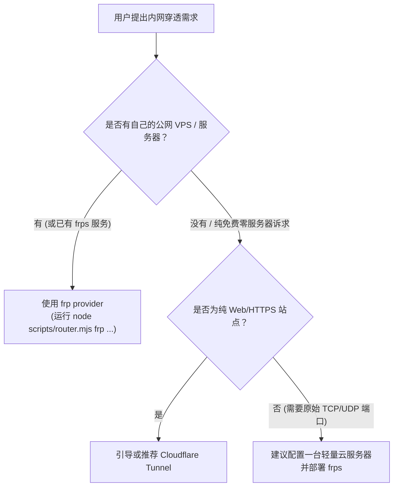

# 内网穿透技术选型与路由矩阵 (Routing Matrix)

在面对用户的内网穿透需求时，优先结合用户的**网络环境、有无公网 IP 服务器、协议类型与安全诉求**进行技术选型路由：

| 方案 | 适用场景 | 核心优势 | 依赖与限制 | 状态 |
| :--- | :--- | :--- | :--- | :--- |
| **`frp` (首选)** | • 自建 VPS / 私有云服务器 • TCP / UDP / 自定义高端口映射 • SSH、本地数据库、游戏联机 • 本地 Web 服务穿透 | • 高性能低延迟，Go 原生单文件 • 支持灵活的端口映射规则 • 支持点对点直连（STCP / XTCP） | 需要一台拥有独立公网 IP 的服务器运行 `frps` | ✅ 生产就绪 (v1.0) |
| **`cloudflare` (规划中)** | • 零公网 VPS 设备 • 纯 Web / HTTPS 服务快速对外暴露 • 需要全球 CDN 加速与 WAF 防护 | • 零服务器成本（免费版即可） • 自动配置权威机构 HTTPS 证书 • 隐藏源站 IP，抗 DDoS | 仅主要适合 HTTP/HTTPS 流量，部分非标端口需额外客户端支持 | ⏳ 规划集成 (v2.0) |

---

## 决策树指引

