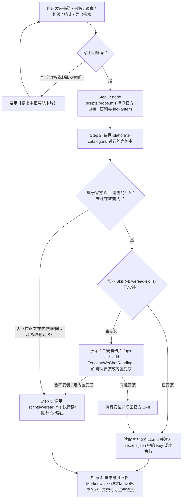

# Leo Novel Router（跨平台读书、官方 Skill 路由与划线归档中枢）

## 📖 核心定位

`leo-novel-router` 是面向多读书平台的**阅读交互、官方 Skill 调度、划线同步与笔记归档路由器**（B 模式：官方平台 Skill 优先 + 内置引擎补齐正文与写操作；本期重点打通 **微信读书 `weread.qq.com`**）。

核心能力闭环：
1. **官方 Skill 调度（如微信读书 `Tencent/WeChatReading` / `weread-skills`）**：
   - 自动探测本地是否已安装目标平台官方 Skill；若缺失则主动提示安装命令（如 `npx skills add Tencent/WeChatReading -g`），经用户确认后安装并交接调度；
   - 自动读取 `~/.shrimp/skills/leo-novel-router/secrets.json` 中的 `weread_api_key`（或环境变量 `WEREAD_API_KEY`）注入官方网关 `https://i.weread.qq.com/api/agent/gateway`，免开浏览器完成搜书、看书架、热门划线、阅读统计、书评与推荐。
2. **拉正文进对话**：官方网关不开放图书正文原文时，由内置 `scripts/weread.mjs` + `leo-lantern` 解码章节原文拉入对话一起精读、讨论或保存到本地。
3. **书内全文精确检索**：通过 `/web/book/search` 返回精确片段与服务器偏移量。
4. **对话划线同步回网页 + 样式管理**：将对话里选定的文字精确校准偏移后同步回网页成为真实划线，支持切换样式（直线 / 马克笔 / 波浪线）、颜色以及删除划线。
5. **以书为单位导出 Markdown**：所有章节副本与划线笔记统一按书名归档到 `~/素材/novel/<书名>/` 下，同一本书的所有内容放在同一目录。

---

## 🧭 工作流概览



---

## 💡 主动导航卡片（需求模糊时展示）

当用户仅输入 `/leo-novel-router` 而未指定书链或操作时，展示以下导航：

```markdown
📚 **Leo Novel Router 跨平台读书与划线中枢**

当前已接入 **微信读书 (`weread.qq.com`)** 双通道（官方 `weread-skills` + 内置浏览器正文/划线引擎）。您可以直接告诉我：
1. **搜书 / 看书架 / 阅读统计**：搜书城好书、查我的书架、看阅读时长与热门划线（优先调度官方 `weread-skills`）；
2. **拉章节进对话**：贴入书籍链接或书名，把第 X 章正文拉进对话一起精读、拆解；
3. **书内搜词定位**：检索全书里包含某个关键词的段落与出处；
4. **同步划线与改样式**：把对话里看中的句子同步划线到微信读书（支持直线/马克笔/波浪线与颜色切换、删除划线）；
5. **导出划线笔记**：按章节汇总整本书的划线与想法，导出为 Markdown 到 `~/素材/novel/<书名>/`。
```

---

## ⚡ Step 1：运行期探测与密钥检查

执行探测脚本确认官方 Skill、`secrets.json` 密钥及 `leo-lantern` 状态：

```bash
node scripts/probe.mjs
```

- **密钥管理**：微信读书官方网关 API Key（`wrk-...`）保存在 `~/.shrimp/skills/leo-novel-router/secrets.json`（权限 `0o600`，**严禁写入仓库 `config.json` 或代码**）：
  ```bash
  node scripts/config.mjs secrets status
  node scripts/config.mjs secrets set --weread-api-key "wrk-xxxxxxxx"
  ```
- **运行态提示**：
  - 若走官方 `weread-skills` 时未配置 Key，提示用户前往 `https://weread.qq.com/r/weread-skills` 扫码获取并使用 `config.mjs secrets set` 写入；
  - 若走内置浏览器引擎 `scripts/weread.mjs` 返回 `login_required`，提示用户在 Chrome 打开 `https://weread.qq.com/` 扫码登录后重试。

---

## 🧭 Step 2：官方 Skill 路由与 JIT 安装引导

参考 [`references/platforms-catalog.md`](references/platforms-catalog.md)：

### 1. 官方 Skill 已安装时（调度官方 Skill）
- 微信读书官方 Skill 安装后通常位于 `~/.agents/skills/weread-skills/SKILL.md`（或 `~/.gemini/config/skills/weread-skills/SKILL.md`）。
- 调度前读取官方 `SKILL.md` 与对应子文档（`search.md` / `shelf.md` / `book.md` / `notes.md` / `readdata.md` / `review.md` / `discover.md`），执行命令时从 `~/.shrimp/skills/leo-novel-router/secrets.json` 读取 `weread_api_key` 注入环境变量 `WEREAD_API_KEY`（无需在终端历史中明文暴露）：
  ```bash
  export WEREAD_API_KEY="$(node -e 'const fs=require("fs"),p=require("path").join(process.env.HOME,".shrimp/skills/leo-novel-router/secrets.json");console.log(JSON.parse(fs.readFileSync(p,"utf8")).weread_api_key||"")')"
  ```

### 2. 官方 Skill 缺失时（JIT 安装推荐卡片，不得直接报错退出）
当用户请求适合由官方 Skill 处理的能力（如书城搜书、阅读统计、热门划线、推荐、书评，或未开浏览器查书架/导出），而 `probe.mjs` 显示 `platforms.weread.externalSkillInstalled === false` 时，向用户展示如下引导卡片并等待确认：

```text
💡 **官方平台 Skill 推荐**：当前请求适合由微信读书官方 Skill **【weread-skills】**（`Tencent/WeChatReading`）直接走官方 API 网关处理（无需打开浏览器，支持搜书、书架、笔记、热门划线、阅读统计与推荐）。

检测到本地尚未安装该官方 Skill：
* **安装命令**：`npx skills add Tencent/WeChatReading -g`
* **API Key 状态**：<已配置 ~/.shrimp/skills/leo-novel-router/secrets.json / 未配置>

**请问您希望如何处理？**
* 回复 **“安装”**：我将为您执行 `npx skills add Tencent/WeChatReading -g` 后立即调度官方 Skill 执行；
* 回复 **“用内置引擎”**：暂不下载官方 Skill，由内置浏览器引擎（`scripts/weread.mjs`）继续处理（注：书城推荐与阅读时长统计仅官方 Skill 支持）。
```

- 用户回复 **“安装”** → 执行 `npx skills add Tencent/WeChatReading -g`，确认生效后立即调度官方 `weread-skills`；
- 用户回复 **“用内置引擎”** → 走 Step 3 内置 `scripts/weread.mjs`（覆盖范围：书架、目录、拉正文、书内搜索、划线增删改、导出 Markdown）。

---

## 📖 Step 3：内置浏览器引擎操作指令（`scripts/weread.mjs`）

针对官方网关未提供的**正文阅读、书内偏移搜索、同步/修改/删除划线**，调用内置 `scripts/weread.mjs`（自动管理隔离窗口，用完清理，不干扰用户当前浏览）：

```bash
# 1. 查看书架（支持 --query 关键词过滤）
node scripts/weread.mjs shelf [--query "叔本华"]

# 2. 查看书籍目录与元数据
node scripts/weread.mjs toc --book "https://weread.qq.com/web/reader/b63327207183c09db6382cf"

# 3. 拉取指定章节正文（--chapter 可传序号/chapterUid/标题关键词；加 --save 落盘至 <书名>/chapters/）
node scripts/weread.mjs read --book "<url_or_hash>" --chapter "辩论三十八计" [--save] [--dir "<output_dir>"]

# 4. 书内全文检索
node scripts/weread.mjs search --book "<url_or_hash>" --keyword "火上浇油" [--count 10]

# 5. 查看已有划线（可选按 --chapter 过滤）
node scripts/weread.mjs bookmarks --book "<url_or_hash>" [--chapter 10]

# 6. 将指定文字同步划线到网页（style: 0=直线 1=马克笔 2=波浪线；color: 1..5）
node scripts/weread.mjs highlight --book "<url_or_hash>" --text "第27计 Provocation ausbauen 火上浇油" [--chapter 10] [--style 0] [--color 5]

# 7. 修改已有划线样式/颜色
node scripts/weread.mjs update-highlight --book "<url_or_hash>" --bookmark-id "25411741_10_15522-15578" --style 2 --color 3

# 8. 删除划线
node scripts/weread.mjs remove-highlight --book "<url_or_hash>" --bookmark-id "25411741_10_15522-15578"

# 9. 导出整本书划线与个人想法为 Markdown
node scripts/weread.mjs export --book "<url_or_hash>" [--dir "<output_dir>"] [--filename "<name>"]
```

### 执行准则
- **禁止编造正文或偏移**：只展示脚本实际拉取并解码的章节原文；找不到匹配文本时，先调用 `search` 或扩大关键词核实后再划线，绝不凭猜测写 `range`；
- **写操作回验**：执行 `highlight` / `update-highlight` / `remove-highlight` 后，确认接口返回的 `bookmarkId` 或 `succ === 1`；删除用户原有划线前需先征求确认（除非是刚产生的测试划线或用户明确指定删除）。

---

## 💾 Step 4：存储与以书为中心的目录规范

配置位于 `~/.shrimp/skills/leo-novel-router/config.json`，密钥位于 `~/.shrimp/skills/leo-novel-router/secrets.json`，均通过 `scripts/config.mjs` 管理：

```bash
node scripts/config.mjs get
node scripts/config.mjs set --dir "~/素材/novel"
```

### 三级输出目录解析
1. **用户显式指定**（`--dir`）：立即采用，若用户希望长期记住则调用 `config.mjs set --dir` 持久化；
2. **持久化配置**：读取 `~/.shrimp/skills/leo-novel-router/config.json` 中的 `output_dir`；
3. **默认兜底**：`~/素材/novel`。

### 以书为中心的分层目录结构
同一本书的所有导出笔记与章节副本统一归入 `<output_dir>/<书名>/`：

```text
~/素材/novel/
└── <书名>/
    ├── <书名>_划线笔记_<YYYYMMDD_HHmmss>.md   # export 导出的 Markdown 划线与想法汇总
    └── chapters/
        └── <000_章节名>.md                    # read --save 保存的章节正文（可选）
```

交付文件时，务必在回复中提供标准 Markdown 可点击链接 `[文件名.md](file:///绝对路径)`。
