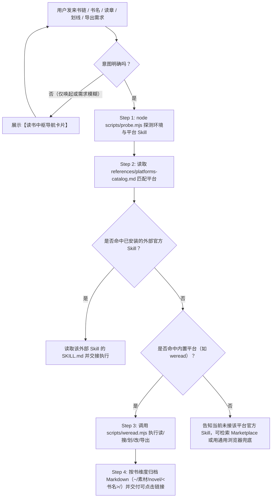

# Leo Novel Router（跨平台读书、划线同步与笔记归档中枢）

## 📖 核心定位

`leo-novel-router` 是面向多读书平台的**阅读交互、划线同步与笔记归档路由器**（B 模式：外部官方平台 Skill 优先，内置适配器开箱兜底；本期内置实装 **微信读书 `weread.qq.com`**）。

核心能力闭环：
1. **看书架与目录**：直接拉取你在平台的书架列表、书籍目录及试读/已购状态；
2. **拉正文进对话**：把指定章节内容解码为干净文本拉进当前对话陪读、提问、拆解，或落盘保存；
3. **书内全文检索**：在整本书内检索关键词片段，快速定位出处所在章节与上下文；
4. **对话划线同步回网页 + 样式管理**：你在对话中选定的句子/标题，可精确校准偏移后同步回网页端变成真实划线，并支持修改划线样式（直线 / 马克笔 / 波浪线）、颜色以及删除划线；
5. **以书为单位导出 Markdown**：所有章节副本与划线笔记统一按书名归档到 `~/素材/novel/<书名>/` 下，同一本书的所有内容放在同一目录；
6. **官方平台 Skill 路由**：识别 URL 或平台名后，先探测本地是否已安装该平台的官方/专用 Skill；若已安装则优先交接，未安装时走内置适配器（如微信读书）或提供安装/发现引导。

---

## 🧭 工作流概览



---

## 💡 主动导航卡片（需求模糊时展示）

当用户仅输入 `/leo-novel-router` 而未指定书链或操作时，展示以下导航：

```markdown
📚 **Leo Novel Router 跨平台读书与划线中枢**

当前已内置支持 **微信读书 (`weread.qq.com`)**，并支持自动路由外部官方读书 Skill。您可以直接告诉我：
1. **看书架 / 选书**：查看我的微信读书书架，或贴入任意 `https://weread.qq.com/web/reader/...` 链接；
2. **拉章节进对话**：把第 X 章正文拉出来一起读、讨论或总结；
3. **书内搜词定位**：检索全书里包含某个关键词的段落；
4. **同步划线与改样式**：把对话里看中的句子同步划线到微信读书（支持直线/马克笔/波浪线与颜色切换、删除划线）；
5. **导出划线笔记**：按章节汇总整本书的划线与想法，导出为 Markdown 到 `~/素材/novel/<书名>/`。
```

---

## ⚡ Step 1：运行期探测

执行探测脚本确认 `leo-lantern` 与外部平台 Skill 状态：

```bash
node scripts/probe.mjs
```

- 若 `lantern.cliFound === false`，提示用户先安装/启用 `leo-lantern` Skill；
- 若用户操作微信读书时返回 `login_required`，提示用户在 Chrome 打开 `https://weread.qq.com/` 完成扫码登录后重试，切勿绕过或重复硬刷。

---

## 🧭 Step 2：平台路由规约

参考 [`references/platforms-catalog.md`](references/platforms-catalog.md)：
1. **外部官方 Skill 优先**：检查 `probe.mjs` 中目标平台 `externalSkillInstalled === true`（或上下文 `Available skills:`），若存在官方/专用 Skill，读取其 `SKILL.md` 按其规约交接；
2. **内置适配器兜底**：微信读书 URL（`weread.qq.com`）或用户明确指定“微信读书”时，调用 `scripts/weread.mjs`；
3. **未支持平台**：明确告知当前一期内置仅支持微信读书，可协助检索是否有对应官方 Skill，或询问是否改用通用浏览器阅读。

---

## 📖 Step 3：微信读书操作指令（`scripts/weread.mjs`）

所有命令均自动管理隔离浏览器任务窗口（完成后清理关闭，不干扰用户当前浏览的标签页），默认输出 JSON 便于解析：

```bash
# 1. 查看书架（支持 --query 关键词过滤）
node scripts/weread.mjs shelf [--query "叔本华"]

# 2. 查看书籍目录与元数据
node scripts/weread.mjs toc --book "https://weread.qq.com/web/reader/b63327207183c09db6382cf"

# 3. 拉取指定章节正文（--chapter 可传序号/chapterUid/标题关键词；加 --save 落盘至 <书名>/chapters/）
node scripts/weread.mjs read --book "<url_or_hash>" --chapter "辩论三十八计" [--save] [--dir "<output_dir>"]

# 4. 书内全文检索
node scripts/weread.mjs search --book "<url_or_hash>" --keyword "火上浇油" [--count 10]

# 5. 查看已有划线（可选按 --chapter 过滤）
node scripts/weread.mjs bookmarks --book "<url_or_hash>" [--chapter 10]

# 6. 将指定文字同步划线到网页（style: 0=直线 1=马克笔 2=波浪线；color: 1..5）
node scripts/weread.mjs highlight --book "<url_or_hash>" --text "第27计 Provocation ausbauen 火上浇油" [--chapter 10] [--style 0] [--color 5]

# 7. 修改已有划线样式/颜色
node scripts/weread.mjs update-highlight --book "<url_or_hash>" --bookmark-id "25411741_10_15522-15578" --style 2 --color 3

# 8. 删除划线
node scripts/weread.mjs remove-highlight --book "<url_or_hash>" --bookmark-id "25411741_10_15522-15578"

# 9. 导出整本书划线与个人想法为 Markdown
node scripts/weread.mjs export --book "<url_or_hash>" [--dir "<output_dir>"] [--filename "<name>"]
```

### 执行准则
- **禁止编造正文或偏移**：只展示脚本实际拉取并解码的章节原文；找不到匹配文本时，先调用 `search` 或扩大关键词核实后再划线，绝不凭猜测写 `range`；
- **写操作回验**：执行 `highlight` / `update-highlight` / `remove-highlight` 后，确认接口返回的 `bookmarkId` 或 `succ === 1`；删除用户原有划线前需先征求确认（除非是刚产生的测试划线或用户明确指定删除）。

---

## 💾 Step 4：存储与以书为中心的目录规范

配置位于 `~/.shrimp/skills/leo-novel-router/config.json`，通过 `scripts/config.mjs` 管理：

```bash
node scripts/config.mjs get
node scripts/config.mjs set --dir "~/素材/novel"
```

### 三级输出目录解析
1. **用户显式指定**（`--dir`）：立即采用，若用户希望长期记住则调用 `config.mjs set --dir` 持久化；
2. **持久化配置**：读取 `~/.shrimp/skills/leo-novel-router/config.json` 中的 `output_dir`；
3. **默认兜底**：`~/素材/novel`。

### 以书为中心的分层目录结构
同一本书的所有导出笔记与章节副本统一归入 `<output_dir>/<书名>/`：

```text
~/素材/novel/
└── <书名>/
    ├── <书名>_划线笔记_<YYYYMMDD_HHmmss>.md   # export 导出的 Markdown 划线与想法汇总
    └── chapters/
        └── <000_章节名>.md                    # read --save 保存的章节正文（可选）
```

交付文件时，务必在回复中提供标准 Markdown 可点击链接 `[文件名.md](file:///绝对路径)`。
