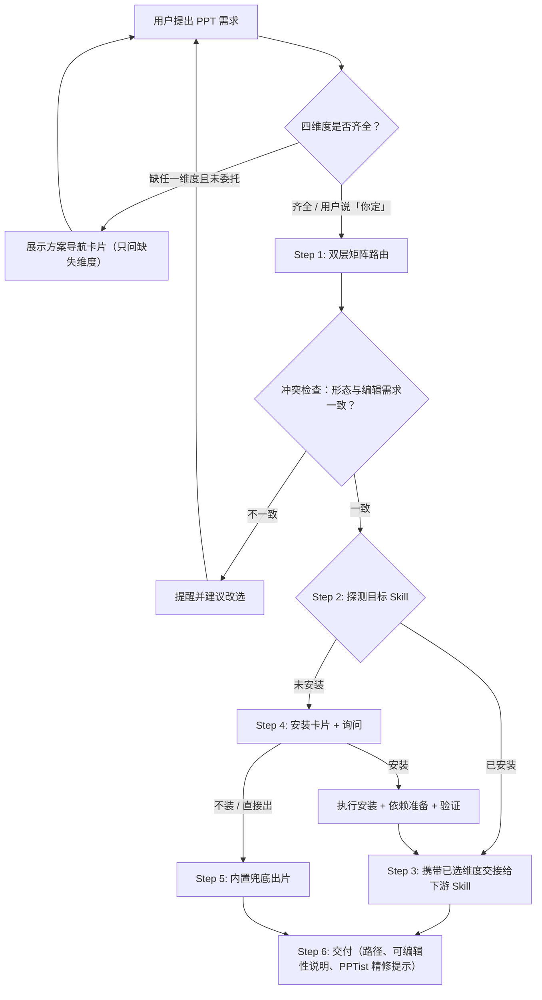

# Leo PPT Router（PPT 需求引导与技能路由中心）

## 📖 核心定位

`leo-ppt-router` 是 PPT / 演示文稿需求的**引导式路由器**：

1. 需求不明确时，用编号选项卡引导用户确定 **用途场景、交付形态（含是否需要在 WPS / PowerPoint 编辑）、风格、素材** 四个维度；
2. 按“公司品牌优先 → 交付形态 → 场景/风格”矩阵路由到最合适的下游 PPT Skill；
3. 动态探测下游 Skill 是否安装，缺失时给出安装卡片，经用户同意后代为安装并准备依赖；
4. 用户拒绝安装或安装失败时，用内置兜底规范 + 工具（PptxGenJS / Marp CLI / 单文件 HTML / `python-pptx`）出片。

**非目标（明确不做）**：

- 不做场景化内容整理（述职/路演等内容框架），留待后续单独决策；
- 不重复下游 Skill 内部流程（`ppt-master` 三路由、`dashi-ppt` 风格确认、`codex-ppt` 样张审批等）；
- 不集成 PPTist（Web GUI，无 CLI/API，AGPL-3.0），仅在交付 `.pptx` 时作“在线手动精修”提示。

## 🧭 工作流概览



## 💡 方案导航（需求引导）

**触发条件**（任一）：

- 调用 `/leo-ppt-router` 但未给出具体需求；
- 用户只说“做个 PPT / 做个演示”等泛意图；
- 四维度中任一缺失且用户未表示委托。

**规则**：

- 已从用户输入能确定的维度**不再询问**，卡片只展示缺失维度（如已知“述职 + WPS 可改 + 素材已贴”只问 ③；“技术分享含代码演示”未定形态时重点提示 ②D `slidev` 与 ②A `ppt-master`）；
- 用户回复编号即可（如 `1B 2A 3推荐 4B`）；
- 用户明确委托（“你定”“不用问直接做”）时跳过卡片，取默认值：**① 按内容推断、②A 可编辑 PPTX、③ 推荐、④ 按实际提供的材料判断**；交付时列出全部假设；
- ③ 风格按 ①② 结果，从 `references/skills-catalog.md` 对应小节的风格菜单中过滤列出，**且始终附带 Z1 公司品牌色与 Z2 公司 PPT 模板两项**。

**卡片模板**：

```markdown
📊 Leo PPT Router · 方案导航
请按编号回复，例如「1B 2A 3推荐 4B」，已说明的维度可跳过：

① 用途场景
  A 工作汇报 / 述职 / 年终总结   B 产品介绍 / 发布会   C 技术分享 / 开发者大会
  D 数据报告 / 市场分析          E 教学课件 / 培训     F 学术答辩 / 科研
  G 咨询提案 / 战略              H 人文分享 / 行业观察演讲   I 党政汇报

② 交付形态（决定后续能否编辑）
  A 要在 WPS / PowerPoint 里继续修改 → 可编辑 PPTX
  B 现场演讲、浏览器播放（演讲者视图、翻页动效）→ HTML 网页
  C 视觉冲击优先，不需要改字 → 整页图片式 PPTX
  D 开发者风格，代码高亮与动画 → Markdown（Slidev）
  E 已有 PPTX，要美化 / 改内容 / 套模板

③ 风格（根据 ①② 动态列出，或回复「推荐」）
  …（动态风格项）
  Z1 使用公司品牌色（请给出色值或 logo）
  Z2 使用公司 PPT 模板（请提供 .pptx，常见为首页 / 内容页 / 感谢页 3 页）

④ 素材
  A 只有主题，需要帮忙调研   B 有文档 / 文章 / 大纲   C 有现成 PPTX
```

## 🗂️ 路由矩阵

路由顺序：**先判公司品牌路由（③ Z1 / Z2），未命中再查主矩阵**；③ 回复“推荐”或委托模式查默认推荐表。

| ② 交付形态 | ①③ 细分条件 | 目标 Skill 标识符 | WPS 可编辑 |
| --- | --- | --- | --- |
| A 可编辑 PPTX | 默认（绝大多数场景） | `ppt-master` | ✅ 原生形状/图表/表格 |
| A 可编辑 PPTX | 用户点名 `dashi-ppt` 的 12 套主题视觉 | `dashi-ppt`（导出 PPTX） | 🟡 DOM 提取，部分区域截图 |
| B HTML | 人文分享、发布会、强个人风格；杂志风 / 瑞士风 | `guizang-ppt-skill` | ❌ 仅 HTML |
| B HTML | 商务、科技、数据类主题 | `dashi-ppt` | 🟡 可转 PPTX |
| C 图片式 | 麦肯锡、科研答辩、党政红、手绘、教学等风格 | `codex-ppt` | ❌ 整页图片 |
| D Markdown | 技术分享、代码演示、课程 | `slidev` | ✅ 用 `--format pptx-editable` 导出 |
| E 已有 PPTX | 美化 / 填充内容 / 做模板 / 加讲稿动画 | `ppt-master` | ✅ |
| 任意 | 目标未安装且用户拒绝安装 | `built-in-fallback` | 视兜底工具而定（见 Step 5） |

**冲突提醒**：用户选 ②B / ②C，但同时表达“要在 WPS / PowerPoint 里改”时，必须提醒该形态不可编辑（`❌`）或仅部分可编辑（`🟡`），并建议改选 ②A；用户坚持则照办。

### 公司品牌路由（③ Z1 / Z2，优先级高于主矩阵）

| 选择 | 路由 | 说明 |
| --- | --- | --- |
| **Z2 公司 PPT 模板** | 强制 `ppt-master`（任何 ② 形态都改为 PPTX 交付，原选 ②B/②C/②D 则提醒） | 追问一次：「本次一次性使用，还是以后常用？」<br>· **一次性** → `ppt-master` **Edit Native PPTX**：把模板当页面库，首页/感谢页复用，内容页以模板内容页为骨架复制扩页（母版、logo、页眉页脚保留），动手前出页面映射计划待确认<br>· **常用** → `ppt-master` **Create Template（kind: deck）**：提取品牌（色/字/logo）+ 结构（母版/版式）为可复用工作区，再 `Generate PPTX` 套用<br>交接时附模板 `.pptx` 绝对路径与所选模式 |
| **Z1 公司品牌色** + ②A/②E | `ppt-master` | 交接时附色值/logo；建议走 `Create Brand` 沉淀为可复用品牌工作区 |
| **Z1** + ②B | `guizang-ppt-skill` | 用脚本按品牌色生成受约束主题，**不直接使用原色值**，必须提示用户颜色可能有偏差 |
| **Z1** + ②C | `codex-ppt` | 在风格提示中指定色值；AI 生图**不保证精确色值**，须提示偏差 |
| **Z1** + ②D | `slidev` | 通过主题 CSS 变量精确设置 |
| **Z1** 且目标为 `dashi-ppt` | 不路由到 `dashi-ppt` | `dashi-ppt` 仅 12 套固定主题、无自定义品牌色入口；提醒后改荐 `ppt-master`（②A）或 `guizang-ppt-skill`（②B） |

### 场景 → 默认推荐（③ 回复「推荐」时使用）

| ① 场景 | ②A 下推荐 | ②B 下推荐 | ②C 下推荐风格 |
| --- | --- | --- | --- |
| A 汇报/述职 | `ppt-master` | `dashi-ppt` theme01 轻拟态 / theme07 冷白调研 | `codex-ppt` 清爽专业风 |
| B 产品/发布会 | `ppt-master` | `dashi-ppt` theme02 炫光紫绿 / `guizang-ppt-skill` 瑞士风 | `codex-ppt` 创意杂志风 |
| C 技术分享 | `ppt-master`（或 ②D `slidev`） | `dashi-ppt` theme03 深浅代码 | `codex-ppt` 手绘技术解释风 |
| D 数据报告 | `ppt-master` | `dashi-ppt` theme05 色谱图表 / theme06 深色图谱 | `codex-ppt` 数据仪表盘风 |
| E 教学课件 | `ppt-master` | `guizang-ppt-skill` 杂志风 | `codex-ppt` 教学课件风 |
| F 学术答辩 | `ppt-master` | `guizang-ppt-skill` 瑞士风 | `codex-ppt` 科研答辩风 |
| G 咨询战略 | `ppt-master` | `dashi-ppt` theme06 深色图谱 | `codex-ppt` 麦肯锡风格 |
| H 人文演讲 | `ppt-master` | `guizang-ppt-skill` 杂志风 | `codex-ppt` 电子墨水杂志风 |
| I 党政汇报 | `ppt-master` | `dashi-ppt` theme07 冷白调研 | `codex-ppt` 党政红风格 |

## ⚡ Step 2：运行期探测

仅按以下 4 条规范路径动态探测，禁止硬编码个人主机路径：

1. Agent 上下文 `Available skills:` 列表；
2. `~/.agents/skills/<skill-name>/SKILL.md`（Windows：`%USERPROFILE%\.agents\skills\<skill-name>\SKILL.md`）；
3. `~/.gemini/config/skills/<skill-name>/SKILL.md`；
4. 工作区 `./lib/skills/<skill-name>` 或 `./.agents/skills/<skill-name>`。

已安装进 **Step 3**；未安装进 **Step 4**。

## 🤝 Step 3：交接给下游 Skill

1. 查阅 `references/skills-catalog.md` 对应小节，再读取目标下游 Skill 的 `SKILL.md` 执行；
2. **携带已选四维度**（含 Z1 色值/logo，或 Z2 模板 `.pptx` 绝对路径与一次性/常用模式），免重复提问；
3. **遵守下游自身门禁**：
   - `ppt-master`：首步运行 `attribution_guard.py` 完整性校验，**非零即停，不得修改或绕过**；内部三路由与页面映射确认遵从其流程；
   - `dashi-ppt`：传入已收集答案并遵从其风格图与图片/视频确认门禁；**仅明确要 PPTX（②A）才导出 PPTX**；
   - `guizang-ppt-skill`：来源/赞助信息**不得写入最终 HTML 产物**；
   - `codex-ppt`：遵从样张审批门禁；
   - `slidev`：需 WPS 编辑时用 `slidev export --format pptx-editable` 导出。

## 📦 Step 4：缺失技能安装

未安装时读取 `references/skills-catalog.md`，按模板展示安装卡片：

```text
💡 **方案推荐**：您的需求最适合 **【<Skill 名>】**（<一句话特性>）。

当前环境尚未安装该技能：
* **开源地址**：<GitHub URL>
* **安装命令**：`<命令>`
* **运行依赖**：<依赖>
* **WPS 可编辑**：<✅/🟡/❌ + 说明>

**是否需要我帮您安装？**
* 回复 **"安装"**：我将完成安装与依赖准备，并直接继续制作；
* 回复 **"直接出"**：我将用内置兜底方案立即制作（<兜底工具> · <可编辑性>）。
```

| 标识符 | 开源地址 | 安装命令 | 运行依赖 | WPS 可编辑 |
| --- | --- | --- | --- | --- |
| `ppt-master` | `github.com/hugohe3/ppt-master` | `npx skills add hugohe3/ppt-master -g` | Python 3.10–3.14；目录内 `pip install -r requirements.txt` | ✅ |
| `dashi-ppt` | `github.com/chuspeeism/dashi-ppt-skill` | `npx dashi-ppt-skill@latest` | Node.js；导出 PPTX 需预览服务 + Playwright | 🟡 |
| `guizang-ppt-skill` | `github.com/op7418/guizang-ppt-skill` | `npx skills add https://github.com/op7418/guizang-ppt-skill --skill guizang-ppt-skill -g` | 浏览器即可 | ❌ |
| `codex-ppt` | `github.com/ningzimu/codex-ppt-skill` | `npx -y skills@latest add ningzimu/codex-ppt-skill --skill codex-ppt -g` | Python 3 + 生图后端（内置生图或 `OPENAI_API_KEY`） | ❌ |
| `slidev` | `github.com/slidevjs/slidev` | `npx skills add slidevjs/slidev -g` | Node.js + `pnpm`；导出需 `playwright-chromium` | ✅（`--format pptx-editable`） |

**用户回复“安装”后**：

1. 执行上表安装命令；
2. 准备运行依赖（如 `ppt-master` 的 `pip install -r requirements.txt`），失败则如实报告并询问是否改走兜底；
3. 验证 `SKILL.md` 存在；
4. 不要求用户重复需求，携带已选维度直接进入 **Step 3** 交接。

**安装失败**：报告错误原文，提供「重试 / 改走兜底」两个选项，不擅自换用其他安装源。

## 🛡️ Step 5：内置兜底（`built-in-fallback`）

触发：目标未安装且用户选“直接出”，或安装失败后用户选兜底。

1. **内容（大纲先确认）**：按 `references/fallback/outline-architect.md`（金字塔大纲）整理大纲，**展示给用户确认后再出片**；
2. **版式**：遵循 `references/fallback/bento-grid-layout.md`、`references/fallback/cognitive-design-principles.md`、`references/fallback/cjk-text-fit.md`；
3. **出片工具按交付形态选择**：

| ② 交付形态 | 兜底工具 | WPS 可编辑 |
| --- | --- | --- |
| A 可编辑 PPTX | PptxGenJS：按 `references/fallback/pptxgenjs-guide.md` 骨架写 `.mjs`，`npm i pptxgenjs` 后 `node` 执行 | ✅ |
| E 已有 PPTX | PptxGenJS 只能新建：先提取旧 PPTX 文字（`uv run --with python-pptx`），再按 A 行重新生成新 deck；**须事先告知不保留原设计** | ✅ |
| B HTML | 按 `references/fallback/html-deck-guide.md` 写单文件 `16:9` 横向翻页 HTML | ❌ |
| C 图片式 | 逐页调用 `leo-codex-imagine` 生图，再用 PptxGenJS（`references/fallback/pptxgenjs-guide.md`）拼装整页图片 | ❌ |
| D Markdown | 按 `references/fallback/marp-guide.md` 写 `deck.md`，`npx @marp-team/marp-cli@latest deck.md --pptx`（需可编辑加 `--pptx-editable`，依赖 LibreOffice） | ❌ 默认 / 🟡 加参数 |
| ③ Z2 公司模板 | 按 `references/fallback/template-fill-guide.md`：`uv run --with python-pptx` 用模板 `slide_layouts` 或整页复制替换扩页（保留母版/logo）；**须事先告知效果明显弱于 `ppt-master`** | ✅ |
| ③ Z1 品牌色 | 各行工具照常，色值写入：PptxGenJS 色板常量 / HTML CSS 变量 / Marp `<style>` | 同所在行 |

## 📤 Step 6：交付规范

交付时必须告知：

1. 产物文件的可点击绝对路径（`.pptx` / `index.html` / `.md`）；
2. 本次使用的 Skill 或兜底工具；
3. **可编辑性说明**：`✅` / `🟡` / `❌` 及原因（含 Z1 色值偏差说明，如有）；
4. 若为 PPTX：附一句“如需在线手动精修，可将 `.pptx` 导入 PPTist（https://pipipi-pikachu.github.io/PPTist/）”；
5. 委托模式下的全部假设。

## 🚀 规划中

| 方向 | 说明 |
| --- | --- |
| 场景化内容整理 | 述职、路演等内容框架，用户后续再决定放在 router 内还是独立 Skill |
| 独立 Marp Skill | 目前无权威 Marp skill，暂以兜底工具形式使用 marp-cli |
| `image-to-editable-ppt-skill` | 图片式 PPTX 转可编辑，待调研后可作为 ②C 的后处理 |
