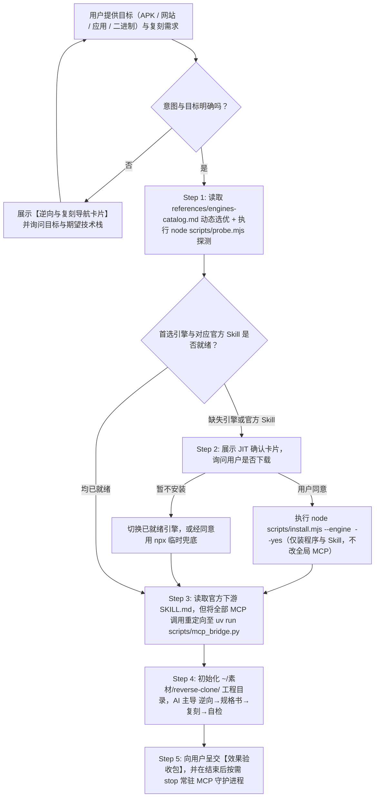

# Leo Reverse Clone（逆向拆解与 1:1 复刻制作路由中枢）

## 📖 核心定位与四大铁律

`leo-reverse-clone` 是面向**「AI 主导全流程逆向拆解 + 1:1 复刻制作，用户只做最终效果验收」**的薄路由与无头常驻 MCP 桥接中枢，统一纳管 **`rea`**（`rea-agents`）与 **`craft-anything`**（`craft-anything-cli`）。

必须严格遵守以下四条铁律：
1. **薄路由、直接复用官方下游 Skill**：本 Skill 不重复抄写 `rea` 或 `craft-anything` 的逆向手册；探测就绪后**直接读取已安装的官方 `reverse-engineer-anything/SKILL.md` 或 `craft-anything/SKILL.md`** 指导逆向分析。
2. **零全局 MCP 污染（脚本即常驻 MCP 客户端）**：**严禁运行 `rea setup` 或 `craft-anything-cli setup` 去篡改用户全局 Agent 的 MCP 配置！** 读取下游官方 Skill 时，忽略其中的全局 MCP 安装/连接段落，**所有 MCP 工具发现、调用与资源读取一律重定向给本 Skill 的常驻桥接脚本 `uv run scripts/mcp_bridge.py`**。
3. **先探测、缺了先问、同意才下载**：任何缺失的下游引擎二进制或官方 Skill，必须先向用户展示 JIT 确认卡片；**未经用户明确同意，严禁私自下载或安装**。
4. **AI 主导闭环、人类只验收**：每个复刻任务按「逆向测绘 → 规格书 → 复刻制作 → 自检对齐」自动跑通，统一归档至 `~/素材/reverse-clone/`；涉及源文件删除前一律强确认。
5. **自动继承本机代理（回环强制直连）**：所有探测、下载与子进程启动均按 `--proxy > config.proxy > 环境变量 > macOS scutil / Windows 系统代理` 自动继承用户本机代理，同时自动将 `127.0.0.1,localhost,::1` 写入 `NO_PROXY`，确保本地 MCP 桥接通信绝不被代理劫持。

> **独立运行说明**：本 Skill 完全自包含，不依赖 Shrimp 网关进程或任何固定代码仓库路径。调用下文 `scripts/*` 时，请以当前读取的 `SKILL.md` 所在目录为基准（或先 `cd` 到本 Skill 目录），在任何机器与任何工作区均可独立运行。

---

## 🧭 工作流概览



---

## 💡 主动导航卡片（输入不明确时触发）

当用户仅触发 `/leo-reverse-clone` 未给出具体目标时，展示以下简洁引导：

```markdown
🛠️ **Leo Reverse Clone 逆向拆解与 1:1 复刻制作中枢**

请发送你要逆向/复刻的目标（**APK / 网站 URL / 桌面程序 / Electron 应用 / 游戏包 / 二进制路径**）以及你期望的**复刻技术栈**（可选，如 Kotlin / Flutter / Next.js / Rust）：

- **`rea`（`rea-agents`）**：适合 Android APK 深度 Java/JNI 逆向、混淆映射、IDA/Hopper/Ghidra 重型二进制分析与抓包/RL 环境；
- **`craft-anything`（`craft-anything-cli`）**：适合零外部依赖秒级拆包、内置 `.so` Pseudo-C 伪代码、网站多屏宽视觉复刻、游戏资产拆解与 Clean Room 净室模式。

全流程由 AI 自动完成「逆向测绘 → 规格书 → 编码复刻 → 编译/自检对齐」，完成后交付给你做最终效果验收。
默认工程目录：`~/素材/reverse-clone/`（不修改你全局 Agent 的 MCP 配置）。
```

---

## ⚡ Step 1：动态选优与运行期探测

1. 查阅 [`references/engines-catalog.md`](references/engines-catalog.md)，结合**目标类型、是否需要深度 Java/JNI 或视觉自动复刻、以及合规模式（Deep / Clean room）**动态选择主力引擎（复杂场景允许双引擎互补）。
2. 执行探测脚本检查本机引擎程序、官方下游 Skill 与可选依赖（JDK / JADX / Ghidra / ADB）：
   ```bash
   node scripts/probe.mjs
   # 如需同时检查上游新版本：
   node scripts/probe.mjs --check-updates
   ```

---

## 📦 Step 2：JIT 询问与按需下载（未同意绝不安装）

若 `probe.mjs` 显示目标引擎的可执行程序或对应官方 Skill（`reverse-engineer-anything` / `craft-anything`）未安装，向用户输出确认卡片并等待回复：

```text
💡 **引擎路由建议**：针对当前目标，建议使用 **【<rea / craft-anything>】**（<理由>）。

检测到本地缺少以下组件：
* **引擎程序**：<已安装 / 未安装>（安装方式：`<npm install -g rea-agents>` 或 `<免编译下载纯 craft-anything-cli 二进制，不装 .dmg>`）
* **官方下游 Skill**：<已安装 / 未安装>（下载到 `~/.agents/skills/<skill>/` 并软链至 `~/.gemini/config/skills/`）
* **MCP 隔离承诺**：全程**不会**修改你全局 Agent 的 MCP 配置，仅由本 Skill 的 `mcp_bridge.py` 按需直连。

请问是否同意现在为你自动下载安装？
* 回复 **“同意下载”**：我立即执行安装并继续逆向复刻；
* 回复 **“暂不安装”**：优先改用本机已就绪的另一引擎（或 `rea` 可用 `npx` 临时运行）。
```

**获得用户明确同意后**执行安装（脚本强制要求 `--yes` 才会写入磁盘）：
```bash
# 安装 REA（npm 包 + 官方 reverse-engineer-anything Skill）
node scripts/install.mjs --engine rea --yes

# 安装 Craft Anything（GitHub Releases 免编译纯 CLI 二进制 + 官方 craft-anything Skill，零 .dmg）
node scripts/install.mjs --engine craft-anything --yes

# 或仅下载缺失的官方 Skill / 仅下载引擎：
node scripts/install.mjs --engine craft-anything --only skill --yes
```

---

## 🔌 Step 3：加载官方下游 Skill + MCP 桥接重定向规约

引擎与官方 Skill 就绪后：
1. **直接读取已安装的官方 `SKILL.md`**（路径由 `probe.mjs` 返回，如 `~/.agents/skills/reverse-engineer-anything/SKILL.md` 或 `~/.agents/skills/craft-anything/SKILL.md`），遵循其逆向方法论、证据引用、分页策略与工具顺序。
2. **执行以下唯一重定向规则**（将官方 Skill 中的直接 MCP 调用转为常驻桥接命令）：

| 官方 Skill 原动作 | 本 Skill 桥接执行命令（通过 `uv run` 无头直连） |
| :--- | :--- |
| 启动/检查常驻 MCP 会话 | `uv run scripts/mcp_bridge.py status` / `start <rea\|craft> [--deep\|--clean-room]` |
| 查看可用工具列表（`tools/list`） | `uv run scripts/mcp_bridge.py tools <rea\|craft> [--query <关键词>] [--format markdown]` |
| 开启 Craft 工具集（`enable_toolset`） | `uv run scripts/mcp_bridge.py enable-toolset craft <android\|native\|browser\|...>` |
| 调用任意 MCP 工具（`tools/call`） | `uv run scripts/mcp_bridge.py call <rea\|craft> <tool_name> '<json>' [--save-json <path>]` |
| 列出/读取 MCP 资源（`evidence://...`） | `uv run scripts/mcp_bridge.py resources <rea\|craft>` / `read-resource <rea\|craft> <uri>` |
| 结束任务释放常驻进程 | `uv run scripts/mcp_bridge.py stop [rea\|craft\|all]` |

> **上下文防爆机制**：当单次 MCP 返回超过默认上限（12,000 字符）时，`mcp_bridge.py` 会自动把完整 JSON 落盘保存并只向终端输出摘要与文件路径，避免撑爆上下文。大查询可主动配合 `--save-json "<projectDir>/evidence/<name>.json"` 归档。

---

## 🏗️ Step 4 & 5：AI 主导四阶段复刻闭环、归档与交付验收

### 1. 初始化标准工程目录（默认 `~/素材/reverse-clone/`）
配置文件持久化于 `~/.shrimp/skills/leo-reverse-clone/config.json`：
```bash
# 查看或修改默认根目录
node scripts/config.mjs get
node scripts/config.mjs set --dir "~/素材/reverse-clone"

# 初始化本次逆向复刻工程骨架
node scripts/config.mjs init --cat "<apk|web|desktop|game|binary>" --name "<目标名称>" --engine "<rea|craft-anything|hybrid>"
```
生成的标准工程目录：
```text
~/素材/reverse-clone/<类别>/YYYY-MM-DD/<目标名称>/
├── project.json       # 目标元数据、选用引擎、模式（deep/clean_room）与阶段状态
├── source/            # （本地文件目标）校验拷贝留底的原始样本副本
├── evidence/          # 逆向采集的结构化 JSON 证据、反编译片段与截图
├── spec.md            # AI 整理出的《功能清单 + 架构/页面图 + 协议 + 核心逻辑规格书》
├── app/               # AI 按目标技术栈从零复刻构建的新工程源码与产物
└── verify/            # 编译日志、单测结果、界面截图对比与自检核对表
```

### 2. AI 自主执行的 4 个阶段（尽量少打扰用户，只在关键决策/权限处确认）
1. **阶段一 · 深度测绘（Evidence）**：通过 `mcp_bridge.py` 复用常驻 MCP 会话，把目标的结构、页面/路由、交互状态、资源文案、核心逻辑与网络协议查清并落盘至 `evidence/`（每条结论标注观察/推导/推测及证据 ID）。
2. **阶段二 · 沉淀规格书（`spec.md`）**：基于 `evidence/` 输出结构化复刻蓝图（若目标依赖远端后端接口，同步规划本地 Mock/StandIn 替身后端方案）。若需求含模糊架构抉择，可先简短向用户确认一次技术栈与范围。
3. **阶段三 · 干净复刻（`app/`）**：对照 `spec.md` 在 `app/` 下完整实现目标工程（网站类或明确要求全自动重绘时，也可直接调用 `craft-anything-cli rebuild` 辅助执行）。
4. **阶段四 · 自主自检对齐（`verify/`）**：AI 自行跑通构建、类型检查、单元测试、运行验证或页面/窗口截图对比，把能自己发现和修复的缺陷全部修完，直到达到可交付验收状态。

### 3. 源文件归档与删除强确认红线
> [!CAUTION]
> 若用户提供的是本地待分析文件（如 APK / 安装包），归档时默认只执行拷贝校验（`node scripts/config.mjs archive-source --src "<原文件>" --dest-dir "<projectDir>"`）。**无论原文件在何处，未经用户明确同意，严禁删除任何原始文件**；仅在用户明确回复同意后才可执行 `delete-original --confirm-delete`。

### 4. 向用户交付【效果验收卡】
任务完成交付时，向用户汇报：
- **选用引擎与工作模式**（`rea` / `craft-anything` / 双引擎协同，`Deep` 或 `Clean room`）；
- **规格书与证据目录**：`[spec.md](file:///...)`、`[evidence/](file:///...)`；
- **复刻工程与启动/体验方式**：`[app/](file:///...)` 及一键启动/预览/安装命令；
- **AI 自检结果清单**（编译/单测/功能点对齐度/已知未覆盖的外部依赖或限制项，落盘于 `[verify/](file:///...)`）；
- 提醒用户验收并直接提出修改意见；验收完毕后按需执行 `uv run scripts/mcp_bridge.py stop all` 释放后台常驻 MCP 进程。
