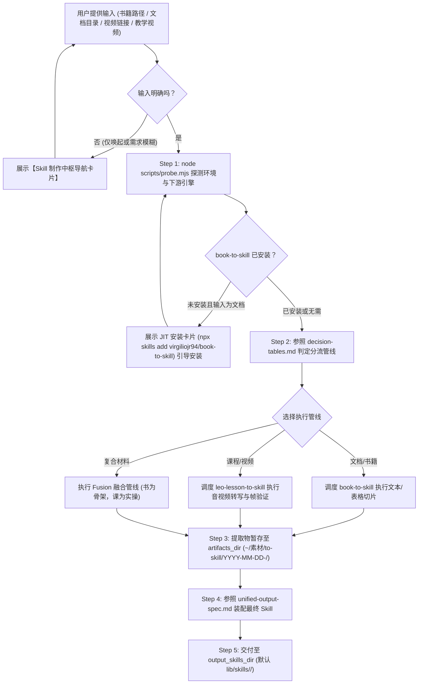

# Leo to Skill Router（跨模态知识转技能路由中枢）

## 📖 核心定位

`leo-to-skill-router` 是面向书籍、文档与教学视频的**知识资产 Skill 化路由总管**。通过统一中枢，将散落的人类知识编译为遵循开放标准、具备决策支持层与懒加载架构的高质量 AI 技能。

核心能力：
1. **模态自适应路由**：自动识别文档类（PDF/EPUB/MD/DOCX/目录）与视频类（网络链接/本地音视频），调度对应专精管线。
2. **两级目录可配置**：
   - 技能产物输出目录由 `~/.shrimp/skills/leo-to-skill-router/config.json` 统一管理，默认生成至当前项目 `lib/skills/`；
   - 中间提取物（音视频流、转写字幕、分块元数据）独立暂存至 `~/素材/to-skill/YYYY-MM-DD-<slug>/`，不污染代码库。
3. **隔离的 Python 运行态**：由 `uv` 管理专用虚拟环境 `~/.shrimp/skills/leo-to-skill-router/.venv`。
4. **统一规范交付**：产出统一包含 `SKILL.md` (<4K tokens)、`cheatsheet.md`（决策层与经验嗅觉）、`patterns.md` 及按需加载章节。

---

## 🧭 工作流概览



---

## 💡 主动导航卡片（需求模糊时触发）

当用户仅输入 `/leo-to-skill-router` 或提问“如何做 skill / 支持哪些格式”时展示：

```markdown
🛠️ **Leo to Skill Router 知识制技路由中枢**

请直接发送 **文件路径、文件夹路径或视频链接**，我将自动识别模态并为您制作标准化 Agent Skill：

1. **书籍与文档类** (`.pdf`, `.epub`, `.docx`, `.md`, 项目 `docs/` 目录)：
   - 提取命名心智模型、技术表格与核心代码，生成按需懒加载章节。
2. **教学与实战视频类** (B站 / YouTube 链接、`.mp4`, `.mov`, 录音)：
   - 提取执行步骤 SOP、操作演示案例与避坑经验法则。
3. **复合教材** (同时提供书籍 + 对应演练视频)：
   - 以书为理论骨架，以课为案例血肉，生成顶配旗舰技能。

*默认技能产物保存于*：`<当前项目>/lib/skills/<slug>/`
*中间提取物暂存于*：`~/素材/to-skill/YYYY-MM-DD-<slug>/`（详见 artifacts-spec.md，可在 config.json 中自定义）
```

---

## ⚡ 执行步骤

### Step 1: 运行期环境与下游探测

执行探测脚本：
```bash
node scripts/probe.mjs
```
- 若 `engines.bookToSkill.installed === false` 且当前任务包含文档，展示 JIT 引导卡片：
  > 💡 检测到尚未安装书籍提取核心 **`book-to-skill`**。
  > 请执行安装：`npx skills add virgiliojr94/book-to-skill`
- 若 `pythonVenv.ready === false`，执行环境初始化：
  ```bash
  bash scripts/setup_env.sh
  ```

### Step 2: 依据材料模态分流
读取 [`references/decision-tables.md`](references/decision-tables.md) 与 [`references/engines-catalog.md`](references/engines-catalog.md)：
- **文档/书籍类** $\rightarrow$ 驱动 `book-to-skill` 抽取器；
- **课程/视频类** $\rightarrow$ 驱动 `leo-lesson-to-skill` 摄取流水线；
- **复合类** $\rightarrow$ 启动融合流程。

### Step 3: 配置路径与执行提取
读取 `~/.shrimp/skills/leo-to-skill-router/config.json` 与 [`references/artifacts-spec.md`](references/artifacts-spec.md)：
- 解析中间物目录：`artifacts_dir`（默认 `~/素材/to-skill/YYYY-MM-DD-<slug>/`），存放提取的音视频流、转写及文本分块；
- 解析目标发布目录：`output_skills_dir`（默认工程 `lib/skills/<slug>/`）。

### Step 4: 规范组装与交付
遵循 [`references/unified-output-spec.md`](references/unified-output-spec.md)：
1. 组装控制在 4,000 tokens 内的 `SKILL.md` 主心智入口；
2. 提炼包含决策树与嗅觉的 `cheatsheet.md`；
3. 将章节或子流程写入 `on-demand/` 目录实现懒加载；
4. 输出完成报告，附带生成目录的可点击链接。
