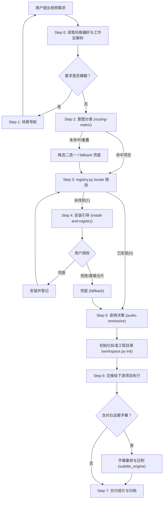

# Leo Video Router（视频场景与调度中枢）

## 核心定位

`leo-video-router` 是面向**多场景 AI 视频生产的智能路由器、工程归档管家与交付中枢**。

- 按场景把需求交给 8 个下游项目之一，下游怎么执行由它自己的入口文档决定。
- **输出目录记忆与智能持久化（Smart Persistence）**：参考 `leo-xhs-router` 标准，配置保存在 `~/.shrimp/skills/leo-video-router/config.json`；默认输出到 `output/`；一旦用户指定工作区（如 `D:\素材\douyin`），自动持久化记住并复用；统一落盘至 `YYYY-MM-DD-视频主题/` 标准工程。
- Router **不选择、不调用任何底层生成引擎**：模型与内部 TTS 由下游决定。音频建议按 Step 5 优先用本机 omnivoice 生成再交接。
- 含对白成片按 [references/subtitle-standard.md](references/subtitle-standard.md) 执行单行独立重排（$\le 16$ 字，院线黑体白字黑边），压制并输出至 `成片/发布版/`。
- 本 skill 独立可用，知识均在 `references/` 与 `scripts/`。命令写 `python3`，Windows 换成 `python`。

---

## 工作流

### ⚠️ 核心工作原则 (Step 0 前置偏好与工作区检查)

> [!IMPORTANT]
> **Step 0：前置读取创作者偏好与工作区（Preferences & Workspace Preflight）**
> 1. 读取 `~/.shrimp/skills/leo-video-router/style-preferences.md`（若存在）：提取全局分发偏好（B站首选、去AI标签片名、极简一句话悬念简介、16:30定时排期）并按题材激活对应风格预设（如悬疑短剧 `preset: suspense-short-drama`）。
> 2. 读取 `~/.shrimp/skills/leo-video-router/config.json` 解析有效工作区（三级级联：用户本次指定 > 历史记录 > 默认兜底）。



### Step 1：场景导航
需求模糊或仅提供未指明用途的素材时，展示下方「场景导航卡片」。

### Step 2：意图分类
按 [references/routing-matrix.md](references/routing-matrix.md) 的触发词与区分规则选定项目；规则无法判断时给最多 2 个候选让用户选；仍未命中按 [references/fallback.md](references/fallback.md) 兜底。

### Step 3：探测
```bash
python3 <本 skill 目录>/scripts/registry.py locate <项目名>
```
退出码 0 表示已安装，交接时 skill 目录一律用输出里的 `entry_dir`，**不要自己拼路径**；退出码 1 进 Step 4；退出码 3 报 registry.json 损坏。例外：上下文已有同名 skill 时先 `registry.py register <项目名> <目录> --source user` 再 locate。细节见 [references/install-and-registry.md](references/install-and-registry.md)。

### Step 4：安装引导
按 [references/install-and-registry.md](references/install-and-registry.md) 展示卡片。**只在用户明确同意后**安装；源码类先问目录（默认 `~/.shrimp/skills/<项目名>`）；装好后 `registry.py register` 登记再重跑 Step 3。拒绝安装按 [references/fallback.md](references/fallback.md) 兜底。

### Step 5：音频决策
需旁白时按 [references/audio-omnivoice.md](references/audio-omnivoice.md) 顺序：用户录音 → 下游商业 TTS → 本机 omnivoice（带重试检查）→ 下游免费 TTS。音画绑定镜头不替换音频。

### Step 6：初始化工程目录与交接
1. 先初始化标准目录：`python3 <本 skill 目录>/scripts/workspace.py init "<视频主题>"`。
2. 旁白统一存至 `<工程目录>/音频/旁白.wav`；脚本记入 `脚本.md`。
3. 读 `references/projects/<项目名>.md` 与项目自己的入口文档（`locate` 输出里的 `entry`），交接素材与音频执行。直出原始成片放入 `成片/原始版/`。Router 不干预下游引擎生成。

### Step 7：交付成片与字幕后处理
1. **字幕与压制**：含对白视频调用 `python3 <本 skill 目录>/scripts/subtitle_engine.py "<成片路径>" --burn`。自动将重排单行字幕（$\le 16$ 字）与压制成片落盘到 `成片/发布版/`。
2. **交付记录**：更新 `<工程目录>/交付记录.md`（记录所用项目、音频来源、字幕统计与 B 站排期策略）。
3. **交付成片**：向创作者反馈带字幕成片绝对路径、字幕路径、封面图及音频来源。

---

## 📁 产物目录与智能工作区记忆 (Smart Persistence)

### 1. 三级级联决策
1. **用户显式指定**（传参 `--workspace` 或对话指明）：落盘并持久化保存至 `config.json` 的 `workspace_dir`，后续免重复输入；
2. **已记录的历史目录**：自动复用 `config.json` 中的 `workspace_dir`；
3. **默认兜底目录**：`~/.shrimp/skills/leo-video-router/output/`。

### 2. 标准单视频工程目录
```text
<workspace_dir>/
└── YYYY-MM-DD-视频主题/
    ├── 交付记录.md                 # 记录项目、音频来源、字幕条数、发布文案与B站排期策略
    ├── 脚本.md                    # 分镜、运镜机位、Prompt 提示词、对白台词
    ├── 音频/                      # 旁白.wav (omnivoice/录音) 与音效/BGM
    ├── 素材/                      # 过程素材、参考图、分镜切片或下游工程文件 (可选)
    └── 成片/
        ├── 发布版/                 # 最终成片 (带字幕版.mp4、.srt、封面.png)
        └── 原始版/                 # 下游直出的无字幕/生肉成片 (可选)
```

---

## 场景导航卡片

```text
🎬 Leo Video Router 视频场景导航
【批量/快速】1. 信息流短视频 —— MoneyPrinterTurbo（主题出竖屏片）
【素材加工】2. 素材剪辑与再创作 —— OpenMontage（口播剪辑/长切短/播客）
【人物出镜】3. AI 人物表演 —— hypit（口播/短剧/双人播客/数字人）
【风格短片】4. 指定风格短片 —— lemo-opuscar（66种风格）
            5. 自由代码视频 —— xilo-opus-video（卡点/绿幕/Manim）
            6. 口播讲解动画 —— dashi-animationstyle（知识口播/剪映）
            7. 艺术与解说风格 —— huashu-art-motion（名画/Vox/3b1b）
【产品宣传】8. 产品宣传片 —— video-shotcraft（网页截图电影感/音效）
也可直接描述需求，由 Router 自动判断。
```

---

## 🛠️ 管理与调试 CLI

```bash
# 查看工作区与配置状态
python3 <本 skill 目录>/scripts/workspace.py status
# 配置并记住默认工作区（免重复输入）
python3 <本 skill 目录>/scripts/workspace.py set-workspace "D:\素材\douyin"
# 初始化新视频标准工程目录
python3 <本 skill 目录>/scripts/workspace.py init "悬疑微短剧请慢用"
```

---

## 铁律

1. **安装只在用户同意后执行**；没同意之前只展示安装卡片。
2. **不改下游项目的代码**；依赖安装和项目数据目录按接入卡和项目文档进行。
3. **付费调用由下游确认**；Router 不替用户同意任何付费操作。
4. **交付时必须说明音频来源**。
5. **产物规范落盘**：统一归档在 `<workspace_dir>/YYYY-MM-DD-视频主题/` 标准工程。
6. 不选择、不调用任何底层生成引擎；兜底时只按已有 skill 文档调用。
