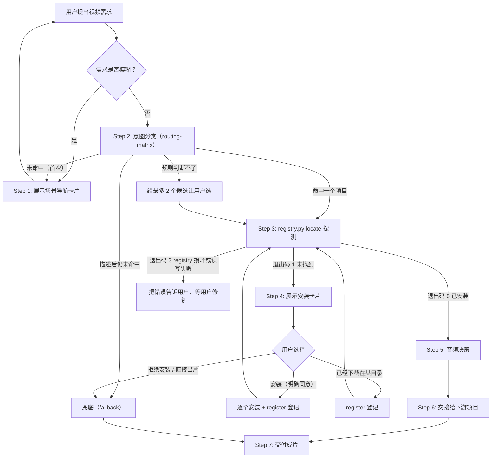

# Leo Video Router（视频场景路由）

## 核心定位

`leo-video-router` 只回答一个问题：**这个视频需求交给谁做**。

- 按场景把需求交给 8 个下游项目之一，下游怎么执行由它自己的入口文档决定。
- Router **不选择、不调用任何底层生成引擎**：用哪个视频模型、下游内部用哪个 TTS，都由下游自己决定。只有音频来源由 Router 建议：需要旁白又没有录音时，按 Step 5 先用本机 omnivoice 生成配音，再从下游的外部音频入口交给它。
- 本 skill 独立可用、不绑定任何 agent：所有接入知识都在 `references/` 和 `scripts/` 里，不依赖 agent 的记忆或私有工具。

下文的 `<本 skill 目录>` 指本 SKILL.md 所在目录；命令写 `python3`，Windows 上换成 `python`。

---

## 工作流



### Step 1：场景导航

满足以下任一条件时，先展示下面的「场景导航卡片」，等用户选择或描述：

- 用户只调用了本 skill，没说要做什么视频；
- 用户问「你能做什么」「支持哪些视频场景」「我想做个视频」；
- 用户给了素材（视频、录音、图片、网址），但没说想做成什么。

### Step 2：意图分类

按 [references/routing-matrix.md](references/routing-matrix.md) 的触发词选出一个项目：先套「重叠项目的区分规则」；规则判断不了时，给最多 2 个候选和一句话区别让用户选。一个都没命中时回到 Step 1；用户描述后仍不命中，按 [references/fallback.md](references/fallback.md) 兜底。

### Step 3：探测

```bash
python3 <本 skill 目录>/scripts/registry.py locate <项目名>
```

`<项目名>` 必须和路由矩阵里的写法完全一致。退出码 0 表示已安装，之后交接时 skill 目录一律用输出里的 `entry_dir`，**不要自己拼路径**；退出码 1 进入 Step 4；退出码 3 表示 registry.json 损坏或读写失败，把错误原文告诉用户，不要覆盖或删除它。

例外：退出码 1，但 agent 自己的上下文里已经列出同名 skill（如 lemo 作为 Claude 插件装在标准目录之外）时，也算已安装：`python3 <本 skill 目录>/scripts/registry.py register <项目名> <那个 skill 的目录> --source user`，再重跑 `locate`，`entry_dir` 仍从 `locate` 取。细节见 [references/install-and-registry.md](references/install-and-registry.md)。

### Step 4：安装引导

按 [references/install-and-registry.md](references/install-and-registry.md) 展示安装卡片。**只在用户明确同意后**执行安装；多个项目逐个装；源码类项目下载前先问目录（默认 `~/.shrimp/skills/<项目名>`）；装好或用户给出已有目录后用 `registry.py register` 登记，再回到 Step 3 拿 `entry_dir`。用户拒绝安装（包括回复「直接出片」）时按 [references/fallback.md](references/fallback.md) 处理。

### Step 5：音频决策

需要旁白或配音时，按 [references/audio-omnivoice.md](references/audio-omnivoice.md) 的顺序决定音频来源：用户录音 → 下游已配的商业 TTS → 本机 omnivoice（健康检查要带重试）→ omnivoice 不可用时请用户启动 VoiceStudio，用户不想开才退回下游免费 TTS 并说明音质有限；下游没有免费 TTS（如 dashi）时回到用户，不要擅自用其他 TTS。音画必须一起生成的镜头（AI 人物开口说话）不替换音频，否则口型对不上。

### Step 6：交接

读 `references/projects/<项目名>.md` 的「交接」「音频」「注意」三节，再读项目自己的入口文档（`locate` 输出里的 `entry`），把用户需求、素材路径和配音文件路径（如有）按它的文档交给它执行。下游的生成方式、引擎和参数一律以它自己的文档为准，Router 不干预。

### Step 7：交付

告诉用户：成片路径、用了哪个项目、音频来源（用户录音 / 下游 TTS / omnivoice / 下游免费 TTS）。兜底出片时同样说明用了哪个 skill，以及哪些提示词槽位是补的。

---

## 场景导航卡片

```text
🎬 Leo Video Router 视频场景导航

请回复编号或项目名：

【批量 / 快速出片】
 1. 信息流短视频 —— MoneyPrinterTurbo
    给个主题，自动出「旁白 + 素材混剪 + 字幕 + BGM」的竖屏短视频，可批量

【加工已有素材】
 2. 素材剪辑与再创作 —— OpenMontage
    真人口播剪辑、长视频切短、播客转视频、多语字幕配音、录屏演示、纪录片、预告片、数字人口播

【AI 人物出镜】
 3. AI 人物表演 —— hypit
    UGC 口播、短剧、双人播客、街头采访、排行榜、讲解员 + MG、旁白带货

【代码动画 / 风格短片】
 4. 指定风格短片 —— lemo-opuscar
    66 种风格（油画厚涂、浮世绘、卫星简报、产品拆解……），可存成自己的风格
 5. 自由代码视频 —— xilo-opus-video
    先出三个方案加预览，按音乐卡点、绿幕人物 + 代码场景、Manim
 6. 口播讲解动画 —— dashi-animationstyle
    15–60 秒中文知识口播 → 7 套风格讲解动画，可直接拖进剪映
 7. 艺术与解说风格 —— huashu-art-motion
    梵高 / 莫奈等艺术家笔法、名画穿越、Vox / 3b1b / Kurzgesagt 式解说

【产品宣传】
 8. 产品宣传片 —— video-shotcraft
    用真实网页 / App 截图做电影感宣传片，导出剪映工程；也能给视频配音效

也可以直接描述您想做的视频，我来判断交给谁。
```

---

## 铁律

1. **安装只在用户同意后执行**；没同意之前只展示安装卡片。
2. **不改下游项目的代码**；依赖安装和项目数据目录按接入卡和项目自己的文档进行。
3. **付费调用由下游按自己的规则向用户确认**，Router 不替用户同意任何付费操作。
4. **交付时必须说明音频来源**。
5. 不选择、不调用任何底层生成引擎；兜底时也只按环境里已有 skill 自己的文档调用，见 [references/fallback.md](references/fallback.md)。
