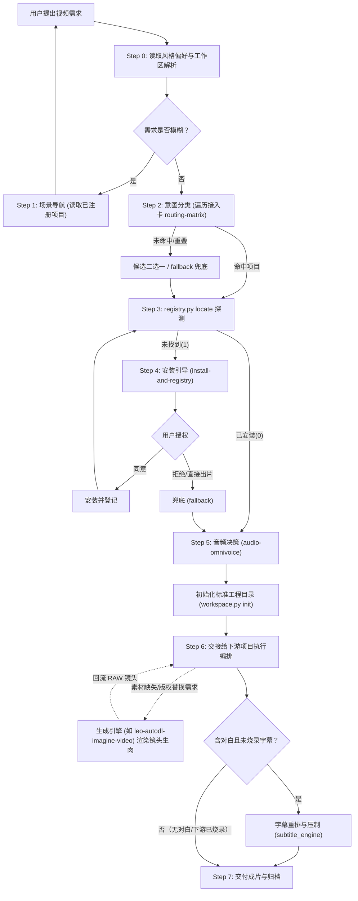

# Leo Video Router（视频场景与调度中枢）

## 核心定位

`leo-video-router` 是面向**多场景 AI 视频生产的可插拔智能路由器、工程归档管家与交付中枢**。

- **双层正交解耦架构**：
  - **编排工程层（Orchestrators）**：下游开源项目负责整片叙事结构、时间线剪辑与视听风格。系统预置多套成熟工程卡，并**支持无限动态注册与感知未来任意新开源项目**；
  - **底层资产与算力服务商（Capability & Asset Providers）**：`leo-autodl-imagine-video`（MiniMax-H3 远程渲染）、`voicestudio` / `omnivoice`（本地人声）、`leo-codex-imagine` 等作为独立的资产提供方。当下游编排项目遇到素材缺失、版权侵权风险（明星肖像/台标水印）或需要原创 8K 画面时，按需申请分镜资产生成。
- **输出目录记忆与智能持久化（Smart Persistence）**：配置保存在 `~/.shrimp/skills/leo-video-router/config.json`；默认输出到 `output/`；一旦用户指定工作区（如 `D:\素材\douyin`），自动持久化记住并复用；统一落盘至 `YYYY-MM-DD-视频主题/` 标准工程。
- Router **不选择、不调用任何底层生成引擎**：模型与内部 TTS 由下游决定。音频建议按 Step 5 优先用本机 `voicestudio` / `omnivoice` 生成再交接。
- 含对白且未烧录字幕的成片，按 [references/subtitle-standard.md](references/subtitle-standard.md) 执行单行独立重排（≤ 16 字，院线黑体白字黑边），压制并输出至 `成片/发布版/`。
- 本 skill 独立可用，知识均在 `references/` 与 `scripts/`。命令写 `python3`，Windows 换成 `python`。

---

## 工作流

### ⚠️ 核心工作原则 (Step 0 前置偏好与工作区检查)

> [!IMPORTANT]
> **Step 0：前置读取创作者偏好与工作区（Preferences & Workspace Preflight）**
> 1. 读取 `~/.shrimp/skills/leo-video-router/style-preferences.md`（创作者手写的自由格式 Markdown，Router 不生成；不存在就跳过，不要假设任何偏好）：提取全局分发偏好（如首选平台、片名与简介风格、发布排期）并按题材激活对应风格预设（如悬疑短剧 `preset: suspense-short-drama`）。
> 2. 读取 `~/.shrimp/skills/leo-video-router/config.json` 解析有效工作区（三级级联：用户本次指定 > 历史记录 > 默认兜底）。



### Step 1：场景导航
需求模糊或仅提供未指明用途的素材时，展示下方「场景导航卡片」（动态汇总预置与已注册的项目场景）。

### Step 2：意图分类
按 [references/routing-matrix.md](references/routing-matrix.md) 以及 `references/projects/` 接入卡目录中的触发词与区分规则选定项目；规则无法判断时给最多 2 个候选让用户选；仍未命中按 [references/fallback.md](references/fallback.md) 兜底。

### Step 3：探测
```bash
python3 <本 skill 目录>/scripts/registry.py locate <项目名>
```
退出码 0 表示已安装，交接时 skill 目录一律用输出里的 `entry_dir`，**不要自己拼路径**；退出码 1 进 Step 4；退出码 3 报 registry.json 损坏。支持预置项目与任意通过 `registry.py register` 动态注册的项目。细节见 [references/install-and-registry.md](references/install-and-registry.md)。

### Step 4：安装引导与可插拔注册
按 [references/install-and-registry.md](references/install-and-registry.md) 展示卡片。**只在用户明确同意后**安装；源码类先问目录（默认 `~/.shrimp/skills/<项目名>`）；装好后 `registry.py register` 登记再重跑 Step 3。未来若引入新开源项目，可通过 `python3 registry.py register <新项目名> <路径> [--entry <入口文件>]` 动态纳入管理。拒绝安装按 [references/fallback.md](references/fallback.md) 兜底。

### Step 5：音频决策
需旁白时按 [references/audio-omnivoice.md](references/audio-omnivoice.md) 顺序：用户录音 → 下游商业 TTS → 本机 `voicestudio` / `omnivoice`（带重试检查）→ 下游免费 TTS。音画绑定镜头不替换音频。这一步只做决定，配音在 Step 6 建好工程目录后生成。

### Step 6：初始化工程目录与交接编排
1. 先初始化标准目录：`python3 <本 skill 目录>/scripts/workspace.py init "<视频主题>"`。
2. 旁白统一存至 `<工程目录>/音频/旁白.wav`；脚本记入 `脚本.md`。
3. 写脚本和提示词前读 [references/production-playbook.md](references/production-playbook.md)（台词语速、画面左右、先用图验证构图）。
4. 读 `references/projects/<项目名>.md` 与项目自己的入口文档（`locate` 输出里的 `entry`），交接素材与音频执行。
5. **素材版权与生成联动**：当编排工程发现素材存在明星肖像、侵权切片或台标水印时，向 `leo-autodl-imagine-video` 等生成技能下发分镜生成任务，将生成的无版权高清 RAW 镜头存入 `<工程目录>/素材/`，再由项目完成多轨编排。
6. 直出原始成片放入 `成片/原始版/`。Router 不干预下游引擎生成。

### Step 7：交付成片与字幕后处理
1. **字幕判断**：先确认成片是否已烧录字幕（看下游报告或抽帧）。多个下游默认或可选烧录字幕，已烧录就不再压制，否则会叠成两层。
2. **后期效果（可选）**：结尾画面停滞或需要点题时，按 [references/post-effects.md](references/post-effects.md) 加片尾金句卡，做完再压字幕。
3. **字幕与压制**：含对白且未烧录字幕时调用 `python3 <本 skill 目录>/scripts/subtitle_engine.py "<成片路径>" --burn`。自动将重排单行字幕（≤ 16 字）与压制成片落盘到 `成片/发布版/`。
4. **交付前检查**：按 production-playbook.md 第 5 条抽帧，并把字幕和脚本台词逐字比对。
5. **交付记录与多端战术标题**：更新 `<工程目录>/交付记录.md`，按 [references/video-title-methodology.md](references/video-title-methodology.md) 填充针对 B站、抖音、小红书视频的「3-Pick 战术矩阵」，杜绝平庸与选择困难。
6. **高潮帧提取与双簧封面交付**：按 [references/cover-methodology.md](references/cover-methodology.md) 提取情绪/动作/奇观高潮帧，压制 4~10 字双簧封面大字，落盘至 `<工程目录>/成片/发布版/封面.png`。
7. **交付成片与归档反馈**：向创作者反馈成片绝对路径、字幕路径、高清封面及音频来源。

---

## 📁 产物目录与智能工作区记忆 (Smart Persistence)

### 1. 三级级联决策
1. **用户显式指定**（传参 `--workspace` 或对话指明）：落盘并持久化保存至 `config.json` 的 `workspace_dir`，后续免重复输入；
2. **已记录的历史目录**：自动复用 `config.json` 中的 `workspace_dir`；
3. **默认兜底目录**：`~/.shrimp/skills/leo-video-router/output/`。

### 2. 标准单视频工程目录
```text
<workspace_dir>/
└── YYYY-MM-DD-视频主题/
    ├── 交付记录.md                 # 记录项目、音频来源、字幕条数、三端3-Pick战术题名、封面策略与排期
    ├── 脚本.md                    # 分镜、运镜机位、Prompt 提示词、对白台词
    ├── 音频/                      # 旁白.wav (omnivoice/录音) 与音效/BGM
    ├── 素材/                      # 过程素材、参考图、生成的RAW镜头或下游工程文件
    └── 成片/
        ├── 发布版/                 # 最终成片 (<原片名>_with_subtitles.mp4、<原片名>.srt、封面.png 标准就绪)
        └── 原始版/                 # 下游直出的无字幕/生肉成片 (可选)
```

---

## 场景导航卡片 (可插拔工程库)

```text
🎬 Leo Video Router 视频场景导航（动态聚合所有已接入的编排项目）
【批量/快速】1. 信息流短视频 —— MoneyPrinterTurbo（主题出竖屏片）
【素材加工】2. 素材剪辑与再创作 —— OpenMontage（口播剪辑/长切短/播客）
【人物出镜】3. AI 人物表演 —— hypit（口播/短剧/双人播客/数字人）
【风格短片】4. 指定风格短片 —— lemo-opuscar（66种风格）
            5. 自由代码视频 —— xilo-opus-video（卡点/绿幕/Manim）
            6. 口播讲解动画 —— dashi-animationstyle（知识口播/剪映）
            7. 艺术与解说风格 —— huashu-art-motion（名画/Vox/3b1b）
【产品宣传】8. 产品宣传片 —— video-shotcraft（网页截图电影感/音效）
【未来项目】支持在 references/projects/ 放入新接入卡，或通过 registry.py register 动态接入任意新开源项目。
也可直接描述需求，由 Router 自动判断。
```

---

## 🛠️ 管理与调试 CLI

```bash
# 查看工作区与配置状态
python3 <本 skill 目录>/scripts/workspace.py status
# 配置并记住默认工作区（免重复输入）
python3 <本 skill 目录>/scripts/workspace.py set-workspace "<工作区目录>"
# 初始化新视频标准工程目录
python3 <本 skill 目录>/scripts/workspace.py init "悬疑微短剧请慢用"
# 探测下游项目（支持预置与动态注册项目）
python3 <本 skill 目录>/scripts/registry.py locate <项目名>
# 动态注册任意未来开源新项目
python3 <本 skill 目录>/scripts/registry.py register <新项目名> "<本地路径>" [--entry <入口文件>]
```

---

## 铁律

1. **安装只在用户同意后执行**；没同意之前只展示安装卡片。
2. **不改下游项目的代码**；依赖安装和项目数据目录按接入卡和项目文档进行。
3. **架构解耦**：Router 调度下游编排工程，编排工程按需调度底层生成引擎，严禁在 Router 内部与特定生成工具锁死。
4. **付费调用由下游确认**；Router 不替用户同意任何付费操作。
5. **交付时必须说明音频来源**。
6. **产物规范落盘**：统一归档在 `<workspace_dir>/YYYY-MM-DD-视频主题/` 标准工程。
