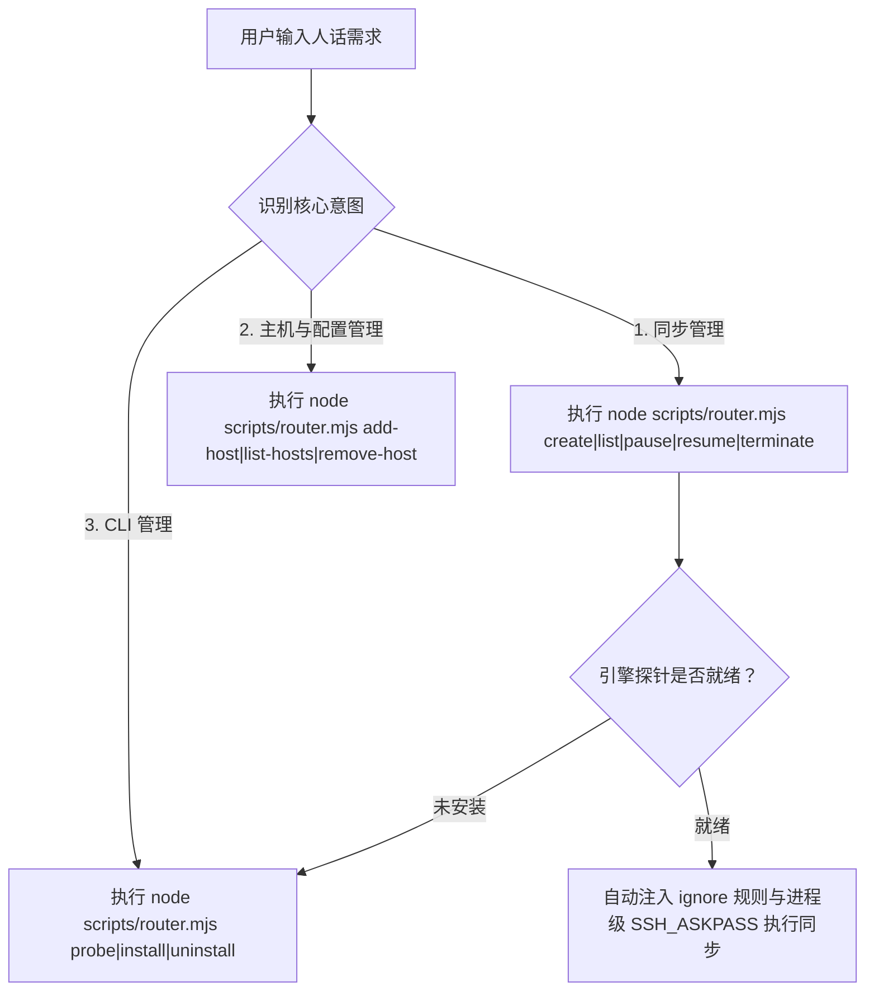

# Leo Workspace Router（通用工作区与工程同步中枢）

## 📖 核心定位

`leo-workspace-router` 是面向**跨端工作区协同与远程开发**的场景驱动智能同步中枢：
* **首期核心引擎**：**`mutagen`**（毫秒级双向无感同步，彻底替代高延迟的磁盘挂载）；
* **开放式架构**：未来平滑扩展 `cloudflare`（网络穿透/隧道）与 `rsync`（单向快照/发布）；
* **绿色沙盒与零家目录污染**：
  - CLI 工具统一下载安装至 `~/.local/bin`（可通过 `config.json` 自定义 `binDir`）；
  - 守护进程、socket 与会话缓存按引擎命名空间严格隔离至 `~/.shrimp/skills/leo-workspace-router/data/<engine>/`；
* **多主机凭据安全隔离**：配置持久化至 `~/.shrimp/skills/leo-workspace-router/config.json`（权限 `0600`），支持进程级 `SSH_ASKPASS` 动态应答，严禁在聊天中打印明文密码。

---

## 🧭 极简路由工作流



---

## 🎯 交互场景与操作对照表

所有底层操作统一经由 `scripts/router.mjs` 调度：

### 1. 同步管理（代码与工程）
* **创建双向同步**：
  > *“把本地 `~/Code/app` 和远程 `macc` 的 `/workspace/app` 建立同步”*
  ```bash
  node scripts/router.mjs create --local="~/Code/app" --remote="/workspace/app" --host="macc"
  ```
  *(注：脚本已自动注入 Node/Python 等防卡顿 ignore 预设，详见 [references/ignore-presets.md](references/ignore-presets.md))*
* **查询状态与健康度**：
  > *“看看当前同步连上了吗 / 列出所有同步任务”*
  ```bash
  node scripts/router.mjs list
  ```
* **暂停 / 恢复 / 强制刷写 / 终止**：
  ```bash
  node scripts/router.mjs pause <name>
  node scripts/router.mjs resume <name>
  node scripts/router.mjs flush <name>
  node scripts/router.mjs terminate <name|--all>
  ```

### 2. 主机与全局配置管理
* **记录/更新远程主机**：
  > *“记住主机：IP 39.105.19.237，端口 6007，用户 pa，密码 xxx，别名 macc”*
  ```bash
  node scripts/router.mjs add-host macc --host="39.105.19.237" --port=6007 --user="pa" --password="xxx"
  ```
* **查看已保存的主机与配置**：
  ```bash
  node scripts/router.mjs list-hosts
  ```
  *(密码严格打码为 `******`，并展示当前 `binDir` 与 `dataDir`)*
* **删除主机**：
  ```bash
  node scripts/router.mjs remove-host <alias>
  ```

### 3. CLI 环境与生命周期管理
* **全局自检**：`node scripts/router.mjs probe`
* **一键安装**：`node scripts/router.mjs install mutagen`（自动安装至 `binDir`）
* **安全卸载**：`node scripts/router.mjs uninstall mutagen`（自动先优雅停用隔离 daemon，再清理二进制）

### 4. 远程 Git 自动更新控制台 (Autopull Dashboard)
* **查看可视化状态看板**：`node scripts/router.mjs autopull list`
* **启动/配置定时拉取**：`node scripts/router.mjs autopull start <name> --remote="<path>" [--host="<alias>"] [--interval=5m]`
* **随时暂停 / 恢复**：`node scripts/router.mjs autopull stop <name>` / `node scripts/router.mjs autopull resume <name>`
* **立即手动触发一次**：`node scripts/router.mjs autopull run <name>`
* **查看任务日志明细**：`node scripts/router.mjs autopull logs <name>`
* **单次远程 Git 安全拉取**：`node scripts/router.mjs remote-git-pull --host="<alias>" --remote="<path>"`

---

## 🛡️ 安全与防泄露底线

1. **绝对脱敏**：向用户展示任何主机信息时，密码必须严格替换为 `******`，严禁在回答中暴露明文密码；
2. **零环境污染**：密码仅在子进程临时通过 `SSH_ASKPASS` 投喂，命令结束瞬间环境变量被操作系统自动销毁；
3. **查阅底层手册**：涉及 Mutagen 高级排错请按需翻阅 [references/engines/mutagen.md](references/engines/mutagen.md)。
