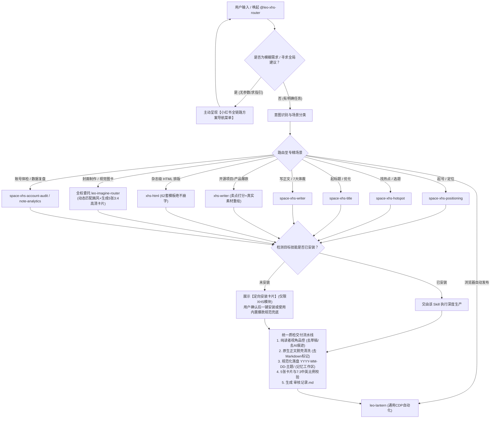

# Leo XHS Router（小红书自媒体智能路由与调度中枢）

## 📖 核心定位

`leo-xhs-router` 是面向**小红书（RedNote）全链路内容生产与运营的智能路由器与 JIT（即时能力）调度管家**。

它融合了以下核心设计架构：
1. **去中心化非侵入路由（零维护负担）**：
   - 不修改下游开源仓库（`creator-buddy` 与 `xhs-writer-skill`）的任何一行代码；
   - 保持下游仓库的独立性，随时可进行 `git pull` 同步最新特性，永远不存在合并冲突；
   - Router 充当“主编与项目经理”，负责需求理解、场景分流与标准把控。
2. **克制精准的依赖管理（仅限小红书模块）**：
   - 严禁整仓大包大揽！当缺少技能时，**只引导用户安装小红书（XHS）相关的专精技能**，坚决排除公众号（`gzh-Skills`）、视频（`video-Skills`）等无关内容，保持运行环境绝对纯净。
3. **输出目录记忆与智能持久化（Smart Workspace Persistence）**：
   - 配置统一保存在 `~/.shrimp/skills/leo-xhs-router/config.json`；
   - 默认输出目录为 `~/.shrimp/skills/leo-xhs-router/output/`；
   - 一旦用户指定了工作区目录，Router 自动持久化记住该路径，后续会话默认复用，免除重复输入。
4. **全面吸收并平替废弃 `xhs-post-creator`**：
   - 将原 `xhs-post-creator` 中最硬核的**“纯读者视角违禁词品控禁令”**（严禁出现“AI生成”、“参考重绘”、“TODO”、“01/06页码”、“草稿水印”）沉淀为统一质检门禁；
   - 统一输出标准归档结构（`YYYY-MM-DD-主题/`、`内容.md`、`图片/发布版/`、`审核记录.md`）。
5. **视觉决策全权委托 `leo-imagine-router`**：
   - 本 Skill **不再内置重复硬编码的生图逻辑或底层引擎**，所有小红书视觉图卡（封面、内页组图、架构图、概念海报）的画风匹配与生成调度，**全权委托给专精视觉路由器 `leo-imagine-router`**；
   - 由 `leo-imagine-router` 凭借其专业的场景分类与先锋画风库（`mono-color`、`scenes-gathered`、`photo-abstract`、`xhs-html` 等）自主决定出图风格；
   - 本 Skill 仅向下游传递小红书核心约束：① 统一 3:4 比例（1080×1440）；② 严格遵守 70% 中文 + 30% 英文黄金排版法则；③ 单篇笔记至少 5 张图卡。
6. **无缝联动 `leo-lantern` 闭环自动发布**：
   - 笔记制作完成并通过质检后，可直接调用 `leo-lantern` 的通用原生 CDP 文件上传和表单注入能力，一键在浏览器中完成上传、填表，并在用户确认后点击发布。
7. **通用爆款规范内置 + 个性化资产外置解耦**：
   - **内置通用铁律**：Markdown 脱壳清洗 SOP、7:3 中英文排版黄金法则、至少 5 张图卡标准、15:00~17:00 黄金摸鱼与冷启动发布窗口、反抄袭真话原则均已直接内置于 Skill，开箱即用；
   - **外置私有资产**：若存在 `~/.shrimp/skills/leo-xhs-router/account-positioning.md`，动态载入博主专属的个人定位与特定渠道偏好。

---

## 🧭 工作流总览 (Workflow Pipeline)

### ⚠️ 核心工作原则 (Core Principles - 前置规则)

> [!IMPORTANT]
> 1. **前置个性化资产检测**：若本地存在 `~/.shrimp/skills/leo-xhs-router/account-positioning.md`，优先加载博主专属人设与特定渠道，未配置时遵循 Skill 内置通用规范；
> 2. **视觉调度全权委托**：凡涉及小红书封面与内页配图，直接唤起 `leo-imagine-router` 决策画风与驱动生图；
> 3. **中英文 7:3 黄金排版**：严格遵循 70% 中文（秒懂、抓人、痛点、结论）+ 30% 英文（专有名词、代码语法、坐标点缀）；
> 4. **图卡数量硬指标**：单篇笔记最少生成 **5 张 3:4 发布版图卡**（1 张反差封面 + 4 张核心内页）；
> 5. **原生正文脱壳清洗**：可复制正文中严禁残留 Markdown 语法标记（`**`、`` ` ``、`##`、`---`）。



---

## 💡 方案导航（交互式需求引导卡片）

**触发条件**：
- 用户调用 `/leo-xhs-router` 未提供明确要求；
- 用户只说“我想做小红书”、“帮我做篇笔记”、“小红书怎么起号”等泛意图。

**导航卡片模板**：
```markdown
📕 **Leo XHS Router · 小红书创作全链路导航中心**

请告诉我您的需求，或直接回复对应序号进入专精流程：

① 🚀 **起号与人设定位**：赛道选择、博主定位金句、人设三件套、前20篇选题库、冷启动避坑
② 🔥 **热点发现与爆款对标**：同行高互动笔记监控、近期热点趋势提取、爆款选题角度拆解
③ 🎯 **爆款标题工坊**：15 种爆款标题公式批量生成、网感评分、合规与 A/B 测试建议
④ ✍️ **深度单篇图文创作**：
   - **A. 产品 / 开源项目 / 技能分享**：科学卖点打分（稀缺×实用×感知）+ 真话原则（硬伤披露）+ 去AI味
   - **B. 通用干货 / 行业洞察**：7 种笔记体裁结构化撰写 + 痛点黄金前三句 + 14项发布体检
⑤ 🎨 **3:4 视觉图卡生成**：全权委托 `leo-imagine-router` 动态匹配专精画风（mono-color、scenes-gathered、photo-abstract、xhs-html 等），产出 1 封面 + 4 核心内页（严格遵循 7:3 中英黄金比例）
⑥ 🏥 **账号体检与数据复盘**：主页八维诊断、已发笔记六层漏斗归因（曝光/CTR/互动卡点定位）
⑦ 🚀 **浏览器自动化发布**：调用 leo-lantern 自动上传卡片、填好草稿并在确认后一键发布

💡 *您也可以直接输入素材、粘贴文章或指定路径，例如：「帮我把指定目录下的素材做成小红书并发布」*
```

---

## 🗂️ 场景路由矩阵 (Routing Table)

| 场景分类 | 细分特征 / 触发词 | 目标 Skill 标识符 | 所属源码仓库 | 交付形式 |
| :--- | :--- | :--- | :--- | :--- |
| **起号定位** | 起号、定位、赛道、人设、冷启动 | `space-xhs-positioning` | `creator-buddy` | 定位方案报告 + 20篇大纲 |
| **热点挖掘** | 热点、爆款选题、对标分析、同行笔记 | `space-xhs-hotspot` | `creator-buddy` | 选题清单 + 爆款共性拆解 |
| **标题生成** | 起标题、爆款标题、改标题、标题评分 | `space-xhs-title` | `creator-buddy` | 5~15个候选标题 + 推荐标题 |
| **产品/项目单篇** | 开源项目、工具推广、卖点打分、实操实测 | `xhs-writer` | `xhs-writer-skill` | 卖点打分表 + 卡片文案 + 真话环节 |
| **通用正文撰写** | 写正文、干货笔记、教程、避坑、生活分享 | `space-xhs-writer` | `creator-buddy` | 7大体裁标准文案 + 标签策略 |
| **HTML 杂志排版** | HTML排版、做卡片、高颜值图卡、3:4纯代码转图 | `xhs-html` | `creator-buddy` | 3:4 单文件 HTML + 截图渲染 |
| **全套视觉图卡/封面** | 做封面、小红书配图、艺术画风、科技感组图、生图 | **`leo-imagine-router`** | 视觉智能中枢 | **由 imagine-router 统一裁决画风**，产出 5 张 1080x1440 高清卡片 |
| **账号诊断** | 账号体检、卡点诊断、主页装修 | `space-xhs-account-audit` | `creator-buddy` | 八维打分雷达图 + 诊断报告 |
| **数据复盘** | 笔记复盘、曝光低、互动差、六层漏斗 | `space-xhs-note-analytics` | `creator-buddy` | 漏斗归因分析 + 针对性修改方案 |
| **自动发布** | 自动发布、上传小红书、填草稿 | `leo-lantern` | `lib/skills/leo-lantern` | CDP 自动化页面注入与一键发布 |
| **通用兜底** | 目标子技能未安装且用户选直接出 | `built-in-fallback` | 内置爆款规范 | 直接输出标准 `内容.md` 与排版方案 |

---

## 🎨 视觉决策统一委托机制 (Visual Delegation to leo-imagine-router)

在小红书视觉图卡（封面与内页组图）制作阶段，**AI 严禁在本地维护割裂的生图引擎配置，统一将画风决策与生成任务委托给 `leo-imagine-router`**。

### 1. 委托调度规则
- 由 `leo-imagine-router` 分析笔记的内容类型、情绪基调与信息密度，自动匹配最适合的画风：
  - **观点金句 / 重磅首发** ➔ 调度 `mono-color`（受控双色印刷、大字报与孔版质感）；
  - **真实硬件 / 极客设备 / 工位实景** ➔ 调度 `scenes-gathered-zine-v1-3`（实景手撕纸拼贴）；
  - **艺术摄影 / 建筑人文 / 大片海报** ➔ 调度 `morandi-cinematic-poster-zeejay` 或 `photo-abstract-editorial`；
  - **代码高亮 / 参数面板 / 密集表格** ➔ 调度 `xhs-html`（100% 矢量不乱码）；
  - **通用拓扑 / 架构流向** ➔ 调度 `built-in-fallback`（6 槽位精准技术信息图）。

### 2. 向 `leo-imagine-router` 传递的小红书核心约束
1. **尺寸规范**：严格输出 3:4 比例竖版（`1080 × 1440` px），保留顶部 120px、底部 160px、左右 80px 安全区；
2. **中英 7:3 黄金排版**：必须满足 70% 中文（痛点秒懂、大字阶主标、结论）+ 30% 英文（项目名、参数单位、代码）；
3. **成套输出数量**：最少生成 5 张发布版图卡（1 张大字报反差封面 + 4 张核心内页）；
4. **落盘路径**：直接写入 `<workspace>/YYYY-MM-DD-主题/图片/发布版/`，并按 `01-封面.png`、`02-卡片1.png` 规范编号。

### 3. 执行日志规范
在调起生图时，显式在输出中打印委托日志：
```markdown
【🎨 视觉中枢调度：唤起 leo-imagine-router 决策画风】
* 笔记主题：[例如: Lightpanda 极速无头浏览器实测]
* 委托引擎：leo-imagine-router (自主匹配画风: 封面 mono-color + 内页 xhs-html 对比表)
* 交付标准：5 张 3:4 (1080x1440) 高清图卡，严格遵循 70%中文+30%英文黄金比例
* 执行动作：正在生成图片至 图片/发布版/ ...
```

---

## 📜 内置核心创作与排版规范

### 一、小红书原生正文脱壳清洗规范 (Markdown Decoupling SOP)
小红书编辑器不支持任何 GFM Markdown 语法渲染。发布前必须强制脱壳清洗：
1. **加粗符号剥离**：将 `**重要观点**` 剥离星号转为纯文本 ` 重要观点 `；
2. **行内代码反引号剔除**：将 `` `lightpanda.io` `` 剥离反引号转为原生英文字符串；
3. **列表符转换**：将 Markdown 短横线 `-` 转换为圆点 `•` 或数字 Emoji（`1️⃣`、`2️⃣`）；
4. **标题与分割线清洗**：彻底剔除 `## 标题` 与 `---` 分割线，靠自然的段落双换行留白；
5. **话题标签收拢**：文末统一放置 3~8 个 `#话题标签`，标签之间以空格隔开。

### 二、中英文 7:3 黄金视觉排版法则
- **70% 中文（负责 0.5 秒秒懂）**：大字阶主标题、痛点冲击、指标维度（如`内存占用`）、强反差结论（如`瞬间拉起`、`严重虚胖`）、客观真话清单（`适合场景` vs `目前硬伤`）；
- **30% 英文（负责极客调性与严谨度）**：开源品牌名（`Lightpanda`）、底层库名（`Zig`、`CDP`）、精准度量单位（`30MB vs 500MB`）、真实代码片段、版头微缩微标（`OPEN SOURCE BENCHMARK`）。

### 三、标准 5 张卡片配置范式
- **卡片 1（大字报反差封面）**：大中文主标题 + 英文品牌/微标 + 中文痛点冲击钩子；
- **卡片 2（核心参数对比）**：中文指标维度 + 英文硬核对比条；
- **卡片 3（架构原理解析）**：中文业务流向 + 英文关键模块名；
- **卡片 4（兼容实操代码）**：英文可复现代码/命令行 + 中文极简对接指引；
- **卡片 5（真话清单与坐标）**：中文双栏对照清单（`适合做什么` vs `搞不定什么`） + 底部英文官方出处。

### 四、最佳发布时段与冷启动策略
- **黄金发布时间窗**：**每天下午 15:00 ~ 17:00（3 点 ~ 5 点）** 定时发布；
- **底层算法逻辑**：抓住下午职场摸鱼刷手机高峰；在 18:00~20:00 晚高峰大流量池到来前，提前累积种子互动（点赞/收藏/完播），助力晚间被算法推向十万级公域推荐。

### 五、严禁照抄！真话原则与深度二创
1. **卖点打分过滤**：$$得分 = 稀缺性(1\sim 5) \times 实用性(1\sim 5) \times 可感知度(1\sim 5)$$，$\ge 60$ 分作为全篇唯一核心卖点；
2. **第一人称实测感**：“这几天我把它接入本地跑了一整天，结果很意外……”；
3. **真话原则（客观建立强信任）**：正文必须包含“真话环节”，坦诚点出当前版本的 **2 个硬伤或配置门槛**，拒绝无脑吹嘘。

---

## 📦 缺失技能精准引导安装（克制安装，仅限 XHS 模块）

当探测到目标专精技能未安装时，**严格遵循“仅安装小红书模块”的原则，绝不引入公众号（`gzh-Skills`）和视频（`video-Skills`）**：

### 引导卡片规范模板
```text
💡 **方案推荐**：当前需求最适合使用专精技能 **【<Skill 名>】**（<一句话特性>）。

当前环境尚未安装该小红书技能：
* **开源地址**：<GitHub URL>
* **定向安装方式（仅安装 XHS 模块，不引入无关平台）**：
  - 本地快速同步（如已配置源码目录）：
    node lib/skills/leo-xhs-router/scripts/cli.mjs install --skill <Skill 名>
  - 在线精准安装：
    <精准命令>

**是否需要我帮您安装？**
* 回复 **"安装"**：我将帮您把该小红书技能精准安装到用户环境并直接继续；
* 回复 **"安装全部XHS套件"**：一键安装全部 10 个小红书技能；
* 回复 **"直接出"**：使用 Router 内置的小红书通用方法论立即出稿。
```

---

## 📁 产物目录与智能工作区记忆 (Smart Persistence)

所有生成产物统一由 Router 的目录管理器调度（见 `scripts/config.mjs`）：

### 1. 三级级联决策
1. **用户本次显式指定**（如“输出到指定目录”）：
   - 本次直接落盘到该路径；
   - **自动写入** `~/.shrimp/skills/leo-xhs-router/config.json` 的 `workspace_dir`；
   - 提示用户已记住该目录，后续自动复用。
2. **已记录的历史目录**：
   - 读取 `config.json` 中的 `workspace_dir`，无需重复询问。
3. **默认兜底目录**：
   - 若未配置过，默认落在 `~/.shrimp/skills/leo-xhs-router/output/`。

### 2. 标准单帖目录结构
每个笔记建立独立的日期主题文件夹：
```text
<workspace_dir>/
└── YYYY-MM-DD-帖子主题/
    ├── 内容.md                  # 包含推荐标题、封面文案、可复制正文、话题标签
    ├── 审核记录.md              # 纯读者视角品控与体检报告
    └── 图片/
        └── 发布版/
            ├── 01-封面.png
            ├── 02-卡片1.png
            └── ...（建议 ≥ 5 张）
```

---

## 🛡️ 纯读者视角品控门禁 (Quality Gate)

在产物交付给用户或调用 `leo-lantern` 发布前，**强制执行品控扫描（调用 `scripts/quality_guard.mjs`）**：

1. **违禁词严苛过滤**：
   - 创作者内部痕迹：`参考原文`、`参考重绘`、`制作说明`、`源文链接`；
   - 破坏真实感的AI标签：`AI生成`、`AI绘图`、`提示词`、`prompt`、`AIGC`；
   - 未完工标记：`待提供`、`待替换`、`待确认`、`TODO`、`XXX`；
   - 卡片角落生硬页码：`01/06`、`1/6`、`page 2`、`第 X 张`；
   - 草稿水印：`DEBUG`、`DRAFT`、`草稿`、`测试`。
2. **正文脱壳状态校验**：
   - 检查可复制正文中是否存在残留的 `**` 加粗或 `` ` `` 反引号，必要时调用 `decoupleMarkdown` 进行脱壳。
3. **卡片数量与结构完整性**：
   - 必须包含《推荐标题》、《正文可复制版》、《话题标签（3~8个）》；
   - 检查 `图片/发布版/` 图片数量，建议 $\ge 5$ 张。
4. **自动生成 `审核记录.md`** 作为验收留底。

---

## 🚀 自动化发布联动 (`leo-lantern`)

当用户确认文案与配图无误并发出发布指令后：
1. Router 自动调用 `leo-lantern` 启动本地浏览器控制；
2. 导航至小红书创作者图文发布后台：`https://creator.xiaohongshu.com/publish/publish?from=tab_switch&target=image`；
3. 原生注入 `图片/发布版/` 下的所有图片；
4. 自动填入推荐标题，并将脱壳后的纯净正文与 `#话题标签` 填入编辑器；
5. 按照 15:00~17:00 黄金时段设置定时发布或存为草稿；
6. 截取发布预览图提供给用户确认后点击发布。

---

## 🛠️ 管理与调试 CLI

在终端中可直接使用内置 CLI 管理配置与技能：
```bash
# 查看当前配置、工作区与小红书技能安装状态
node lib/skills/leo-xhs-router/scripts/cli.mjs status

# 配置默认工作区（免重复输入）
node lib/skills/leo-xhs-router/scripts/cli.mjs config --workspace "<自定义输出目录>"

# 从已配置的本地源码仓一键安装小红书技能
node lib/skills/leo-xhs-router/scripts/cli.mjs install --all

# 初始化新帖子标准目录
node lib/skills/leo-xhs-router/scripts/cli.mjs init-post "GLM-5.2开源模型解析"

# 体检帖子目录中的违禁词与完整性
node lib/skills/leo-xhs-router/scripts/cli.mjs audit "<待体检的帖子目录>"

# 对帖子正文一键执行小红书脱壳清洗（去除Markdown语法标记）
node lib/skills/leo-xhs-router/scripts/cli.mjs decouple "<待清洗的帖子目录>"
```
