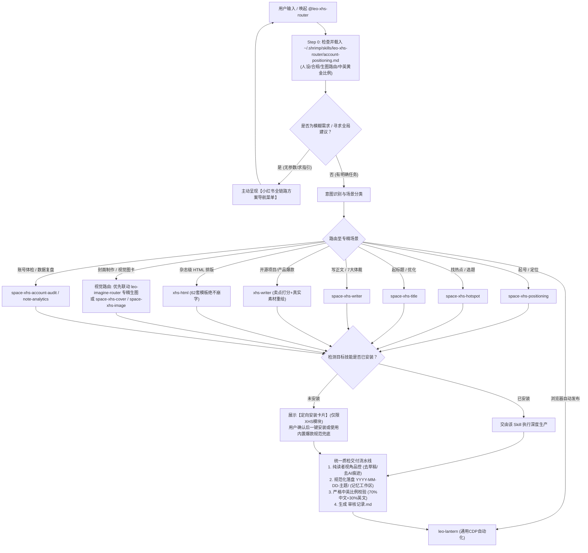

# Leo XHS Router（小红书自媒体智能路由与调度中枢）

## 📖 核心定位

`leo-xhs-router` 是面向**小红书（RedNote）全链路内容生产与运营的智能路由器与 JIT（即时能力）调度管家**。

它融合了以下核心设计架构：
1. **去中心化非侵入路由（零维护负担）**：
   - 不修改下游开源仓库（`creator-buddy` 与 `xhs-writer-skill`）的任何一行代码；
   - 保持下游仓库的独立性，随时可进行 `git pull` 同步最新特性，永远不存在合并冲突；
   - Router 充当“主编与项目经理”，负责需求理解、场景分流与标准把控。
2. **克制精准的依赖管理（仅限小红书模块）**：
   - 严禁整仓大包大揽！当缺少技能时，**只引导用户安装小红书（XHS）相关的专精技能**，坚决排除公众号（`gzh-Skills`）、视频（`video-Skills`）等无关内容，保持运行环境绝对纯净。
3. **输出目录记忆与智能持久化（Smart Workspace Persistence）**：
   - 参考 `/leo-ppt-router` 标准，配置统一保存在 `~/.shrimp/skills/leo-xhs-router/config.json`；
   - 默认输出目录为 `~/.shrimp/skills/leo-xhs-router/output/`；
   - 一旦用户指定了工作区目录，Router 自动持久化记住该路径，后续会话默认复用，免除重复输入。
4. **全面吸收并平替废弃 `xhs-post-creator`**：
   - 将原 `xhs-post-creator` 中最硬核的**“纯读者视角违禁词品控禁令”**（严禁出现“AI生成”、“参考重绘”、“TODO”、“01/06页码”、“草稿水印”）沉淀为统一质检门禁；
   - 统一输出标准归档结构（`YYYY-MM-DD-主题/`、`内容.md`、`图片/发布版/`）；原 `xhs-post-creator` 即可安全停用废弃。
5. **底层视觉引擎完全解耦（参考 `leo-imagine-router`）**：
   - 抽象出可插拔的视觉生成插槽，支持在 `leo-codex-imagine`（AI扩散生图/图生图）、`xhs-html`（62套纯HTML杂志排版）、Pillow 确定性图卡之间自由无缝切换。
6. **无缝联动 `leo-lantern` 闭环自动发布**：
   - 笔记制作完成并通过质检后，可直接调用 `leo-lantern` 的通用原生 CDP 文件上传和表单注入能力，一键在浏览器中完成上传、填表，并在用户确认后点击发布。
7. **个性化账号策略与人设资产外置（Smart Persona & Guidelines Loading）**：
   - Router 保持通用性与中立性，不硬编码具体用户的业务方向与信源；
   - 自动检测并读取 `~/.shrimp/skills/leo-xhs-router/account-positioning.md`（若存在），动态加载用户专属的账号定位、人设语调、偏好的情报摄取通道与二次创作准则，实现“通用调度引擎 + 个性化私有资产”的分层解耦。

---

## 🧭 工作流总览 (Workflow Pipeline)

### ⚠️ 核心工作原则 (Core Principle - Step 0 强制门禁)

> [!IMPORTANT]
> **Step 0：前置强制读取个性化资产库（Mandatory Preflight）**
> 在开始任何分流、创作、写稿或调用生图前，**必须首先读取 `~/.shrimp/skills/leo-xhs-router/account-positioning.md`（若存在）**！
> 严格遵照其中的资产准则执行：
> 1. **账号定位与人设语气**：遵循博主技术极客口语化人设与价值主张；
> 2. **反抄袭红线与合规守则**：严格执行事实核验与原创表述；
> 3. **视觉风格与生图路由（第六章）**：在需要配图或封面时，**必须优先参考第六章视觉场景映射表，调用 `leo-imagine-router` 调度专精生图技能**（如 `mono-color`、`photo-abstract-editorial` 等），实现差异化视觉美学；
> 4. **中英文排版黄金法则（第七章）**：严格遵循 70% 中文核心语义 + 30% 英文点缀/专有名词的黄金比例，确保国内用户极速读懂同时兼具高级视觉感。



---

## 💡 方案导航（交互式需求引导卡片）

**触发条件**：
- 用户调用 `/leo-xhs-router` 未提供明确要求；
- 用户只说“我想做小红书”、“帮我做篇笔记”、“小红书怎么起号”等泛意图。

**导航卡片模板**：
```markdown
📕 **Leo XHS Router · 小红书创作全链路导航中心**

请告诉我您的需求，或直接回复对应序号进入专精流程：

① 🚀 **起号与人设定位**：赛道选择、博主定位金句、人设三件套、前20篇选题库、冷启动避坑
② 🔥 **热点发现与爆款对标**：同行高互动笔记监控、近期热点趋势提取、爆款选题角度拆解
③ 🎯 **爆款标题工坊**：15 种爆款标题公式批量生成、网感评分、合规与 A/B 测试建议
④ ✍️ **深度单篇图文创作**：
   - **A. 产品 / 开源项目 / 技能分享**：科学卖点打分（稀缺×实用×感知）+ 真实素材图生图 + 去AI味
   - **B. 通用干货 / 行业洞察**：7 种笔记体裁结构化撰写 + 痛点黄金前三句 + 14项发布体检
⑤ 🎨 **3:4 视觉图卡与排版**：
   - **A. HTML 杂志排版**：62 套预设模板、单文件 HTML 转图、排版绝对不乱码
   - **B. AI 扩散生图**：调用生图引擎（默认 leo-codex-imagine）出具素人感科技/生活配图
   - **C. 确定性封面**：大字报反差封面、安全边距排版
⑥ 🏥 **账号体检与数据复盘**：主页八维诊断、已发笔记六层漏斗归因（曝光/CTR/互动卡点定位）
⑦ 🚀 **浏览器自动化发布**：调用 leo-lantern 自动上传卡片、填好草稿并在确认后一键发布

💡 *您也可以直接输入素材、粘贴文章或指定路径，例如：「帮我把指定目录下的素材做成小红书并发布」*
```

---

## 🗂️ 场景路由矩阵 (Routing Table)

| 场景分类 | 细分特征 / 触发词 | 目标 Skill 标识符 | 所属源码仓库 | WPS/交付形式 |
| :--- | :--- | :--- | :--- | :--- |
| **起号定位** | 起号、定位、赛道、人设、冷启动 | `space-xhs-positioning` | `creator-buddy` | 定位方案报告 + 20篇大纲 |
| **热点挖掘** | 热点、爆款选题、对标分析、同行笔记 | `space-xhs-hotspot` | `creator-buddy` | 选题清单 + 爆款共性拆解 |
| **标题生成** | 起标题、爆款标题、改标题、标题评分 | `space-xhs-title` | `creator-buddy` | 5~15个候选标题 + 推荐标题 |
| **产品/项目单篇** | 开源项目、工具推广、卖点打分、截图图生图 | `xhs-writer` | `xhs-writer-skill` | 卖点打分表 + 卡片文案 + 配图建议 |
| **通用正文撰写** | 写正文、干货笔记、教程、避坑、生活分享 | `space-xhs-writer` | `creator-buddy` | 7大体裁标准文案 + 标签策略 |
| **HTML 杂志排版** | HTML排版、高颜值卡片、3:4代码转图 | `xhs-html` | `creator-buddy` | 3:4 单文件 HTML + 截图渲染 |
| **封面/AI图卡** | 做封面、小红书配图、科技感组图、专精艺术风格 | `space-xhs-cover` / `space-xhs-image` / 或按 `account-positioning.md` 指引联动 `leo-imagine-router` 调度专精生图 | `creator-buddy` / 专精视觉体系 | 1080x1440 高清卡片 |
| **账号诊断** | 账号体检、卡点诊断、主页装修 | `space-xhs-account-audit` | `creator-buddy` | 八维打分雷达图 + 诊断报告 |
| **数据复盘** | 笔记复盘、曝光低、互动差、六层漏斗 | `space-xhs-note-analytics` | `creator-buddy` | 漏斗归因分析 + 针对性修改方案 |
| **自动发布** | 自动发布、上传小红书、填草稿 | `leo-lantern` | `lib/skills/leo-lantern` | CDP 自动化页面注入与一键发布 |
| **通用兜底** | 目标子技能未安装且用户选直接出 | `built-in-fallback` | 内置爆款规范 | 直接输出标准 `内容.md` 与排版方案 |

---

## 🎨 视觉引擎自主决策仲裁树 (Autonomous Visual Decision Matrix)

在小红书图文制作阶段，**AI 必须自主评估笔记的内容属性与受众需求，在 `leo-imagine-router`（先锋艺术生态）与 `xhs-router` 内置组件（通用卡片套件）之间进行二选一裁决，并在执行时打印决策日志，严禁仅输出文字性配图建议**！

### 1. 核心裁决决策树 (Decision Tree)

```text
[识别内容核心属性]
   │
   ├─► 场景 1: 【深度开源评测 / 先锋技术洞察 / 极客态度观点 / 震撼首发】
   │    │
   │    └─► 🎯 封面裁决: 强制自主选用 【leo-imagine-router】
   │         ├─ 观点/理念/金句/重磅 ➔ 调度 mono-color（受控双色孔版印刷、大字报、高逼格）
   │         ├─ 影像/情感/意境 ➔ 调度 scene-distillation-zine-v1-3（极简插画、单色块）
   │         └─ 严格执行 70% 中文主干 + 30% 英文点缀
   │
   ├─► 场景 2: 【多步教程 / 代码实操 / 参数横评 / 流程链路 / SOP干货】
   │    │
   │    ├─► 🎯 封面裁决: 自主选用 【leo-imagine-router】(mono-color) 或 【space-xhs-cover】
   │    └─► 🎯 内页裁决: 强制自主选用 【xhs-html】(Linear / Stripe 科技杂志风)
   │         └─ 原因: 杜绝 AI 绘图的文字乱码，确保代码块、对比表格 100% 矢量清晰
   │
   ├─► 场景 3: 【真机开箱 / 极客工位桌搭 / 真实硬件实测 / 现场探访】
   │    │
   │    └─► 🎯 封面/插图裁决: 强制自主选用 【leo-imagine-router】
   │         ├─ 硬件/工位照片 ➔ 调度 scenes-gathered-zine-v1-3（手撕纸刊、实景拼贴）
   │         └─ 展会/特写照片 ➔ 调度 photo-abstract-editorial（原图双联、象牙白展签）
   │
   ├─► 场景 4: 【日常泛科技快讯 / 效率小工具轻推荐 / 普惠职场经验】
   │    │
   │    └─► 🎯 裁决: 自主选用 【space-xhs-cover】+【space-xhs-image】
   │         └─ 原因: 内容偏轻量生活化，标准圆角卡片即可满足，降低调用复杂度
   │
   └─► 场景 5: 【用户已提供真实界面截图 / 对比测试结果】
        │
        └─► 🎯 裁决: 自主选用 【xhs-writer】真实素材提炼 + 【xhs-html】卡片嵌图
```

### 2. 执行门禁与日志规范 (Mandatory Execution & Logging)

在进入配图环节时，AI **必须**显式在输出中打印裁决依据，并立即调起生成：

```markdown
【🎨 视觉引擎自主裁决结果】
* 笔记赛道/属性：[例如: 深度开源评测 / 极客观点]
* 裁决引擎：leo-imagine-router (专精画风: mono-color 双色孔版) + 内页 xhs-html
* 裁决理由：需要先锋视觉冲破信息流，内页含代码对比需 100% 矢量排版不乱码
* 执行动作：正在调起对应技能生成 1080x1440 图片至 图片/发布版/ ...
```

> [!CAUTION]
> **拒绝“只提建议不出图”！** AI 必须在当前会话中驱动真实生图工具或 HTML 截图，完成图片落盘至 `<workspace>/YYYY-MM-DD-主题/图片/发布版/`。


---

## 📦 缺失技能精准引导安装（克制安装，仅限 XHS 模块）

当探测到目标专精技能未安装时，**严格遵循“仅安装小红书模块”的原则，绝不引入公众号（`gzh-Skills`）和视频（`video-Skills`）**：

### 引导卡片规范模板
```text
💡 **方案推荐**：当前需求最适合使用专精技能 **【<Skill 名>】**（<一句话特性>）。

当前环境尚未安装该小红书技能：
* **开源地址**：<GitHub URL>
* **定向安装方式（仅安装 XHS 模块，不引入无关平台）**：
  - 本地快速同步（如已配置源码目录）：
    node lib/skills/leo-xhs-router/scripts/cli.mjs install --skill <Skill 名>
  - 在线精准安装：
    <精准命令>

**是否需要我帮您安装？**
* 回复 **"安装"**：我将帮您把该小红书技能精准安装到用户环境并直接继续；
* 回复 **"安装全部XHS套件"**：一键安装全部 10 个小红书技能；
* 回复 **"直接出"**：使用 Router 内置的小红书通用方法论立即出稿。
```

---

## 📁 产物目录与智能工作区记忆 (Smart Persistence)

所有生成产物统一由 Router 的目录管理器调度（见 `scripts/config.mjs`）：

### 1. 三级级联决策
1. **用户本次显式指定**（如“输出到指定目录”）：
   - 本次直接落盘到该路径；
   - **自动写入** `~/.shrimp/skills/leo-xhs-router/config.json` 的 `workspace_dir`；
   - 提示用户已记住该目录，后续自动复用。
2. **已记录的历史目录**：
   - 读取 `config.json` 中的 `workspace_dir`，无需重复询问。
3. **默认兜底目录**：
   - 若未配置过，默认落在 `~/.shrimp/skills/leo-xhs-router/output/`。

### 2. 标准单帖目录结构（继承 xhs-post-creator 优点）
每个笔记建立独立的日期主题文件夹：
```text
<workspace_dir>/
└── YYYY-MM-DD-帖子主题/
    ├── 内容.md                  # 包含推荐标题、封面文案、可复制正文、话题标签
    ├── 审核记录.md              # 纯读者视角品控与体检报告
    └── 图片/
        └── 发布版/
            ├── 01-封面.png
            ├── 02-卡片1.png
            └── ...
```

---

## 🛡️ 纯读者视角品控门禁 (Quality Gate)

在产物交付给用户或调用 `leo-lantern` 发布前，**强制执行品控扫描（调用 `scripts/quality_guard.mjs`）**：

1. **违禁词严苛过滤**：
   - 创作者内部痕迹：`参考原文`、`参考重绘`、`制作说明`、`源文链接`；
   - 破坏真实感的AI标签：`AI生成`、`AI绘图`、`提示词`、`prompt`、`AIGC`；
   - 未完工标记：`待提供`、`待替换`、`待确认`、`TODO`、`XXX`；
   - 卡片角落生硬页码：`01/06`、`1/6`、`page 2`、`第 X 张`；
   - 草稿水印：`DEBUG`、`DRAFT`、`草稿`、`测试`。
2. **结构完整性**：
   - 必须包含《推荐标题》、《正文可复制版》、《话题标签（3~8个）》；
   - 图片放置在 `图片/发布版/`，以数字序号命名（01-封面.png, 02-卡片1.png）。
3. **自动生成 `审核记录.md`** 作为验收留底。

---

## 🚀 自动化发布联动 (`leo-lantern`)

当用户确认文案与配图无误并发出发布指令后：
1. Router 自动调用 `leo-lantern` 启动本地浏览器控制；
2. 导航至小红书创作者图文发布后台：`https://creator.xiaohongshu.com/publish/publish?from=tab_switch&target=image`；
3. 原生注入 `图片/发布版/` 下的所有图片（避开操作系统原生文件选择弹窗）；
4. 自动填入推荐标题，并将正文与 `#话题标签` 填入富文本编辑器；
5. 截取发布预览图提供给用户；
6. 获得用户最终确认后，触发点击“发布”按钮并验证跳转结果。

---

## 🛡️ 内置兜底方法论 (`built-in-fallback`)

当用户环境中未安装任何下游专精子技能且选择“直接出”时，Router 不会中断，而是自动启用内置方法论：
- **卖点提取**：执行 `稀缺性 × 实用性 × 可感知度` 过滤（见 `references/viral-methodology.md`）；
- **拟人化文案**：执行 `humanizer-zh` 口语化去 AI 味改写；
- **爆款标题**：按 5 大核心爆发力公式出 5 个候选标题；
- **视觉建议**：输出每张 3:4 卡片的具体排版大纲与配色建议。

---

## 🛠️ 管理与调试 CLI

在终端中可直接使用内置 CLI 管理配置与技能：
```bash
# 查看当前配置、工作区与小红书技能安装状态
node lib/skills/leo-xhs-router/scripts/cli.mjs status

# 配置默认工作区（免重复输入）
node lib/skills/leo-xhs-router/scripts/cli.mjs config --workspace "<自定义输出目录>"

# 从已配置的本地源码仓一键安装小红书技能
node lib/skills/leo-xhs-router/scripts/cli.mjs install --all

# 初始化新帖子标准目录
node lib/skills/leo-xhs-router/scripts/cli.mjs init-post "GLM-5.2开源模型解析"

# 体检帖子目录中的违禁词与完整性
node lib/skills/leo-xhs-router/scripts/cli.mjs audit "<待体检的帖子目录>"
```
